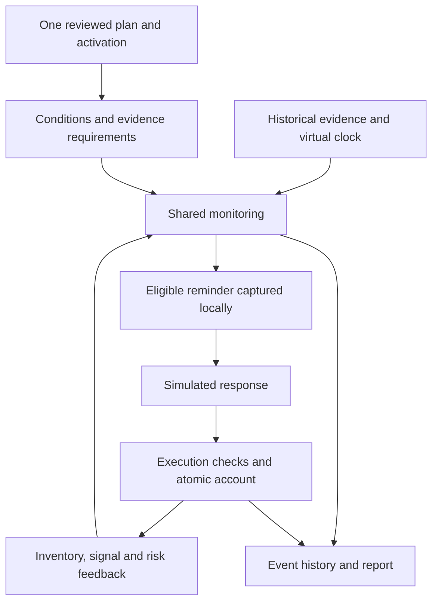

# Proposal: Backtest the Monitoring Loop

Status: Implementation authorized by the user on 2026-10-07, Asia/Shanghai: isolate backtest first, then deliver the business workflow. Final API/contract review of the concrete implemented diff is recorded in ML-T29/ML-C10, with approval in SPEC-unified-plan U09 and executed evidence in MV43–MV46; implementation authorization alone is not acceptance evidence. Module: `backtest-engine`; adapters: `backtest-data`, `backtest-jobs`, `backtest-results`, `backtest-api`, `backtest-web`. Chinese review copy: [PROPOSAL-monitor-loop-backtest.zh-CN.md](PROPOSAL-monitor-loop-backtest.zh-CN.md).

The confirmed business choices are mapped to an [implementation plan](../../../tasks/plan.md) and [task list](../../../tasks/todo.md). Thread isolation is confirmed. Executed implementation checks are recorded separately in [verification](../../verification/monitor-loop-backtest.md); ML18 records final executed scope and accepted boundaries.

## ML01. Objective and assumptions

Scope confirmed by the user on 2026-10-07: **one reviewed plan establishes the opening position → shared monitoring triggers reminders → simulated execution → account/state feedback → continued monitoring until the end date**. Each run freezes exactly one plan for one symbol/account. The plan can govern multiple trading days while valid; execution changes state, not its rules. Daily plan chains, replacement during a run and simultaneous multi-plan replay are cancelled from this release.

1. Supply one historical source plan; extract/review its complete Schema 5 snapshot and explicit opening holdings/cost. Preserve actual authoring, availability and historical start separately from today's import/submission time. Later-authored retrospective experiments remain labelled.
2. Update inventory, sellability, consumed occurrences, risk and the monitoring view after fills. Keep strategy text, thresholds, quantities and branches fixed for the run.
3. Select a simulated response policy explicitly. No automatic live trading follows this research authorization.
4. End date remains optional: resolve once at submission in Asia/Shanghai. Preserve frozen cutoff, account precision, full-quantity checks and causal evidence.
5. Prepare one source with existing extraction/review safeguards. No predecessor context, inherited-rule merge, batch ordering or descendant invalidation is needed.

Success remains a causally complete, auditable monitoring history; returns alone do not prove the loop.

## ML02. Planning-time gaps and delivered changes

The planning-time replay already shared monitoring evaluation. This table preserves its orchestration gaps and the delivered direction; ML18 records executed completion:

| Observed current behavior | Proposed behavior |
|---|---|
| `research_session.py` constructs one plan and activation identity. | A session owns the active plan version, its activation revision, and evolving execution state. |
| `research_input.py` / UR03 require explicit operations targeting an exact occurrence. | Ordinary research needs a response policy, not a prewritten list of future trades. Recorded actions remain an optional replay mode. |
| `research_runner.py` ends ordinary authority after `REPLACE`. | The new single-plan mode accepts no replacement; old frozen modes retain their existing semantics. |
| `_ResearchRuntime._enqueue` suppresses notifications. | Capture reminders through an isolated sink, including the same eligibility and stale-evidence checks that precede live delivery. |
| `_simulate` updates inventory, consumes the signal, and may fulfil risk obligations. | Reuse those transitions, then refresh the monitoring view and derived requirements before subsequent actions. |
| UR06 may preserve a monitoring receipt after research cash becomes insufficient. | In the new mode, cash checks, inventory changes, signal consumption, and monetary entries form one research transaction; rejection changes none of them. |

Current contracts remain [SPEC-unified-plan.md](../monitoring/SPEC-unified-plan.md) and [SPEC-unified-replay.md](SPEC-unified-replay.md). This proposal delivers an additive monitoring-loop mode that replaces the explicit-script requirement, replacement-ends-run behavior, and post-receipt cash handling **only in that new mode**. Frozen historical runs retain their original meaning.

## ML03. Shared core and environmental adapters



Reuse condition interpretation, signal independence/expiry, risk priority/latching, delivery authorization, execution eligibility, and accounting transitions. First inspect their actual online call paths. Extract shared application participants only where adapters cannot safely use them; do not copy strategy logic or retain a dependency on private HTTP handlers as the intended architecture.

Online adapters use real data, time, storage, notification delivery and explicit user actions. Research adapters use a frozen dataset, virtual clock, private repositories, a recording notification sink and a simulated response policy. No production composition, provider request, live notification or live plan mutation occurs during deterministic replay.

“Derive conditions” interprets the one reviewed plan into condition trees, timeframes, warm-up, validity, confirmation, quantity, reset policy and execution windows. It never asks AI for new per-tick rules. Position/risk feedback changes eligibility; strategy definitions stay frozen throughout the run.

Before replay, ML13 translates one supplied source into a complete candidate and explicit opening-account facts. Validation and human review freeze that snapshot. Replay reads only it and frozen market evidence, with no AI calls.

## ML04. Inputs and state ownership

Freeze exactly one reviewed plan snapshot and its initial effective date, dataset/revisions, range/warm-up, cash, inventory lots/costs, calendar, evidence versions and response/fill assumptions. Preserve causal adjustment/availability checks. Unknown inventory allows observation but blocks execution and full-account return claims.

The initial binding retains `symbol`, `effective_trade_date`, `plan_version_id`, `plan_hash` and the reviewed snapshot. Accept exactly one entry; reject a second entry even if it repeats the same version. Validate the effective trading day and a covered run start. The initial date does not widen activation/rule validity and provides no switch capability.

**Optional end date.** Omitted/null `end_date` resolves once to submission day in Asia/Shanghai; store resolved date and explicit/defaulted origin. It is inclusive. Reject dates before the plan start or after submission. Preserve weekend/holiday end dates and use the exchange calendar for sessions.

Resolve and freeze the evidence cutoff with the input: for a past end date use the end of that local day; for today's end use the submission instant. Consume only completed, available evidence no later than that cutoff. Do not create today's closing data while the session is still open. Admission checks still require the needed dataset coverage; genuine gaps are shown and handled by the existing coverage rules, not silently treated as an earlier requested end. Reports distinguish the requested/resolved end date, frozen evidence cutoff and actual last market evidence/valuation time. Waiting in a queue, retrying tomorrow or repeating a frozen run does not move its end date or add newer evidence; submitting a new run can use a later current date.

At the cutoff, stop generating and executing intents, retain remaining holdings for valuation and show pending intents as unfilled at the run end. Do not force liquidation solely because the study ended. This terminal run status does not claim the underlying plan's signal expired early.

**Single-plan initialization.** Derive the historical account/start from the supplied plan and its known availability/effectiveness. A post-close plan cannot drive earlier trades; an intraday plan can initialize at its actual availability. Show this mapping and warm up without transactions. Initialize holdings only once.

Use explicit statements of actual holdings, actual CORE/TACTICAL allocation and cost in the first source to build a reviewed initial-account snapshot. Strategy allocation targets alone still cannot initialize holdings. Bind extracted values to source text and record any confirmed supplements/overrides. Already-owned shares are opening inventory, not a new simulated buy; do not charge purchase fees again or infer an acquisition date from the plan date. Unknown cash or acquisition/sellability facts remain missing inputs: request them when needed for funded trading/T+1 checks, or explicitly limit the run to observation with incomplete account valuation. Never insert an arbitrary cash balance or assume all opening shares are sellable.

The user's pasted first plan from [盛新锂能中期波段交易计划](https://chatgpt.com/c/6aa21e11-9d54-83ea-8a91-3c401c270008) illustrates the extraction; these are source assertions, not independently verified market facts:

| Source item | Initialization/interpretation |
|---|---|
| `002240`; actual 100 shares; CORE 100, TACTICAL 0 | Seed 100 existing CORE shares once. |
| Cost CNY 40.105/share | Preserve exact precision; total opening accounting cost is CNY 4,010.50 (`401050` fen). Do not round the unit cost to 40.11. |
| Maximum 300 shares | Position ceiling; the remaining 200-share capacity is neither existing inventory nor buy authorization. |
| Reference 28.98; delayed intraday quote 28.45 | Dated reference market observations, not acquisition cost or automatically valid opening valuation. |
| Hypothetical buy 100 at 28.70 and sell at 29.30 | Fee illustration, not an actual fill, opening lot or active order. |
| Ordinary buy/sell currently 0; observation zone 28.50–29.00 | No ordinary buy authorization; do not turn an observation zone into a buy trigger. CORE is not available for the ordinary tactical sale. |
| Technical risk line 25.99; risk exit includes CORE, target 0 | Preserve the declared multi-close confirmation/exit sequence; a simple intraday touch is not authorization to sell. |

Extract the source fee/slippage assumptions as visible research settings for review: commission 0.03% each side, minimum CNY 5 each side, sell stamp duty 0.05%, transfer fee 0.001% each side, and slippage CNY 0.01/share each side. Do not silently substitute a basis-point model. These are supplied assumptions, not a claim about current statutory rates. Do not add hypothetical historical acquisition fees to the stated opening cost without evidence.

Keep original accounting cost and the start-of-research market valuation separately. Measure interval equity change from the initial known market value plus known cash, while reporting historical cost-based P/L separately. Pre-existing losses must not be labelled losses caused by the monitoring period. Missing opening prices/cash block the corresponding return metric rather than replacing cost with a convenient quote.

The pasted source mentions a September 9 report using September 8 close and an update containing September 10 intraday information. September 7 in the user's explanation is an illustrative start, not proof this exact text was available then. Establish the first-plan time from the actual supplied artifact; never backdate this text to September 7. The current design does not choose or run a specific historical dataset.

Preserve unrepresentable clauses as visible limitations: the source's partial fills, pending-order capacity and fundamental-information exits are not fully covered by the current whole-trade technical-monitoring contract. Missing scoped evidence for subjective technical invalidation remains unknown. This source is not a fully executable fixture merely because its initial holdings can be extracted; do not silently omit unsupported clauses or claim complete source-plan parity.

Keep four distinct state groups:

| State | Contents and ownership |
|---|---|
| Plan definition | Immutable source/content hash, reviewed conditions and quantities; new content creates a new version. |
| Monitoring state | Active version/revision, signal occurrences, resets, expiry, risk records, evidence dependencies and reminder identities. |
| Research account | Cash, dated CORE/TACTICAL lots, sellable quantities, costs and fees; shared inventory transitions plus research money entries. |
| Event history | Evidence availability, evaluations, reminders, requests, fills/rejections, state transitions, fixed-plan provenance and valuation. |

Declare research activation separately from production. Bind explicit review without invented historical human facts. Derive/preload data requirements from this one snapshot; apply market and external-evidence availability cutoffs. Missing dependencies block affected conditions with a reason. Loading another plan cannot replace this run snapshot.

## ML05. Event time and one monitoring cycle

Drive evaluation with evidence availability and scheduled lifecycle boundaries, not just a loop over price rows. The calendar must advance expiry and T+1 sellability even when no new price arrives. At a timestamp, process a deterministic sequence:

1. Make newly available market revisions and scoped external facts visible; apply calendar transitions.
2. Preserve the same frozen plan at calendar boundaries; advance expiry, T+1 and explicit supported risk reassessment/deactivation without introducing new content or resetting occurrences.
3. Freeze the current plan/state revisions and evidence cutoff, derive requirements, and run shared monitoring. Missing dependencies yield unknown/blocked conditions.
4. Recheck reminder eligibility using current revisions/evidence and capture the simulated delivery. Pure technical alerts cannot authorize a trade. Delivery here means a configured research assumption, not proof of real external delivery.
5. Process eligible response intents. A new intent can use only a future eligible price interval; an older intent may attempt execution now. Use shared risk/conflict priority; do not invent a favorable buy/sell order for simultaneous conflicting signals.
6. For a successful attempt, atomically commit cash/fees, dated lots, occurrence consumption and risk fulfilment. Refresh affected monitoring state before considering another intent. Rejected attempts leave those states unchanged.
7. Record before/after state and mark available prices for valuation. Post-trade refresh cannot create a new independent occurrence by repeatedly consuming the same evidence. No zero-time trade loop is allowed.

Formal daily confirmation still executes only in `NEXT_EXCHANGE_SESSION_ONLY`; completed five-minute confirmation retains `CURRENT_SESSION`. `PLAN_ACTIVE` does not extend a single signal's execution window. Warm-up never generates reminders or trades. Late corrections are new events and never rewrite already recorded history.

## ML06. Reminder response and fill policy

Offer three business-facing modes; names below are proposed contract discriminators, not current API fields:

| Mode | Behavior |
|---|---|
| `FOLLOW_REMINDERS` (recommended) | A frozen policy responds to each currently authorized ordinary/risk trade reminder with one complete requested quantity. |
| `OBSERVE_ONLY` | Record reminders and state changes; no generated execution requests. |
| `RECORDED_ACTIONS` | Replay explicitly supplied user actions; no additional automatic response. Useful for historical comparison and parity fixtures. |

The first mode requires the user to select the policy at run creation. It applies to executable trade reminders, not every Boolean condition or pure technical alert. Retain one intent per authorized occurrence, even if delivery is repeated. Risk intents bind the current risk revision/target, not an obsolete quantity.

Recommended initial fill model: full quantity at the **close of the first eligible completed one-minute interval whose start is at or after the response's ready time**, with configured slippage and fees. Ready time includes reminder availability plus a frozen response delay (proposed default: 0 seconds). A minute already in progress at decision time is ineligible. The result becomes known only when that minute's evidence is available; recheck current authority, risk, quote applicability and price limits then. Record both price time and availability time. Never fill at the close that first generated the same reminder.

For example, a five-minute confirmation available at 09:35:12 cannot fill at 09:35 or 09:36 using the 09:35–09:36 interval; the first candidate interval is 09:36–09:37, evaluated only after its evidence arrives. A daily reminder waits for the next eligible exchange session. End-of-run intents remain visibly unfilled.

Enforce current full-quantity positive 100-share units, T+1, CORE protection, position limits and risk/conflict checks. Check cash including fees before commitment; no partial substitute. Cash/sellability/market blockers may retry on later evidence while authority remains valid, once per intent/eligible interval. Expiry, consumption or deactivation closes ordinary intents. Insufficient data/liquidity evidence is explicitly blocked/unsupported. Preserve conservative suspension/price-limit checks; minute bars establish neither queue priority nor real fill certainty.

## ML07. Fixed plan and execution-state continuity

The run holds one immutable plan and activation identity. Calendar transitions retain signal/reset/consumption state while its authority remains valid. Expiry or explicit deactivation ends ordinary authority without substituting a new plan; preserve risk obligations and account valuation. Reject an uncovered run start and any multi-entry input.

Fills change cash, lots, sellability and signal/risk state; subsequent monitoring uses this feedback. A satisfied condition, reminder or read receipt alone changes no holdings. Repeated buying still requires the declared independent-signal reset policy. No new sell condition is invented.

Initialize the reviewed account once. The frozen plan's stated holdings do not repeatedly overwrite the evolving ledger. `RECORDED_ACTIONS` requires separately evidenced prices, quantities and times; a portfolio statement alone is insufficient. Preserve authoring, effective date, availability and import time as separate provenance. Later-authored retrospective experiments remain explicit.

## ML08. Persistence, determinism and limits

Reuse existing durable jobs, frozen datasets, isolated result storage, cancellation and atomic report publication. Use a new versioned input/report discriminator for this mode; exact version identifiers and API schemas belong to the approved interface design. Do not relabel old `backtest-run-v4` or `backtest-report-v3` data with changed semantics.

Run identity includes the single reviewed snapshot/evidence, dataset, response/fill policies and engine versions. Event identity depends only on causal past; future market evidence cannot rename earlier events. Task IDs, retries and wall-clock time stay outside semantic identity. Cash/inventory use one private transaction and stable idempotency. A failed attempt can restart from the frozen input; mid-run checkpoints are not required initially.

Keep 70,000 evaluation events including refreshes, and separate finite bounds for captured reminders, intents and attempts. Plan count is exactly one. Exceeding a bound fails visibly without publishing completion. Stream the audit trail. Missing evidence is a business blocker; unsupported inputs/engine errors fail the run. Failed/cancelled runs are not completed performance results.

## ML09. User workflow and reports

The create page accepts or selects one plan, previews its historical start, opening holdings/cost/allocation, reviewed rules and unresolved clauses, then accepts optional end (default today in Asia/Shanghai), dataset and response settings. Request only missing cash/sellability facts. Show resolved end/cutoff and data/warm-up gaps. Reject multiple plans; no daily plan calendar or switch UI is needed. Label historical versus retrospective interpretation.

The result timeline is **fixed plan → condition/evidence → reminder → response → fill/blocker → state feedback → next monitoring cycle**. Show frozen plan provenance, holdings/cash/equity, reminder-to-fill counts and rejected/expired/unfilled intents. Link each step to its cause, cutoff, state revision and reason. Distinguish satisfied condition, eligible reminder and completed trade.

Preparation shows one source's extraction/progress/retry/review state. Corrections invalidate only that candidate's approval; submitted frozen runs remain immutable. End/cutoff resolves at run submission, not upload.

Return/drawdown/fees/turnover require valid valuations. Unknown prices/holdings stay visible. Observation results may show known holdings' market changes but attribute none to simulated trades. Preserve cost-based P/L separately from interval return.

## ML10. Acceptance criteria

| ID | Required evidence |
|---|---|
| ML-A01 | Without any scripted trades, one reviewed plan produces a buy reminder, a policy-generated full fill, updated inventory, a later independently eligible sell reminder/fill, and continued monitoring. Prices/quantities are declared fixture values, not invented production strategy. |
| ML-A02 | Repeated true conditions and repeated reminder delivery do not duplicate trades; only the declared reset policy creates another occurrence. State refresh cannot consume the same evidence into an infinite loop. |
| ML-A03 | Pure alerts and `OBSERVE_ONLY` never mutate holdings; `RECORDED_ACTIONS` adds no automatic requests. |
| ML-A04 | Completed five-minute/daily/mixed conditions, delayed reception, warm-up, gaps, corrections and the 09:35:12 example obey point-in-time availability and execution windows. Changing future inputs leaves earlier events unchanged. |
| ML-A05 | Fees-inclusive cash failure, T+1, CORE, max position and full-quantity rejection leave cash, holdings and signal consumption atomically unchanged; a later valid attempt can succeed exactly once. |
| ML-A06 | Shared risk/conflict priority governs simultaneous candidates; no favorable arbitrary ordering. A new risk or stale evidence blocks a queued positive reminder/intent. |
| ML-A07 | Cancelled on 2026-10-07: daily successor activation/multi-plan continuity is outside the single-plan release; retained ID is not a completion gate. |
| ML-A08 | Feed identical facts, lifecycle changes and execution outcomes through online application participants and the research adapter; compare semantic reminders and state transitions event by event, with independent expected-value assertions. Exclude only environmental delivery IDs/time. |
| ML-A09 | Repeated runs/retries produce identical canonical reports; cash/inventory commits are fault-tested; cancellation and all finite-limit failures publish no completed report. Old frozen reports/exports remain byte-compatible. |
| ML-A10 | Existing API/job/result paths and a browser flow create and inspect the loop without handwritten future trades; deterministic tests make zero live-provider, AI, notification or production-database calls. |
| ML-A11 | Exactly one reviewed binding covers the historical start. Reject second entries/closed or unknown effective dates; respect availability and expiry. Multi-day continuation retains activation and consumed occurrences without resets. |
| ML-A12 | Extract the first-plan 100 CORE shares, 0 TACTICAL, cost 40.105/share and ceiling 300; preserve total cost `401050` fen without an opening simulated buy or duplicate purchase fee. Reference quotes/hypothetical fee trades do not initialize lots. Missing cash/sellability stays explicit. |
| ML-A13 | Account initialization happens once. Fixed plan text cannot overwrite evolved cash/lots/cost. Historical cost P/L and interval return remain distinct. |
| ML-A14 | Today's import/job time does not replace the first-plan historical start; no trades precede its availability/effectiveness. The supplied September 10 information cannot drive September 7 decisions. Unsupported source clauses remain visible rather than silently translated into executable rules. |
| ML-A15 | Explicit and omitted/null end dates produce the correct inclusive Asia/Shanghai boundary. Cover UTC/local-day differences, queueing across midnight, retries, holidays, today's incomplete session, invalid before-start/future dates and genuine data gaps. Frozen reruns do not extend the cutoff; reports show actual coverage. Ending preserves open holdings and does not create a liquidation trade. |
| ML-A16 | One source yields a complete plan candidate and explicit initial-account facts through existing bounded extraction guards, with source spans. No batch/update/predecessor context or replay AI calls. |
| ML-A17 | Review one complete candidate and source-bound fields; unresolved clauses remain visible. AI cannot invent thresholds, account facts or approval. Inheritance/merge operations are cancelled. |
| ML-A18 | Bound retry/cancel/restart to one source revision. Editing that source invalidates its candidate/review and fences late results; submitted frozen inputs stay unchanged. Explicit review precedes replay. |
| ML-A19 | App startup/status/monitor navigation/shutdown performs zero backtest preparation even with unusable backtest-only settings. Explicit first-use failure is scoped to backtest; metadata reads never resume jobs or paid work, and queued recovery requires explicit selected authorization. |
| ML-A20 | Concurrent first requests share one lazy initialization; waiter cancellation and failed-init polling cannot duplicate work. Bounded threads/resources drain before retry/replacement; a controlled non-cooperative timeout reports degradation, never forced termination. |
| ML-A21 | Persist cancellation and inject cancel/commit/lease races: committed cancellation wins, stale work cannot publish, lost completed replies reuse verified results. Unconfirmed cancellation is visible; failed/cancelled jobs do not requeue. |
| ML-A22 | Existing storage-domain/notification guards prove separate state; no new deep aliases. Replay makes zero network/AI/live-sink calls. Explicit single-active historical sync retains local fixed pacing, timeout/error handling and cooperative cancellation; monitor request control is unchanged. Global quotas, reserved capacity and cross-business scheduling remain excluded. Low-frequency single-source AI extraction retains existing guards and does not block isolation. |
| ML-A23 | Record Windows 10-stock monitoring baseline/load gates and existing finite single-task/streaming guard regression. Report shared CPU/memory/disk and non-cooperative thread limits; no hard per-thread resource or native-crash isolation claim. |
| ML-A24 | API/UI distinguishes service/job/item failure and stale/unconfirmed views, with scoped stop/recovery. Monitoring remains usable; recovery repeats neither paid extraction nor submission/cutoff resolution. Review concrete bilingual contract changes. |

## ML11. Engineering boundaries and verification

This is one redesign within `backtest-engine`, using existing module boundaries. Expected code ownership: `backtest/` for orchestration/clock/response/account/report adapters; `decision/`, `runtime/`, `state/` for necessary shared participants; `web/` for input/results. Existing `research_*` readers remain available for frozen mode compatibility. Tests belong in `tests/unit`, `tests/integration` and `web/tests`.

Single-plan preparation may extend the existing extractor only for explicit initial-account facts and review bindings. Preserve versioned output/prompt contracts and existing regressions. No plan-update extractor, inherited-rule merge or batch controller is required. No strategy-generation capability is added.

Use existing strict immutable Python models, snake_case, revision-checked transitions and exact Decimal/integer-fen arithmetic; Vue changes follow TypeScript Composition API and `<script setup>`. Preserve naming and bilingual documentation conventions.

- Always: maintain one strategy evaluator, causal evidence, isolated storage, full-quantity constraints, explicit version contracts and online parity regressions.
- Resolve before extending scope: new production schema/dependencies or shared multi-symbol capital. Strategy generation and plan-content switching remain outside this single-plan design.
- Never: alter historical bytes, invent thresholds/facts, weaken failing tests, write production state, send real alerts, submit broker orders or silently reinterpret historical runs.

After implementation, run the following from `trade-plan-monitor/` (frontend commands from `web/`), plus focused tests added for ML-A01–ML-A24 and affected extraction/source-review tests with fake AI responses:

```text
.venv/Scripts/python.exe -m pytest tests/unit/test_unified_replay_input.py tests/integration/test_unified_replay.py tests/integration/test_unified_replay_parity.py tests/integration/test_unified_runtime.py tests/integration/test_unified_simulation_transactions.py -q -m "not live"
.venv/Scripts/python.exe -m ruff check src tests scripts
.venv/Scripts/python.exe scripts/generate_frontend_types.py --check
npm run test -- --run
npm run type-check
npm run build
npm run test:e2e
git diff --check
```

Expand tests according to shared-participant changes, retain unaffected capacity evidence, and record actual commands/results in bilingual verification reports. Do not claim these checks have run for this design-only change. Existing unrelated failures are reported separately, never waived by modifying baselines.

## ML12. Decisions for review

The user's 2026-10-07 correction supersedes all earlier multi-plan choices: implement one frozen plan per run. Cancel daily switching, successor inheritance, multi-plan extraction/merge and simultaneous multi-plan replay. Keep one-plan preparation, explicit review, opening-account extraction, reminder responses, atomic feedback, optional end and existing isolation/publication safeguards.

Recommended baseline remains `FOLLOW_REMINDERS` with frozen assumptions; observation and recorded actions remain supported modes. The same plan continues across days while valid without resetting state. Multi-entry inputs are rejected.

This scope decision is authoritative but does not complete pending implementation or approve future API digests. Keep historical evidence and stable task/acceptance IDs; mark cancelled multi-plan gates separately.

## ML13. Single-plan extraction and review

Preserve one original source, hash, authoring/availability/effective dates and supplied account evidence. Reuse the existing single-plan extraction/source-review flow. A bounded, versioned candidate contains a complete Schema 5 plan and explicitly stated opening holdings/allocation/cost. Targets, references and hypothetical trades cannot become actual holdings or costs.

Validate unsupported clauses and missing facts without fabricating them. Keep human review separate from parsing/validation. Bind exact source/content/evidence revisions and freeze one accepted snapshot; no predecessor, update operations, inheritance or chain review is included.

Use existing provider guards and at most 3 retryable attempts for this source. Persist candidate/progress/review state as needed for restart; edits/cancel/restart fence late completions. Unknown paid-request outcomes need explicit recovery, not blind retry. Re-extraction can differ and requires fresh review; submitted inputs remain immutable. Replay uses the stored snapshot and makes zero AI calls.

## ML14. Why backtest startup is currently coupled

Source inspected on 2026-10-07 at `main` `e95de03`. These are code findings, not new runtime acceptance results.

| Current path (relative to `src/trade_plan_monitor/`) | Finding |
|---|---|
| `web/app.py:create_production_app` | Supplies a default backtest lifecycle factory whenever none was injected. Opening the existing Web application therefore includes backtest service preparation even if the user never submits a run. |
| `backtest/composition.py:create_backtest_composition` | Opens the cursor key, historical market database and result/job database, then constructs services and the coordinator. This prepares query/submission/recovery capability; it is not execution of a historical study. |
| `web/lifespan.py:create_runtime_lifespan` | Starts monitor, AI, plan service and backtest sequentially before `yield`. A backtest factory/interface/start exception escapes startup and enters shared cleanup, which stops the already-started monitor. |
| `backtest/jobs/coordinator.py:start` / `_run` | Starts a background coordinator, which may claim previously queued work or recover expired leases. A fresh application with no jobs does not manufacture a new replay. Existing operations run in a dedicated thread, not the Web event loop. |
| `_execute_claim` / `shutdown` | Ordinary operation exceptions normally fail only the job. Coordinator/store errors can disable the service. A timed-out shutdown cannot terminate an already-running thread. |

**Business relationship:** backtest needs application-owned configuration, storage, API bindings and a task lifecycle. These resources must be prepared before affected operations are accepted. It does not need to succeed before monitoring or the website becomes available. The current all-or-nothing startup policy is an implementation choice, not a business dependency. The empty-WAL repair addressed one store error without changing that policy.

The user selected **same-process business isolation with dedicated backtest threads, prepared only on explicit first use**. No child process is required now or as a mandatory later step. Process/service/remote deployment alternatives remain unselected; introducing them requires a new scope decision. [ADR 0008](../../decisions/0008-isolate-backtest-service-lifecycle.md) records the selected lifecycle boundary and its limits.

## ML15. Selected thread and state boundaries

Keep one product, one Web/API entry and one application process. Preserve the existing single execution slot and result/job database ownership from ADR 0001. The current coordinator already owns a dedicated execution thread and a bounded repository executor; the missing boundary is independent startup, failure, recovery and cleanup, not creating one thread per stock or merely adding another replay thread.

Web startup registers only inert backtest routes and lightweight lifecycle/status bindings; no backtest preparation or background warm-up follows startup. Explicit first use requests guarded preparation; blocking work stays in lazily acquired, explicitly owned bounded executors. Service states are independent of monitor health, preparation items and jobs. Existing routes remain mounted; unavailable backtest operations return scoped errors instead of preventing application startup.

Share immutable rules/application participants, never mutable live runtime/account/clock/notification instances. Research owns one frozen plan, account, virtual clock, tagged preparation/market/results stores, private transactions and captured reminders. Replay constructs no live provider, AI or real sender. Initialize opening holdings/cost once; fixed plan text cannot overwrite the evolving ledger.

On 2026-10-07 the user adopted compatibility-only storage protection: preserve independent default backtest databases, existing path normalization and `storage_guard.py` rejection of live-monitor tables or mixed market/result domains. Add no deep actual-file identity checker for Windows case, symlinks/junctions or hard links, and no new cross-file alias framework for WAL/SHM, keys, logs or staging. Regress the existing guards; this scope does not claim exhaustive alias or filesystem-race protection. Preparation extraction and historical sync require explicit requests and separate transports. On 2026-10-07 the user confirmed that low-frequency AI extraction must not block resource isolation: preserve ordinary single-source extraction guards; no new global AI quota infrastructure or monitor-controller change is required for this purpose.

On 2026-10-07 the user narrowed the former "reserve live market capacity" item to local historical-sync pacing. Preserve one active sync operation and add only a fixed minimum interval between outbound sync request starts. Reuse the existing 1.25-second live pacing value as a conservative local default; this is not a combined provider-quota guarantee. The wait observes existing cooperative cancellation, and requests retain existing timeouts/error mapping. A failed or rate-limited sync reports its existing failure; no new automatic retry policy is introduced.

Keep formal monitoring's current request controller and transport behavior. Do not add a global quota pool, reserved capacity, cross-business priority queue, per-account/per-interface budget registry, shared cooldown or adaptive allocation. No AI connection, monitoring-module change, quota settings UI or new generic admission framework is required. Implement within `backtest/sync.py` and verify serial request spacing/cancellation with fake calls. Shared host/network contention remains covered by the existing offline load acceptance; this scope does not claim complete provider-quota isolation.

Expose application services directly inside the process; no IPC channel, worker handshake, public worker port, process launcher or backtest CLI is introduced. Immutable command values cross thread boundaries. Database connections and progress/cancellation ownership must respect their existing thread rules; do not share a connection merely because both businesses are in one process.

## ML16. Independent startup, failures and recovery

Proposed backtest service states: `DISABLED`, `NOT_INITIALIZED`, `STARTING`, `READ_READY`, `READY`, `RECOVERING`, `DEGRADED`, `STOPPING`, `STOPPED`. Preserve existing job enums. Job failure does not degrade a healthy service; initialization failure does not fail every historical job.

**On-demand policy:** application startup registers only inert backtest routes and a lightweight lifecycle manager in `NOT_INITIALIZED`. It does not call the backtest factory/start, validate backtest-only paths/credentials/schema, open a backtest database/key, create a backtest executor/coordinator, scan/recover jobs or schedule background warm-up. Valid monitoring and Web dependencies determine application readiness; a backtest-only defect cannot fail it. Configuration required by monitoring itself remains a monitoring dependency.

First explicit use of a backtest data API requests preparation. Loading frontend code, prefetching routes, opening monitoring pages, schema generation, health/status polling and whole-app shutdown do not initialize backtest. GET `/api/v1/backtest-service` reports `NOT_INITIALIZED` without touching stores. A user visiting a backtest page triggers its actual data request; direct API callers use the same gate.

Initialize only the capabilities needed. Historical result/dataset/job reads prepare bounded metadata/read resources and reach `READ_READY`; they do not start execution, acquire AI/market permits or resume queued tasks. Valid explicit extraction/sync/verify/run requests activate required execution resources and reach `READY`. Merely viewing history must not trigger an old paid sync/extraction or replay. The current all-in-one factory therefore must split metadata/service preparation from coordinator activation, preserving store ownership and existing identities.

Use one in-process single-flight initialization task guarded by a lock/generation; concurrent first requests share it and cannot duplicate stores/executors. Run blocking preparation on an owned lazily created executor. Cancellation of one HTTP waiter must not cancel shared initialization. A proposed 1-second response wait returns the requested result if ready, otherwise scoped 503 with bounded `Retry-After` and a status projection; it never returns a false empty list or accepted job. Mutation retries use the original idempotency key. Input/cutoff is frozen at the actual durable admission reservation, not at a rejected pre-initialization request.

At first use show `STARTING`, then `READ_READY` or `READY`. Initialization failure shows `DEGRADED`, preserves the entered form and leaves monitoring unchanged. A proposed 5-second initialization watchdog reports slow preparation but cannot forcibly cancel a thread. Once failed, status polling/data refresh must not create endless retries: repair/retry is explicit, single-flight and allowed only after prior physical work drains. `DISABLED` remains an intentional setting; `NOT_INITIALIZED` is ordinary unused state, not a fault.

Application restart leaves old queue/leases untouched and dormant. Reading job history does not claim/recover/execute them. New explicit submissions authorize their own jobs only; previously pending work resumes only after explicit user selection/confirmation (proposed bounded `resumeJobIds` on recovery control, at most 1). Coordinator claim/recovery is gated by current-session authorized job IDs, not every historical queue row. Persisted cancel/completion and lease fences still govern reconciliation; readiness alone cannot replay an unknown paid outcome.

An unused manager has nothing to stop: app shutdown must not initialize it for cleanup. An activated manager cooperatively cleans up only resources it actually acquired, independently of monitor cleanup. No fixed idle-unload timer is required in this release; leaving the page stops polling, not a submitted durable job. Explicit backtest stop releases drained resources; reopening history may request read preparation again, but execution requires a new explicit operation/resume authorization.

| Fault / action | Monitor/Web effect | Backtest behavior and recovery |
|---|---|---|
| First-use key, permission, schema, database or factory/start failure | Website and already-started monitoring remain available | Scoped `DEGRADED`, repair guidance and retry after owned resources drain; no blind database deletion/migration. |
| Ordinary invalid input / job exception | None from exception propagation | Reject input or mark only the job `FAILED`; healthy service stays `READY`. |
| Coordinator/repository failure | No monitor stop/restart | Stop admission; reads/cancel may remain available if their store/control path is independently healthy. Recreate only after old tasks/executors drain. |
| Slow request or cooperative cancellation | Monitor continues subject to shared-resource load | Durable `CANCEL_REQUESTED`; check token at safe boundaries. Unconfirmed cancellation never appears as `CANCELLED`. |
| Hung/non-cooperative thread or shutdown timeout | Cannot guarantee resource/exit independence | Report `DEGRADED`/restart required; no unsafe thread kill, no duplicate executor or concurrent replacement. An explicit whole-application restart affects monitoring too. |
| Cancel/complete/lease race | None from business-state propagation | Current claim, revision and cancellation are revalidated in atomic completion; stale work cannot publish a completed partial report. |
| Backtest-only stop/recovery | Monitor lifecycle unchanged when cooperative cleanup succeeds | Stop new claims and request cooperative interruption; separate cleanup/error ownership. Existing completed results are retained. |
| Whole-application shutdown | Both stop deliberately | Begin monitor and backtest cleanup independently; record timeout honestly. Running executor threads may still prevent process exit. |
| Native crash, process memory exhaustion, host/disk failure | May affect both | Explicit remaining same-process risk accepted for this choice; threads do not contain process-level failure. |
| AI preparation/item failure | Existing activated monitoring continues while dependencies remain valid | Persist this source outcome; edits/retries bind its revision; unknown paid outcomes need explicit scoped recovery. |

Automatic recovery applies only to already explicitly activated work, never an unused service or failed first initialization. It handles classified transient coordinator/service failures after physical drain: at most 3 attempts with delays of 1, 5 and 15 seconds per incident; 5 minutes healthy resets the incident budget. Storage/configuration/unsupported input, non-cooperative work and unknown paid outcomes require explicit action. Keep 30-second job leases and 3 claim generations; service recovery never resets job attempts. Failed/cancelled jobs do not silently requeue. Frozen replay recovery starts from durable input, not a half-mutated in-memory account.

Safe boundaries should occur at most 1 second apart during local loops; provider waits have explicit transport deadlines. Cooperative shutdown has a proposed 5-second observation budget. Timeout is a diagnostic/escalation boundary, not a guarantee that a thread stopped. Avoid unbounded await on the Web event loop; capture backtest cleanup failure separately and still attempt monitor cleanup. Do not dispose stores while a late worker can access them.

Proposed service resources remain `GET /api/v1/backtest-service`, `POST /api/v1/backtest-service/recovery-requests` and `POST /api/v1/backtest-service/stop-requests`, with existing guards/error envelopes. Status uses lightweight lifecycle state even if backtest stores are unavailable. Controls bind a boot epoch and expected revision, caching at most 1,000 key receipts per epoch; after parent restart old epochs conflict and require status re-read. Accepted stop/recovery is not proof of completed cleanup.

Show service/job/item failures separately, available read/submit/cancel/export capabilities, safe reason, last progress and recovery action. Retain stale job views with timestamps, keep monitoring navigation usable and reduce degraded polling. Claim “monitoring continues” only when actual monitor health supports it. Service recovery does not create paid AI work, change the frozen cutoff or submit a new run. No new monitor-control API or reinterpretation of existing monitor health is included.

## ML17. Windows checks, finite work and accepted limits

Windows development and deployment use the same thread-based lifecycle. No `spawn`, Job Object, cgroup, child-process reaping or process CPU/memory hard cap is required by the selected design. Python threads share a process and cannot be reliably forcibly stopped; dedicated executors isolate work scheduling and ordinary exceptions, not native crashes or process memory exhaustion. [Python threading](https://docs.python.org/3/library/threading.html) and [executor shutdown](https://docs.python.org/3/library/concurrent.futures.html) establish this boundary.

Implemented application limits: permit one unfinished task across sync/verify/replay and preserve 256 KiB requests. The latest user instruction on 2026-10-07 supersedes earlier queue/preparation concurrency choices: until the task reaches a terminal state, reject new tasks and mutually exclusive preparation/sync/verify/replay operations. Cancellation-in-progress and expired leases retain the slot. Existing read-only status/history/results and live monitoring remain usable. Apply admission through existing transaction boundaries; add no queue, scheduler or generic lock framework. Preparation review/freeze remains a prerequisite. Preparation entries implement the same rule, recorded in MV20–MV30; implemented task admission/recovery evidence is MV18 and ADR 0009. On 2026-10-07 the user limited exports to compatibility: preserve existing supported-mode CSV/JSON contracts and bytes; add no loop-export support, bulk export, export jobs, scheduler or export participation in heavy-operation exclusion. Retain IP04 finite source/event/evaluation limits. Stream results instead of loading unlimited history. On 2026-10-07 the user cancelled disk-capacity and log budgets because deployment disk headroom is ample. Add no retained/transient byte cap, disk free-space admission threshold, log quota or new log rotation. Keep only the latest 30 materialized historical run records, ordered by publication/retention time descending with run_id as a deterministic tie-breaker; after publishing a new result, use existing bounded maintenance to delete the oldest excess runs and their summaries, fills and details. Pins do not exempt a run from this total cap. Protect queued/running jobs and shared datasets/snapshots still referenced by retained runs or jobs. ML-T21 implements this retention change and MV32 verifies it; it remains outside ML-T34 isolation prerequisites.

On 2026-10-07 the user adopted existing finite-work safeguards only: retain bounded queues/inputs/events, the single job slot, owned bounded threads, paging/batch reads and ordinary cooperative cancellation. Cancel new dynamic memory/CPU sampling controllers, pressure thresholds and pressure-triggered admission/cancellation; no generic resource-control module is required. Offline load verification may measure memory, queue wait and monitor delay to find actual bottlenecks, without adding a production pressure-control system. These existing safeguards cannot impose a per-thread CPU/memory ceiling or guarantee same-volume disk I/O isolation. The 1-second proposed service-control acknowledgement deadline must not block on heavy operation completion; long reads use bounded paging and explicit timeouts. Preserve existing export chunking/disconnect behavior and compatibility checks without new export development.

| Windows verification | Required evidence |
|---|---|
| Lazy activation | Assert zero backtest factory/store/key/executor/provider/queue access on startup/status/monitor navigation/prefetch/shutdown, then inject first-use damaged/locked/read-only stores and key/schema/factory errors; monitor remains serving. |
| Thread ownership | Concurrent first requests initialize once, cancelled waiters do not cancel shared work, metadata reads do not start execution; dedicated bounded executors have no duplicate lifecycle after retry/reload and partial failure reclaims resources. |
| Cancel/shutdown/recovery | Safe-boundary cancellation, lost replies, outstanding provider calls and coordinator errors; old work drains before replacement. A deliberately non-cooperative test uses a bounded controllable fixture and proves timeout/blocked replacement, not forced thread termination. |
| State and publication | Cancel/commit/lease races, repeated submissions, stale completion, rollback and result retention; no live account/notification mutation. |
| Storage/capability | Existing storage-domain guard regression and local sync pacing/cancellation; fake services only, no production DB or paid access. |
| Load regression | 10-stock monitoring with admitted preparation/replay/WAL load; compare schedule delay, Web response, queue wait, missing/duplicate semantic events and memory growth. Existing exports require compatibility regression only. |

Reference load host: at least 4 logical cores, 8 GiB RAM, local SSD and required free space. Record Windows/Python versions and hardware. Run 10 minutes of fake-provider monitoring baseline and 10 minutes with the admitted backtest load; collect at least 1,000 status requests per phase. Proposed gates: status p95 <= 250 ms, p99 <= 1 second, p95 increase <= 100 ms, monitor scheduling p99 added delay <= 250 ms, zero missed fake evaluations, duplicate/missing semantic reminders or unexplained monitor restarts. If gates fail, reduce admitted load or fix the measured bottleneck; do not claim thread isolation solves contention. These original gates are unchanged; MV43 records final executed measurements and corrections after failures, certifying only the measured paced fixture.

This choice deliberately accepts shared process/native-crash/memory/host failure and inability to force-stop stuck threads. A child process is an optional future scope change only if those accepted boundaries become insufficient. It is not a mandatory second implementation phase.


## ML18. Final delivery and review scope (2026-10-09)

All 37 active tasks and 13 checkpoints are complete; cancelled ML-T06/ML-T09 and ML-A07 retain their historical IDs. The 20 tasks requested in this run are individually verified, committed and pushed to GitHub. One-source explicit extraction, complete plan/opening-account review and freeze, one cutoff, the private complete loop, atomic settlement, native causal reports and latest-30 retention are delivered. ML02/ML14 gaps describe the planning-time baseline, not current blockers.

MV43 records actual Windows 600/600-second ten-stock monitoring/admitted replay acceptance, preserving four failed long measurements and narrow corrections. Offline experiment starts are at least 120 seconds apart, at most five per ten minutes; no production throttle or memory/CPU/disk controller is added, and unrestricted stress is not certified. Public fill identities and exact legacy retry remain stable; historical compatibility scanning only filters SQL candidates and reuses the decision within one transaction, without changing monitor rules. MV44 records final relevant backend/frontend/build/real Chrome checks; MV45 records operations and thread boundaries. MV46 and SPEC-unified-plan U09 record the concrete differences of both generated profiles, final approval and unchanged historical compatibility branches. ML-T29 adds only the 10 reviewed paths to the exact allowlist, preserving full path equality, snapshot and public-error assertions.

Only one unfinished task exists at a time; cancellation-pending and unknown work keep the exclusive slot, and accepted stop/repair is not physical drain. Status/history reads do not authorize backlog, and resume requires exactly one explicitly selected task. Native loop exports remain 409, with existing export byte contracts preserved. Shared-process, inability-to-force-stop and uncertified live AI/market-source boundaries remain. See [operations](../../operations/monitor-loop-backtest.md) and [executed verification](../../verification/monitor-loop-backtest.md).
