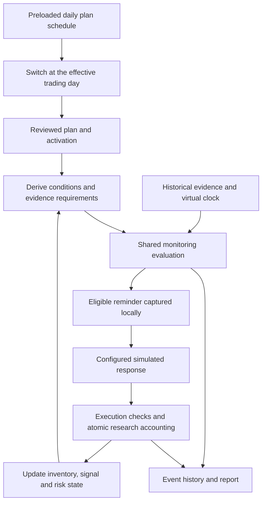

# Proposal: Backtest the Monitoring Loop

Status: DRAFT for user review; 2026-10-06, Asia/Shanghai. This is a design deliverable, not an implementation or a replacement of approved contracts. Module: `backtest-engine`; adapters: `backtest-data`, `backtest-jobs`, `backtest-results`, `backtest-api`, `backtest-web`. Chinese review copy: [PROPOSAL-monitor-loop-backtest.zh-CN.md](PROPOSAL-monitor-loop-backtest.zh-CN.md).

The confirmed business choices are now mapped to an [implementation plan](../../../tasks/plan.md) and [task list](../../../tasks/todo.md). Their technical details remain for review; no task is marked implemented by this planning update.

## ML01. Objective and assumptions

The user has confirmed the main workflow: **first plan establishes the opening position → daily plan updates derive add/reduce conditions → monitoring triggers add/reduce reminders → simulated execution → account/state feedback → continued monitoring until the end date**. The first plan's existing holdings initialize the account once; they are not purchased a second time. The user supplies the plan collection and response settings; the run discovers reminder and trade times from historical evidence.

Assumptions proposed for review:

1. The user supplies the first historical plan and all follow-up plans together. Extract and review the source plans into Schema 5 before the run. The first plan anchors the historical account/timeline and provides explicitly stated initial holdings and costs; today's job creation/import time is not the historical start. A plan reviewed today may be researched over past dates, but the report must not imply it was known then.
2. Automatic updates include inventory, sellable quantities, consumed signal occurrences, risk state, and the resulting monitoring view. Strategy text, thresholds, quantities, or logical branches do not change merely because a reminder fires.
3. Confirmed by the user: all plans are prepared and supplied before the historical run; plan updates occur by day. Freeze a schedule keyed by `symbol` and `effective_trade_date`, and switch plans at the corresponding trading-day boundary. The run does not generate strategy content.
4. The recommended mode applies an explicitly selected simulated response policy to eligible trade reminders. This research authorization never enables automatic live trading.
5. Confirmed by the user: the end date is optional. A supplied date ends the study on that date; otherwise resolve it to the current date in Asia/Shanghai when the run is submitted.
6. Confirmed by the user: one batch upload, followed by sequential per-plan AI extraction in chronological order. This is not one AI request containing every plan. ML13 defines extraction, predecessor binding, validation and retry behavior.

Success means a causally complete, auditable monitoring history; returns are a result of the simulated responses, not the sole acceptance criterion.

## ML02. Observed gaps and intended changes

The current replay already shares monitoring evaluation; it is not a separate evaluator throughout. Its orchestration is the gap:

| Observed current behavior | Proposed behavior |
|---|---|
| `research_session.py` constructs one plan and activation identity. | A session owns the active plan version, its activation revision, and evolving execution state. |
| `research_input.py` / UR03 require explicit operations targeting an exact occurrence. | Ordinary research needs a response policy, not a prewritten list of future trades. Recorded actions remain an optional replay mode. |
| `research_runner.py` marks ordinary authority ended after `REPLACE`. | Successful replacement invalidates old ordinary authority, binds the successor, refreshes requirements, and continues the same run. |
| `_ResearchRuntime._enqueue` suppresses notifications. | Capture reminders through an isolated sink, including the same eligibility and stale-evidence checks that precede live delivery. |
| `_simulate` updates inventory, consumes the signal, and may fulfil risk obligations. | Reuse those transitions, then refresh the monitoring view and derived requirements before subsequent actions. |
| UR06 may preserve a monitoring receipt after research cash becomes insufficient. | In the new mode, cash checks, inventory changes, signal consumption, and monetary entries form one research transaction; rejection changes none of them. |

Current contracts remain [SPEC-unified-plan.md](../monitoring/SPEC-unified-plan.md) and [SPEC-unified-replay.md](SPEC-unified-replay.md). Approval of this proposal would authorize a new monitoring-loop mode that replaces the explicit-script requirement, replacement-ends-run behavior, and post-receipt cash handling **only in that new mode**. Frozen historical runs retain their original meaning.

## ML03. Shared core and environmental adapters



Reuse condition interpretation, signal independence/expiry, risk priority/latching, delivery authorization, execution eligibility, and accounting transitions. First inspect their actual online call paths. Extract shared application participants only where adapters cannot safely use them; do not copy strategy logic or retain a dependency on private HTTP handlers as the intended architecture.

Online adapters use real data, time, storage, notification delivery and explicit user actions. Research adapters use a frozen dataset, virtual clock, private repositories, a recording notification sink and a simulated response policy. No production composition, provider request, live notification or live plan mutation occurs during deterministic replay.

“Derive conditions” means interpreting the reviewed plan and constructing its current monitoring requirements: condition tree, timeframe, warm-up, validity, confirmation, quantity, reset policy and execution window. It does not mean asking an AI to invent new conditions at every market tick. Position/risk changes update eligibility; only an authorized content revision changes strategy definitions.

Before replay, ML13 uses AI to translate supplied text into structured candidates and change descriptions. Programs validate and materialize complete versions; review then freezes the accepted chain. During replay, the monitoring engine only reads those frozen versions and market evidence, with no AI extraction calls.

## ML04. Inputs and state ownership

Freeze all reviewed plan snapshots and their daily schedule, dataset/revisions, run range and warm-up, known cash, dated inventory lots and costs, trading calendar, indicator/adjustment evidence versions, response/fill assumptions, and optional external evidence. Preserve existing point-in-time adjustment and availability checks. Unknown inventory permits observation but blocks execution and full-account return claims.

Proposed schedule fields: `symbol`, `effective_trade_date`, `plan_version_id`, `plan_hash` and an immutable reviewed snapshot binding. Each symbol has at most one entry per effective trading day. Sort and validate the complete schedule before submission; reject conflicting duplicates, unknown/unreviewed versions and non-trading effective dates rather than silently shifting them. Preflight must establish an applicable plan at the run start. Plan validity/activation constraints still apply and cannot be widened by scheduling. These are proposed input fields, not existing API claims.

**Optional end date.** Accept an optional `end_date`. Omission/null resolves once to the submission date in Asia/Shanghai; store the resolved date and whether it was explicit or defaulted. The date is inclusive. Reject an end before the first-plan start or after the submission date; a historical replay does not wait for future dates. A weekend/holiday is a valid end date: preserve the requested date and use the exchange calendar for actual market sessions. Plans effective after the end remain outside this run's decision timeline.

Resolve and freeze the evidence cutoff with the input: for a past end date use the end of that local day; for today's end use the submission instant. Consume only completed, available evidence no later than that cutoff. Do not create today's closing data while the session is still open. Admission checks still require the needed dataset coverage; genuine gaps are shown and handled by the existing coverage rules, not silently treated as an earlier requested end. Reports distinguish the requested/resolved end date, frozen evidence cutoff and actual last market evidence/valuation time. Waiting in a queue, retrying tomorrow or repeating a frozen run does not move its end date or add newer evidence; submitting a new run can use a later current date.

At the cutoff, stop generating and executing intents, retain remaining holdings for valuation and show pending intents as unfilled at the run end. Do not force liquidation solely because the study ended. This terminal run status does not claim the underlying plan's signal expired early.

**First-plan initialization.** Derive the historical start from the first supplied plan, rather than asking for an unrelated start and a manually reconstructed portfolio. Separate the account snapshot at that first-plan point from the earliest executable monitoring time: execution requires the plan to be available and effective. A plan available before trading on September 7 can govern that day; one written after its close cannot produce trades earlier that day. An intraday first plan can initialize the session at its known availability time without backdating it to the opening. Subsequent content updates still use the daily schedule. Show this mapping before running; keep import time separate and load warm-up before the historical start without generating transactions.

Use explicit statements of actual holdings, actual CORE/TACTICAL allocation and cost in the first source to build a reviewed initial-account snapshot. Strategy allocation targets alone still cannot initialize holdings. Bind extracted values to source text and record any confirmed supplements/overrides. Already-owned shares are opening inventory, not a new simulated buy; do not charge purchase fees again or infer an acquisition date from the plan date. Unknown cash or acquisition/sellability facts remain missing inputs: request them when needed for funded trading/T+1 checks, or explicitly limit the run to observation with incomplete account valuation. Never insert an arbitrary cash balance or assume all opening shares are sellable.

The user's pasted first plan from [盛新锂能中期波段交易计划](https://chatgpt.com/c/6aa21e11-9d54-83ea-8a91-3c401c270008) illustrates the extraction; these are source assertions, not independently verified market facts:

| Source item | Initialization/interpretation |
|---|---|
| `002240`; actual 100 shares; CORE 100, TACTICAL 0 | Seed 100 existing CORE shares once. |
| Cost CNY 40.105/share | Preserve exact precision; total opening accounting cost is CNY 4,010.50 (`401050` fen). Do not round the unit cost to 40.11. |
| Maximum 300 shares | Position ceiling; the remaining 200-share capacity is neither existing inventory nor buy authorization. |
| Reference 28.98; delayed intraday quote 28.45 | Dated reference market observations, not acquisition cost or automatically valid opening valuation. |
| Hypothetical buy 100 at 28.70 and sell at 29.30 | Fee illustration, not an actual fill, opening lot or active order. |
| Ordinary buy/sell currently 0; observation zone 28.50–29.00 | No ordinary buy authorization; do not turn an observation zone into a buy trigger. CORE is not available for the ordinary tactical sale. |
| Technical risk line 25.99; risk exit includes CORE, target 0 | Preserve the declared multi-close confirmation/exit sequence; a simple intraday touch is not authorization to sell. |

Extract the source fee/slippage assumptions as visible research settings for review: commission 0.03% each side, minimum CNY 5 each side, sell stamp duty 0.05%, transfer fee 0.001% each side, and slippage CNY 0.01/share each side. Do not silently substitute a basis-point model. These are supplied assumptions, not a claim about current statutory rates. Do not add hypothetical historical acquisition fees to the stated opening cost without evidence.

Keep original accounting cost and the start-of-research market valuation separately. Measure interval equity change from the initial known market value plus known cash, while reporting historical cost-based P/L separately. Pre-existing losses must not be labelled losses caused by the monitoring period. Missing opening prices/cash block the corresponding return metric rather than replacing cost with a convenient quote.

The pasted source mentions a September 9 report using September 8 close and an update containing September 10 intraday information. September 7 in the user's explanation is an illustrative start, not proof this exact text was available then. Establish the first-plan time from the actual supplied artifact; never backdate this text to September 7. The current design does not choose or run a specific historical dataset.

Preserve unrepresentable clauses as visible limitations: the source's partial fills, pending-order capacity and fundamental-information exits are not fully covered by the current whole-trade technical-monitoring contract. Missing scoped evidence for subjective technical invalidation remains unknown. This source is not a fully executable fixture merely because its initial holdings can be extracted; do not silently omit unsupported clauses or claim complete source-plan parity.

Keep four distinct state groups:

| State | Contents and ownership |
|---|---|
| Plan definition | Immutable source/content hash, reviewed conditions and quantities; new content creates a new version. |
| Monitoring state | Active version/revision, signal occurrences, resets, expiry, risk records, evidence dependencies and reminder identities. |
| Research account | Cash, dated CORE/TACTICAL lots, sellable quantities, costs and fees; shared inventory transitions plus research money entries. |
| Event history | Evidence availability, evaluations, reminders, requests, fills/rejections, state transitions, version changes and valuation. |

Declare research activation independently of production activation. Bind imported research review declarations explicitly; do not manufacture historical human facts. Inspect all scheduled plans to preflight and preload the union of data requirements, but expose only the currently effective plan to decision-making. Future plan contents cannot influence earlier conditions, actions or event identities. Market and external evidence keep their own availability cutoffs. Missing successor data blocks affected conditions with a reason; it never silently falls back to the old strategy.

## ML05. Event time and one monitoring cycle

Drive evaluation with evidence availability and scheduled lifecycle boundaries, not just a loop over price rows. The calendar must advance expiry and T+1 sellability even when no new price arrives. At a timestamp, process a deterministic sequence:

1. Make newly available market revisions and scoped external facts visible; apply calendar transitions.
2. At the trading-day boundary, apply that day's scheduled plan before the first monitoring evaluation or execution attempt; also apply explicitly ordered deactivation and approved reassessment events. Reject ambiguous competing lifecycle events. Invalidate old pending ordinary actions before they can execute. No scheduled intraday plan-content switch is supported in this design.
3. Freeze the current plan/state revisions and evidence cutoff, derive requirements, and run shared monitoring. Missing dependencies yield unknown/blocked conditions.
4. Recheck reminder eligibility using current revisions/evidence and capture the simulated delivery. Pure technical alerts cannot authorize a trade. Delivery here means a configured research assumption, not proof of real external delivery.
5. Process eligible response intents. A new intent can use only a future eligible price interval; an older intent may attempt execution now. Use shared risk/conflict priority; do not invent a favorable buy/sell order for simultaneous conflicting signals.
6. For a successful attempt, atomically commit cash/fees, dated lots, occurrence consumption and risk fulfilment. Refresh affected monitoring state before considering another intent. Rejected attempts leave those states unchanged.
7. Record before/after state and mark available prices for valuation. Post-trade refresh cannot create a new independent occurrence by repeatedly consuming the same evidence. No zero-time trade loop is allowed.

Formal daily confirmation still executes only in `NEXT_EXCHANGE_SESSION_ONLY`; completed five-minute confirmation retains `CURRENT_SESSION`. `PLAN_ACTIVE` does not extend a single signal's execution window. Warm-up never generates reminders or trades. Late corrections are new events and never rewrite already recorded history.

## ML06. Reminder response and fill policy

Offer three business-facing modes; names below are proposed contract discriminators, not current API fields:

| Mode | Behavior |
|---|---|
| `FOLLOW_REMINDERS` (recommended) | A frozen policy responds to each currently authorized ordinary/risk trade reminder with one complete requested quantity. |
| `OBSERVE_ONLY` | Record reminders and state changes; no generated execution requests. |
| `RECORDED_ACTIONS` | Replay explicitly supplied user actions; no additional automatic response. Useful for historical comparison and parity fixtures. |

The first mode requires the user to select the policy at run creation. It applies to executable trade reminders, not every Boolean condition or pure technical alert. Retain one intent per authorized occurrence, even if delivery is repeated. Risk intents bind the current risk revision/target, not an obsolete quantity.

Recommended initial fill model: full quantity at the **close of the first eligible completed one-minute interval whose start is at or after the response's ready time**, with configured slippage and fees. Ready time includes reminder availability plus a frozen response delay (proposed default: 0 seconds). A minute already in progress at decision time is ineligible. The result becomes known only when that minute's evidence is available; recheck current authority, risk, quote applicability and price limits then. Record both price time and availability time. Never fill at the close that first generated the same reminder.

For example, a five-minute confirmation available at 09:35:12 cannot fill at 09:35 or 09:36 using the 09:35–09:36 interval; the first candidate interval is 09:36–09:37, evaluated only after its evidence arrives. A daily reminder waits for the next eligible exchange session. End-of-run intents remain visibly unfilled.

Enforce current full-quantity positive 100-share units, T+1, CORE protection, position limits and risk/conflict checks. Check cash including fees before commitment; no partial quantity substitution. Cash/sellability/market blockers may be retried on subsequent evidence while authority remains valid, with one attempt per intent per eligible interval. Expiry, consumption, replacement or deactivation closes ordinary intents. Insufficient data/liquidity evidence yields an explicit blocked/unsupported attempt, never a fabricated fill. Preserve conservative existing suspension/price-limit rules; minute bars cannot establish queue priority or real execution certainty.

## ML07. Plan updates and successor continuity

There are two update paths, both visible in the timeline:

**Execution-state update.** A fill changes cash/lots and the corresponding signal/risk state; the next monitoring view uses the new holdings, capacity, sellability and consumed occurrence. A satisfied condition alone, notification delivery, or read receipt does not change inventory. Repeated buying requires the plan's existing independent-signal reset rule, not simply a new day. No new sell condition is invented when a buy fills.

**Daily plan-content update.** All reviewed versions are supplied before the run. At the start of `effective_trade_date`, before any evaluation or execution: recheck the scheduled binding → end old ordinary authority and pending intents → activate that day's version → rebuild requirements → continue monitoring. Use the exchange calendar in Asia/Shanghai. Initialize the applicable version before the first event for an intraday run start; do not replay pre-start trades. Draft saving alone does not switch plans. Carry cash/lots, acquisition dates, costs and existing risk obligations across the switch; never reset the account or silently release risk. Risk reassessment follows the existing explicit evidence rules.

Schedule semantics (carry-forward confirmed by the user; other defaults remain proposed):

- A schedule row states the day a plan starts governing monitoring, not necessarily its creation/report date. A plan using day D's close must be assigned to the next eligible trading day, never day D's opening. Later-authored retrospective plans remain explicitly labelled experiments.
- Confirmed: with no new row on a day, continue the most recent still-valid active plan. Show this carry-forward in the preview. If its authority has expired or was deactivated, do not extend it; record no ordinary plan authority while preserving risk obligations and account valuation. Reject an uncovered run start before running.
- Repeating the same immutable version on adjacent days is continuation, not a fresh activation; preserve occurrence/reset/consumption state. A genuinely different scheduled version uses the existing replacement semantics.
- An old ordinary daily signal that was due to execute today loses authority if a different plan replaces its owner before execution. Do not silently transfer it to the new version. Without replacement, it retains its original next-session window. This consequence must appear in the report and acceptance fixtures.
- Loading every future plan into storage is not permission for the monitoring core to read it early. No strategy generation, AI generation call, automatic content editing or intraday strategy update occurs during replay.

Example: D1 schedules P1, D2 schedules P2, and D3 has no row. D1 monitors P1; D2 switches to P2 before monitoring and retains the accumulated account; D3 continues P2 if still valid. The preview expands this into an explicit daily plan calendar.

Initialize the account from the first plan only. Later plans' statements such as “currently 200 shares” or “now flat” are historical observations, not instructions to overwrite simulated holdings/cost/cash. Compare them with the replay account and show discrepancies. In `FOLLOW_REMINDERS`, the ledger evolves only through its simulated fills; do not fabricate trades to match a later description. If a follow-up strategy is explicitly contingent on a different account state, mark the affected instructions incompatible pending an explicit reviewed interpretation, rather than inventing quantities or changing their meaning. `RECORDED_ACTIONS` may apply separately evidenced actual trades with their prices, quantities and times; a portfolio statement alone is insufficient. The report describes execution of supplied historical plans, not a claim that these fixed follow-ups would have been authored identically under a different simulated trading history.

The authoring date records when the plan was actually written, for provenance and interpretation of its information context; preserve an exact timestamp when available. The effective trading date selects when that version starts governing monitoring. Import time is a third, separate storage event and changes neither date. For example, a plan written on Monday evening using Monday's close starts on Tuesday; if no new plan arrives Wednesday, it continues while valid, with its original Tuesday effective date unchanged. A plan written Friday for next Monday can be stored over the weekend without becoming active early. Importing historical plans today preserves their original authoring/effective dates. A plan actually authored today but assigned to a past trading day is a retrospective experiment, not a historically available plan. Date labels alone do not prove absence of future information; underlying evidence cutoffs still require validation. Only the effective trading date drives schedule selection.

## ML08. Persistence, determinism and limits

Reuse existing durable jobs, frozen datasets, isolated result storage, cancellation and atomic report publication. Use a new versioned input/report discriminator for this mode; exact version identifiers and API schemas belong to the approved interface design. Do not relabel old `backtest-run-v4` or `backtest-report-v3` data with changed semantics.

The run identity includes normalized input, plan-chain/evidence artifacts, dataset identity, response/fill policies and relevant engine versions. Event identities depend only on their causal past, so changing future evidence cannot rename earlier events. Task IDs, retries and wall-clock time stay outside semantic identity. Preserve cash and inventory in one private transaction with stable idempotency keys; a failed worker attempt can restart from frozen input with identical output. Mid-run checkpoint optimization is not required initially.

Retain the current 70,000-decision-event bound; include any added monitoring refreshes in the count. Freeze and validate separate finite limits for captured reminders, intents, plan revisions and attempts during interface design; exceeding a limit fails visibly and publishes no completed report. Stream the audit trail rather than keeping the entire run in memory. Missing condition evidence is a recorded business blocker; unsupported inputs or engine errors are run failures. Canceled/failed runs never appear as completed performance results.

## ML09. User workflow and reports

The create page accepts the first plan and all follow-ups in one batch, then previews the extracted first-plan start, initial holdings/cost/allocation and daily effective-date schedule. The user optionally supplies an end date (blank means today in Asia/Shanghai), chooses the dataset and response mode, and fills only genuinely missing account inputs such as available cash or sellability evidence. Show the resolved date and available-data cutoff in the submission result. Execution assumptions and optional timed facts are advanced inputs. Ordinary use does not require raw operation JSON or retyping initial values already explicit in the plan. Preview a calendar showing each day's effective plan, switches, carry-forward and uncovered days, alongside unresolved plan bindings, duplicate dates, account-context discrepancies, data/warm-up gaps and unsupported clauses. Clearly label whether this is a historical plan replay or a retrospective experiment using later-authored plans.

The main result is a timeline: **active plan → condition/evidence → reminder → response → fill/blocker → state update → next monitoring cycle**. Show a plan-version lane, holdings/cash/equity charts, and reminder-to-execution counts including rejected/expired/unfilled intents. Each step links to its causal event, active version, cutoff, state revision and reason. Distinguish “condition satisfied”, “reminder eligible”, and “trade completed”.

Before starting the run, show extraction progress per plan, failed/needs-review items, each version's condition diff and the complete daily plan calendar. Let the user correct or retry the affected item and review the resulting chain together. Do not require uploading the entire collection again after one extraction failure. Batch upload/extraction is preparation; ML04's default end date and cutoff are resolved at backtest submission, not at the earlier upload time.

Include return/drawdown/fees/turnover only where valuation is valid; label missing prices and unknown holdings. Observation-only results emphasize reminders and may show mark-to-market on known initial holdings; never attribute that change to simulated trades. A return curve alone cannot demonstrate monitoring parity.

## ML10. Acceptance criteria

| ID | Required evidence |
|---|---|
| ML-A01 | Without any scripted trades, one reviewed plan produces a buy reminder, a policy-generated full fill, updated inventory, a later independently eligible sell reminder/fill, and continued monitoring. Prices/quantities are declared fixture values, not invented production strategy. |
| ML-A02 | Repeated true conditions and repeated reminder delivery do not duplicate trades; only the declared reset policy creates another occurrence. State refresh cannot consume the same evidence into an infinite loop. |
| ML-A03 | Pure alerts and `OBSERVE_ONLY` never mutate holdings; `RECORDED_ACTIONS` adds no automatic requests. |
| ML-A04 | Completed five-minute/daily/mixed conditions, delayed reception, warm-up, gaps, corrections and the 09:35:12 example obey point-in-time availability and execution windows. Changing future inputs leaves earlier events unchanged. |
| ML-A05 | Fees-inclusive cash failure, T+1, CORE, max position and full-quantity rejection leave cash, holdings and signal consumption atomically unchanged; a later valid attempt can succeed exactly once. |
| ML-A06 | Shared risk/conflict priority governs simultaneous candidates; no favorable arbitrary ordering. A new risk or stale evidence blocks a queued positive reminder/intent. |
| ML-A07 | Successor activation invalidates old ordinary intents, preserves lots/cash/risks and continues with new conditions in the same run; draft-only changes have no effect. Unknown or unreviewed successor content is blocked. |
| ML-A08 | Feed identical facts, lifecycle changes and execution outcomes through online application participants and the research adapter; compare semantic reminders and state transitions event by event, with independent expected-value assertions. Exclude only environmental delivery IDs/time. |
| ML-A09 | Repeated runs/retries produce identical canonical reports; cash/inventory commits are fault-tested; cancellation and all finite-limit failures publish no completed report. Old frozen reports/exports remain byte-compatible. |
| ML-A10 | Existing API/job/result paths and a browser flow create and inspect the loop without handwritten future trades; deterministic tests make zero live-provider, AI, notification or production-database calls. |
| ML-A11 | Preload P1/P2 and switch only at their effective trading days before evaluation/execution; retain account state. Cover carry-forward, expired plans, uncovered start, duplicate/non-trading dates and intraday run initialization. Repeating the same version does not reset signals. Replacement cancels old next-session ordinary intents; continuation preserves their window. Editing future P2 cannot change earlier P1 decisions. |
| ML-A12 | Extract the first-plan 100 CORE shares, 0 TACTICAL, cost 40.105/share and ceiling 300; preserve total cost `401050` fen without an opening simulated buy or duplicate purchase fee. Reference quotes/hypothetical fee trades do not initialize lots. Missing cash/sellability stays explicit. |
| ML-A13 | A later plan declaring 200 or 0 shares cannot overwrite the replay ledger; detect incompatible account-dependent instructions. Interval return and historical cost P/L remain distinct. |
| ML-A14 | Today's import/job time does not replace the first-plan historical start; no trades precede its availability/effectiveness. The supplied September 10 information cannot drive September 7 decisions. Unsupported source clauses remain visible rather than silently translated into executable rules. |
| ML-A15 | Explicit and omitted/null end dates produce the correct inclusive Asia/Shanghai boundary. Cover UTC/local-day differences, queueing across midnight, retries, holidays, today's incomplete session, invalid before-start/future dates and genuine data gaps. Frozen reruns do not extend the cutoff; reports show actual coverage. Ending preserves open holdings and does not create a liquidation trade. |
| ML-A16 | One batch is extracted sequentially: the first source yields initial-account data and a complete rule candidate; each follow-up sees only its own source and validated predecessor context. No future-plan text enters an earlier request. Every accepted item produces a complete snapshot and traceable change list. |
| ML-A17 | Exercise add/modify/revoke/retain and full-replacement versus partial-update semantics; missing scope or unclear references block dependent extraction. Preserve original bindings for inherited rules; AI cannot invent thresholds, account mutations or approvals. |
| ML-A18 | A failed item retries without re-extracting its unchanged predecessors; unresolved semantics stop dependent items. Changing an earlier source/base invalidates dependent candidates and their reviews, but leaves frozen historical runs intact. Batch review and all required bindings precede replay; replay makes zero AI calls. |

## ML11. Engineering boundaries and verification

This is one redesign within `backtest-engine`, using existing module boundaries. Expected code ownership: `backtest/` for orchestration/clock/response/account/report adapters; `decision/`, `runtime/`, `state/` for necessary shared participants; `web/` for input/results. Existing `research_*` readers remain available for frozen mode compatibility. Tests belong in `tests/unit`, `tests/integration` and `web/tests`.

The approved per-plan preparation approach also touches the existing `ai/plan_extraction.py`, source-review/domain validation participants and narrowly scoped batch orchestration. Reuse the single-plan extraction capability and add explicit predecessor/change context; do not claim the current prompt already implements batch updates. Keep any changed extraction/prompt contract versioned and regression-tested against existing single-plan behavior. No strategy-generation capability is added.

Use existing strict immutable Python models, snake_case, revision-checked transitions and exact Decimal/integer-fen arithmetic; Vue changes follow TypeScript Composition API and `<script setup>`. Preserve naming and bilingual documentation conventions.

- Always: maintain one strategy evaluator, causal evidence, isolated storage, full-quantity constraints, explicit version contracts and online parity regressions.
- Resolve before extending scope: new production schema/dependencies or shared multi-symbol capital. Strategy generation and intraday plan-content switching are outside this daily-schedule design.
- Never: alter historical bytes, invent thresholds/facts, weaken failing tests, write production state, send real alerts, submit broker orders or silently reinterpret historical runs.

After implementation, run the following from `trade-plan-monitor/` (frontend commands from `web/`), plus focused tests added for ML-A01–ML-A18 and affected extraction/source-review tests with fake AI responses:

```text
.venv/Scripts/python.exe -m pytest tests/unit/test_unified_replay_input.py tests/integration/test_unified_replay.py tests/integration/test_unified_replay_parity.py tests/integration/test_unified_runtime.py tests/integration/test_unified_simulation_transactions.py -q -m "not live"
.venv/Scripts/python.exe -m ruff check src tests scripts
.venv/Scripts/python.exe scripts/generate_frontend_types.py --check
npm run test -- --run
npm run type-check
npm run build
npm run test:e2e
git diff --check
```

Expand tests according to shared-participant changes, retain unaffected capacity evidence, and record actual commands/results in bilingual verification reports. Do not claim these checks have run for this design-only change. Existing unrelated failures are reported separately, never waived by modifying baselines.

## ML12. Decisions for review

Confirmed scope: all historical plans are supplied before the run and activated by effective trading day. The earlier question about generating strategy content is resolved; no generation during replay is required.

Confirmed input workflow: start the historical study from the first plan, extract its explicit initial portfolio and cost, and process the supplied follow-ups thereafter. Initialization occurs once; any missing cash/sellability or source-time ambiguity is an input gap to resolve for an actual run, not permission to invent a baseline account.

The user has confirmed the opening-position → plan update → add/reduce conditions → reminder → execution loop and manual end-date selection with a current-date default. ML04 defines the proposed deterministic cutoff and end-of-run handling; this workflow confirmation does not by itself assert implementation or test completion.

Confirmed extraction choice: upload once, extract each plan separately in chronological sequence, validate/save per item, and preview/review the entire chain before replay. ML13 records this choice; no further choice between one-shot and per-plan extraction is pending.

Recommended baseline: `FOLLOW_REMINDERS`, explicit execution assumptions, automatic execution-state updates and the frozen daily plan schedule. Preserve observation and recorded-action modes. The user has confirmed carrying forward the latest still-valid plan on days without a new entry. ML07's switching before the day's first evaluation/execution remains a design recommendation.

This document specifies the proposed behavior and acceptance contract. Implementation tasks and code follow a later review of the proposal; no implementation is included here.

## ML13. One upload, sequential per-plan extraction

**Preparation sequence.** Preserve the original text, source identity/hash, plan time and explicit ordering for each item. Confirm source boundaries and chronological order before extraction; conflicting dates or ambiguous same-day order require correction rather than upload-order guessing. Source chronology and the effective-day calendar are distinct: multiple same-day source updates still need an explicitly selected effective version under ML04. Freeze a stable item order for the batch and process one item at a time.

1. Extract the first source into initial-account facts and a complete monitoring-rule candidate, keeping those outputs separate as ML04 requires.
2. For each follow-up, provide its source plus the preceding validated structured candidate and retained source bindings. Include earlier source excerpts only when needed to resolve an explicit reference. Never include later plans or future replay results. If the predecessor is ambiguous or incomplete, stop dependent extraction until corrected.
3. Ask AI to identify changes and scope: a full replacement or a partial update, with explicit additions, modifications, revocations and retained conditions. Every change cites the current source; inherited fields retain their original evidence. A program checks targets and applies supported changes to materialize a complete new snapshot plus its diff.
4. Validate the candidate, persist the item result and its predecessor binding, and continue only when no unresolved semantic dependency remains. Show initial-account values, changes and unresolved issues in a batch preview.
5. Review the complete chain through the existing source-bound review process and freeze approved snapshots and the effective-day schedule before backtest submission. Automatic format/consistency validation is not human approval: a clean candidate may support further preparation, but neither it nor its descendants become executable solely by passing validation.

**Update semantics.** For partial updates, retain only the scope supported by the update or an explicit reviewed clarification, such as “other conditions unchanged.” Full replacements must identify removed prior rules in the diff; omission alone does not authorize silently retaining or deleting an unclear rule. Vague instructions such as “new platform” or “obvious deterioration” remain unresolved evidence/parameter requirements. A follow-up account description does not mutate the simulated account. Reusing a rule identifier preserves traceability, not authority for an old signal across a genuine version replacement; ML07 still applies.

**Per-item state and recovery.** Show pending, extracting, validated candidate, needs review and failed states, alongside separate approval status; these are proposed business states, not existing API enums. Save source/base hashes, extraction contract/prompt version, model/provider, candidate/diff/bindings, issues and attempt metadata. A transient/format failure retries only that item using the same frozen inputs, retaining successful predecessors. Semantic uncertainty needs correction, not unlimited retries or silent skipping. No dependent item is processed against a failed or unresolved base.

Each persisted result binds its source revision and predecessor content hash. Editing an earlier source, order, interpretation or base invalidates affected descendants and their reviews; resume preparation from the earliest affected item. Reject a late extraction result if its source/base has changed. Do not overwrite approved frozen snapshots or previously submitted runs. Explicitly re-extracting unchanged text can yield a different candidate; review it as a new result rather than assuming AI determinism. Deterministic replay depends on stored accepted snapshots, not on reproducing model output.

**Why this approach.** It extends the existing single-plan extractor with predecessor context, a sequential batch controller and per-item progress. Local failure recovery and source/diff review are simpler than disentangling all versions from a single large model response. The user still uploads once; preparation may require multiple AI requests, but monitoring/replay requires none.
