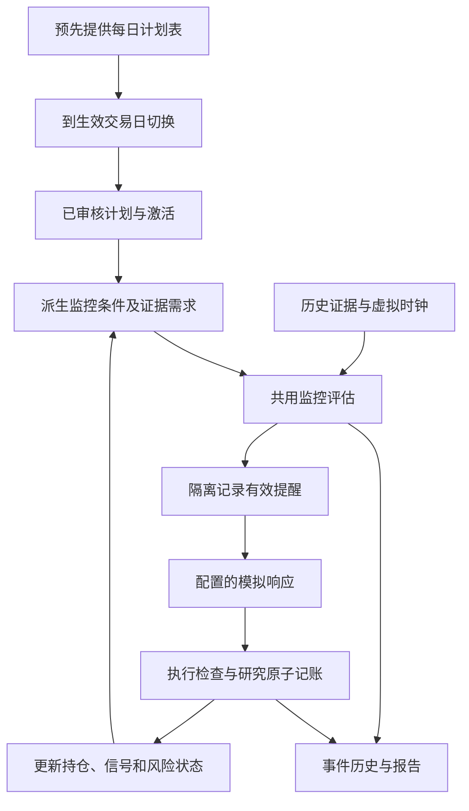

# 方案：按真实监控闭环重新设计回测

状态：用户于 2026-10-07（Asia/Shanghai）授权实施：先隔离回测，再交付业务流程。最终 API/契约审阅仍待 ML-T29；本次授权不代表验收通过，也不替代已批准契约。模块：`backtest-engine`；适配涉及 `backtest-data`、`backtest-jobs`、`backtest-results`、`backtest-api`、`backtest-web`。英文规范：[PROPOSAL-monitor-loop-backtest.md](PROPOSAL-monitor-loop-backtest.md)。

已确认的业务选择对应到[实施方案](../../../tasks/plan.zh-CN.md)和[任务清单](../../../tasks/todo.zh-CN.md)。线程隔离选择已确认。实际实施检查单独记录在[验证记录](../../verification/monitor-loop-backtest.zh-CN.md)；未执行验收项仍待完成。

## ML01. 目标与假设

用户已确认主流程：**首份计划建立期初仓位 → 每日更新计划生成加减仓条件 → 监控触发加减仓提醒 → 模拟执行 → 账户/状态反馈 → 持续监控至结束日期**。首份计划中的已有持仓只初始化一次，不再次买入。用户提供计划集合和响应设置；提醒、成交的具体时刻由历史证据驱动产生。

提交审阅的假设：

1. 用户一次性提供首份历史计划及全部后续计划。运行前将原文提取、审核为 Schema 5。首份计划确定历史账户/时间轴起点，并提供明确写出的初始持仓和成本；今天创建任务/导入的时间不是历史起点。今天审核的计划可以研究过去，但报告不能声称当时已经知道该计划。
2. 自动更新包括持仓、可卖数量、已消费信号、风险状态和由此形成的监控视图。提醒触发本身不修改策略原文、阈值、数量或逻辑分支。
3. 用户已明确：历史回测的所有计划提前准备，在运行前提供，按天更新。冻结以 `symbol` 和 `effective_trade_date` 为索引的计划日程，到对应交易日边界切换。运行中不生成策略内容。
4. 推荐模式以用户明确选择的模拟响应策略处理有交易权限的提醒。此研究授权不会启用实盘自动交易。
5. 用户已确认：结束日期可选；填写则在指定日期结束，不填则在提交回测时按 Asia/Shanghai 的当前日期确定。
6. 用户已确认：一次批量上传，系统按时间顺序逐份调用 AI 提取，不把全部计划塞入一次 AI 请求。ML13 定义提取、前版绑定、校验和重试行为。

完成标准是因果完整、可以审计的监控历史；收益是模拟响应的结果，不是唯一验收指标。

## ML02. 已确认的问题与改造方向

当前回放已经复用了监控评估，并非全程使用另一套评估器。主要缺口在流程编排：

| 当前已确认行为 | 新方案 |
|---|---|
| `research_session.py` 构造一个计划和激活身份。 | 会话管理当前计划版本、激活修订和持续变化的执行状态。 |
| `research_input.py` / UR03 要求明确指定信号发生次数的操作。 | 普通回测配置响应策略，无需提前编写未来交易清单；历史操作保留为可选重放模式。 |
| `research_runner.py` 在 `REPLACE` 后结束普通权限。 | 成功替换后使旧普通权限失效，绑定后续计划，刷新取数需求，继续同次运行。 |
| `_ResearchRuntime._enqueue` 禁止通知入队。 | 通过隔离出口记录提醒，并执行与真实发送前相同的资格和证据时效检查。 |
| `_simulate` 更新持仓、消费信号，并可能完成风险义务。 | 复用这些转换，再刷新监控视图和派生需求，之后才考虑后续操作。 |
| UR06 允许研究现金不足后保留监测回执。 | 新模式中，现金检查、持仓变更、信号消费和资金记账构成一个研究事务；拒绝时均不改变。 |

现行契约仍为 [SPEC-unified-plan.md](../monitoring/SPEC-unified-plan.md) 和 [SPEC-unified-replay.md](SPEC-unified-replay.md)。本方案获批后，新增监控闭环模式，**仅在新模式内**替代“必须编写操作脚本”“替换即结束”“先回执后检查研究现金”的行为。冻结历史运行保留原有含义。

## ML03. 共用核心与环境适配



复用条件解释、独立信号与到期、风险优先级与锁存、发送授权、执行资格和记账转换。先核对这些能力的实际在线调用链。适配器不能安全使用时，才提取共用应用参与者；不复制策略逻辑，也不把依赖私有 HTTP 处理函数作为目标架构。

在线适配器使用真实数据、时钟、存储、通知发送和明确用户操作。研究适配器使用冻结数据集、虚拟时钟、私有仓储、提醒记录出口和模拟响应策略。确定性回放过程中不创建生产组合、不请求供应商、不发送真实通知、不修改在线计划。

“生成监控条件”指解释已审核计划，构建当前监控需求：条件树、周期、预热、有效性、确认方式、数量、重置策略和执行窗口。它不意味着每来一条行情就让 AI 发明条件。持仓和风险改变执行资格；只有经过授权的内容修订才改变策略定义。

回放前，ML13 使用 AI 将提供的原文翻译为结构化候选和变化说明，由程序校验并形成完整版本，审核后冻结已接受的版本链。回放期间，监控引擎只读取这些冻结版本和行情证据，不调用 AI 提取。

## ML04. 输入与状态归属

冻结全部已审核计划快照及每日生效日程、数据集及修订、运行区间与预热、已知现金、带取得日期和成本的持仓批次、交易日历、指标与复权证据版本、响应与成交假设，以及可选外部证据。保留现有复权和可用时间检查。未知库存允许观察，但阻断执行和完整账户收益声明。

建议日程字段：`symbol`、`effective_trade_date`、`plan_version_id`、`plan_hash` 及不可变已审核快照绑定。同一股票每个生效交易日最多一条记录。提交前排序并校验完整日程；拒绝冲突重复、未知/未审核版本和非交易日生效日期，不静默顺延。准入时必须确认回测起点有适用计划。计划自身有效期/激活约束仍然生效，不能通过日程扩大。这些是建议输入字段，不代表已有 API。

**可选结束日期。** 接受可选 `end_date`。省略/null 时，在提交时按 Asia/Shanghai 日期解析一次，保存解析结果及手填/默认来源。区间包含结束当天。结束日期早于首份计划起点或晚于提交当天时拒绝；历史回测不等待未来日期。周末/节假日可以作为结束日期，保留用户要求的日期，实际行情时段按交易所日历处理。结束日期之后生效的计划不进入本次决策时间线。

与输入一起解析并冻结证据截止：过去日期取当地当天结束，结束日期为今天时取提交时刻。只消费截至该时刻已完成、已可用的证据；盘中不能生成尚未出现的今日收盘数据。准入仍须满足所需数据集覆盖，真实缺口应展示并按既有覆盖规则处理，不能静默当作用户要求更早结束。报告分别展示要求/解析后的结束日期、冻结证据截止及实际最后行情证据/估值时点。任务排队、次日重试或重放冻结运行均不改变结束日期、不加入更新证据；新提交任务可以使用新的当前日期。

到截止时停止生成和执行意图，保留未平仓持仓用于估值，待执行意图显示为回测结束时未成交。不能仅因回测结束而强制清仓。这个运行终止状态不代表原计划信号提前到期。

**首份计划初始化。** 从首份提供的计划推导历史起点，不要求另填无关起点并手工重建组合。区分首份计划时点的账户快照与最早可执行监控时间：执行要求计划已经可用且生效。如果计划在 9 月 7 日开盘前已可用，可以支配当天监控；如果收盘后才写成，就不能生成当天此前的交易。首份计划在盘中形成时，可以在已知可用时点初始化会话，不倒推到开盘。后续内容更新仍使用每日计划日程。启动前展示这个映射；导入时间独立，历史起点以前只加载预热，不生成交易。

从首份原文中明确的实际持仓、实际 CORE/TACTICAL 分仓和成本构建已审核期初账户快照。仅有策略分仓目标仍不能初始化持仓。提取值绑定原文，并记录明确确认的补充/覆盖。已有股份属于期初库存，不是新模拟买入；不重复收取买入手续费，也不把计划日期猜作买入日期。未知现金或取得日期/可卖量保持缺失：资金执行或 T+1 检查需要时补齐，否则明确限定为观察及不完整账户估值。不得填入任意现金，也不得默认期初股份全部可卖。

用户粘贴的[盛新锂能中期波段交易计划](https://chatgpt.com/c/6aa21e11-9d54-83ea-8a91-3c401c270008)首份计划用于说明提取；下列为原文声明，不是独立核验后的市场事实：

| 原文信息 | 初始化/解释 |
|---|---|
| `002240`；实际 100 股；CORE 100、TACTICAL 0 | 一次性建立已有 100 股 CORE 库存。 |
| 成本 40.105 元/股 | 保留精度，期初会计总成本为 4,010.50 元（`401050` 分），不能把单股成本四舍五入为 40.11。 |
| 上限 300 股 | 持仓上限；剩余 200 股额度既不是已有持仓，也不是买入授权。 |
| 参考价 28.98；延迟盘中报价 28.45 | 带时间的行情参考，不是取得成本，也不自动成为有效期初估值。 |
| 假设 28.70 买 100 股、29.30 卖 | 费用示例，不是实际成交、期初批次或活动订单。 |
| 普通买卖当前 0 股；观察区 28.50–29.00 | 无普通买入授权，不能把观察区转成买入触发；CORE 不用于普通机动仓卖出。 |
| 技术风险线 25.99；风险退出含 CORE、目标 0 | 保留原文多次收盘确认/退出顺序，盘中简单触线不授权卖出。 |

将原文费用/滑点假设提取为可见、可审核的研究设置：双边佣金 0.03%、单边最低 5 元、卖出印花税 0.05%、双边过户费 0.001%、每边滑点 0.01 元/股。不能静默替换为基点模型。这些是用户提供的假设，不声明为当前法定费率。没有证据时，不能在已给期初成本上另加假想历史买入费用。

分别保留原始会计成本与研究起点市值。回测区间权益变化以期初已知市值加已知现金为基准，另行展示相对历史成本的盈亏。回测前已经存在的浮亏不能归为监控期间造成的亏损。缺少期初行情/现金时，阻断对应收益指标，不用方便取得的报价替换成本。

粘贴原文提到 9 月 9 日生成、参考 9 月 8 日收盘的报告，也包含 9 月 10 日盘中信息。用户说明中的 9 月 7 日是起点举例，不能证明这段文字当时已可用。应依据实际提供的原始材料确定首份计划时间，不能将这段内容倒填到 9 月 7 日。本次设计不选定或执行具体历史数据集。

不能表达的条款保留为可见限制：原文部分成交、未成交买单占额和基本面信息退出，尚未被当前完整数量技术监控契约完整覆盖。主观技术失效缺少限定范围证据时仍为未知。能提取初始持仓不代表这份原文已成为完整可执行夹具；不能静默删掉不支持条款或宣称完整复现原计划。

区分四类状态：

| 状态 | 内容与归属 |
|---|---|
| 计划定义 | 不可变原文/内容哈希、已审核条件与数量；内容变化生成新版本。 |
| 监控状态 | 活动版本/修订、信号发生、重置、到期、风险记录、证据依赖和提醒身份。 |
| 研究账户 | 现金、带日期的 CORE/TACTICAL 批次、可卖数量、成本与费用；共用持仓转换加研究资金分录。 |
| 事件历史 | 证据可用、评估、提醒、请求、成交/拒绝、状态转换、版本变化和估值。 |

研究激活与生产激活独立声明。明确绑定导入的研究审核声明，不编造历史人工事实。准入时检查全部计划并预载合并后的数据需求，但决策过程只能使用当前已生效计划。未来计划内容不能影响此前条件、操作或事件身份。行情和外部证据各自保留可用时间截止。后续计划缺数据时，明确阻断受影响条件，不静默退回旧策略。

## ML05. 事件时间与单轮监控

用证据可用时间和生命周期边界推进评估，不能只循环价格行。没有新价格时，日历也要推进信号到期和 T+1 可卖数量。同一时刻按确定顺序处理：

1. 使新到市场修订和限定范围的外部事实可见，应用日历转换。
2. 在交易日边界、当天首次监控评估或执行尝试之前应用当天计划日程；同时处理明确排序的停用和已批准重评事件。拒绝顺序不明的竞争生命周期事件。在旧普通待执行操作可能成交前使其失效。本方案不支持日程中的盘中计划内容切换。
3. 冻结当前计划/状态修订及证据截止，派生需求，调用共用监控。依赖缺失时条件为未知或阻断。
4. 按当前修订和证据复核提醒资格，记录模拟送达。纯技术提醒不授权交易。此处送达是配置的研究假设，不证明真实外部送达。
5. 处理符合条件的响应意图。新意图只能使用后续合格价格区间；旧意图可以在此刻尝试执行。使用共用风险/冲突优先级，不能给同时冲突的买卖信号人为安排有利顺序。
6. 成功时原子提交现金/费用、持仓批次、信号消费和风险完成。在考虑另一个意图前刷新受影响监控状态。拒绝时这些状态均不变。
7. 记录前后状态，用已知价格估值。成交后刷新不能反复消费同一证据形成新的独立信号。禁止零时间交易循环。

正式日线确认仍只在 `NEXT_EXCHANGE_SESSION_ONLY` 执行；完整五分钟确认保留 `CURRENT_SESSION`。`PLAN_ACTIVE` 不延长单个信号窗口。预热不产生提醒或交易。后到更正作为新事件处理，不重写既有历史。

## ML06. 提醒响应与成交策略

提供三种面向业务的模式；以下名称是建议的契约区分值，并非当前 API 字段：

| 模式 | 行为 |
|---|---|
| `FOLLOW_REMINDERS`（推荐） | 冻结策略响应当前有权限的普通/风险交易提醒，每次请求完整数量。 |
| `OBSERVE_ONLY` | 记录提醒和状态变化，不生成执行请求。 |
| `RECORDED_ACTIONS` | 回放明确提供的用户操作，不附加自动响应；用于历史对照与一致性夹具。 |

第一种模式要求用户在创建运行时选择策略。它作用于可执行交易提醒，不对所有条件为真或纯技术提醒自动交易。每个授权信号发生只保留一个意图，重复送达不产生重复交易。风险意图绑定当前风险修订和目标，不沿用过时数量。

推荐首版成交模型：在**区间起点不早于响应就绪时间的首根合格、完整一分钟 K 线收盘价**上加入配置的滑点与费用，模拟完整数量成交。就绪时间包含提醒可用时间及冻结响应延迟（建议默认：0 秒）。决策时已经开始的分钟区间不合格。只有该分钟证据可用后，结果才可知；此时复核当前权限、风险、报价适用性和涨跌停限制。同时记录价格时点和证据可用时点。禁止使用首次产生该提醒的同根收盘价成交。

例如，五分钟确认在 09:35:12 才可用，不能以 09:35 或使用 09:35–09:36 区间在 09:36 成交；首个候选区间为 09:36–09:37，且要等证据到达后才评估。日线提醒等待下一合格交易日。回测结束时尚未执行的意图明确显示未成交。

执行现有正数 100 股整数倍、完整数量、T+1、CORE 保护、持仓上限、风险/冲突检查。提交前检查含费用的现金，不以部分数量替代。现金、可卖量或市场阻断可以在权限仍有效时随新证据重试，每个意图在每个合格区间最多尝试一次。到期、消费、替换或停用关闭普通意图。缺少数据/流动性依据时明确阻断或标为不支持，不编造成交。保留既有保守停牌/涨跌停规则；分钟 K 线无法证明排队位置或真实成交确定性。

## ML07. 计划更新与版本连续性

区分两条更新路径，并在时间线中同时展示：

**执行状态更新。** 成交改变现金/持仓批次和对应信号/风险状态；下一轮监控使用新的持仓、剩余额度、可卖数量和已消费信号。条件成立、通知送达或已读本身不改变持仓。重复买入需要计划既有的独立信号重置规则，不能仅因跨日再次买入。买入成交也不会凭空生成新卖出条件。

**每日计划内容更新。** 全部已审核版本在回测前提供。在 `effective_trade_date` 开始、任何评估或执行之前：复核日程绑定 → 结束旧普通权限及待执行意图 → 激活当天版本 → 重建需求 → 继续监控。使用 Asia/Shanghai 的交易所日历。回测从盘中开始时，在首个事件前初始化当时适用版本，不补做起点以前的交易。只保存草稿不切换计划。跨版本继承现金/持仓、取得日期、成本和已有风险义务，不能重置账户或静默解除风险。风险重评遵守现有明确证据规则。

日程语义（沿用规则已获用户确认，其他默认处理仍为建议）：

- 日程日期表示计划开始支配监控的日期，不一定等于编写/报告日期。使用 D 日收盘信息的计划必须安排在下一个合格交易日，不能用于 D 日开盘。后来编写的回溯计划仍明确标为研究假设。
- 已确认：某天没有新记录时，沿用最近仍有效的活动计划，在预览中明确显示“沿用”。如果权限已过期或已停用，则不能延长，记录无普通计划权限，同时保留风险义务和账户估值。回测起点没有适用计划时，启动前拒绝。
- 相邻日期重复使用同一不可变版本属于延续，不重新激活；保留信号发生、重置和消费状态。真正不同的日程版本使用现有替换语义。
- 旧普通日线信号本来应在今天执行，但其所属计划在执行前被不同计划替换时，旧信号失去权限，不能静默转交新版本。没有替换时仍保留原有下一交易日窗口。报告和验收夹具必须展示这个影响。
- 全部未来计划已入库，不代表监控核心可以提前读取。回放期间不生成策略、不调用 AI 生成、不自动修改内容，也不进行盘中策略更新。

示例：D1 安排 P1，D2 安排 P2，D3 无新记录。D1 监控 P1；D2 在监控前切换 P2，继承累计账户状态；D3 若 P2 仍有效则继续使用。预览将其展开为明确的每日计划日历。

账户只从首份计划初始化一次。后续计划写的“当前 200 股”“已经空仓”是历史状态描述，不是覆盖模拟持仓/成本/现金的命令。应与回测账户对比并显示差异。`FOLLOW_REMINDERS` 中账本仅由模拟成交推进，不能为了吻合后续描述编造成交。如果后续策略明确依赖不同账户状态，将受影响指令标为不兼容，等待明确审核的解释，不能编造数量或改变语义。`RECORDED_ACTIONS` 可应用另有证据的真实成交，须有价格、数量和时间，仅凭持仓描述不足。报告说明这是执行已提供历史计划，不声称在不同模拟交易历史下也会制定出完全相同的后续计划。

编写日期记录计划实际写成的时间，用于追溯来源、理解制定时的信息背景；有精确时间时应保留。生效交易日决定该版本从哪一天开始支配监控。导入时间属于第三种独立的存储事件，不改变前两个日期。例如，周一晚上根据周一收盘信息写成的计划从周二生效；周三没有新计划且原计划仍有效时继续沿用，其原始周二生效日期不变。周五写好的下周一计划可以在周末入库，不提前启用。今天导入历史计划时保留原编写/生效日期；今天实际新写却安排在过去交易日的计划属于回溯研究，不代表当时已有该计划。仅凭日期标签不能证明没有未来信息，仍需校验证据截止。日程选择只由生效交易日驱动。

## ML08. 持久化、确定性与限制

复用既有持久任务、冻结数据集、隔离结果存储、取消和原子报告发布。此模式使用新的版本化输入/报告区分值；确切版本编号和 API 模式进入获批后的接口设计。不能用改变后的语义重新标记旧 `backtest-run-v4` 或 `backtest-report-v3` 数据。

运行身份包含规范化输入、计划链/证据产物、数据集身份、响应/成交策略及相关引擎版本。事件身份只依赖其因果过去，修改未来证据不能重命名早期事件。任务 ID、重试和墙上时钟不进入语义身份。现金与库存使用同一私有事务和稳定幂等键；工作者失败后可从冻结输入重跑，得到相同输出。首版不要求中途检查点优化。

保留现有 70,000 个决策事件上限，新增监控刷新也计入。接口设计时为提醒、意图、计划修订和尝试次数分别冻结并校验有限上限；超限明确失败，不发布已完成报告。审计历史流式落盘，不能全部保存在内存。条件证据缺失是可记录的业务阻断；不支持的输入或引擎错误是运行失败。取消/失败的运行不能显示为已完成收益结果。

## ML09. 用户流程与结果

创建页一次性接收首份及全部后续计划，预览提取的首份计划起点、初始持仓/成本/分仓和每日生效日程。用户可选填结束日期（留空表示 Asia/Shanghai 的今天），选择数据集与响应模式，仅补充确实缺失的账户输入，如可用现金或可卖依据。提交结果显示解析后的日期与可用数据截止。成交假设与可选定时事实放入高级输入。普通使用不要求原始操作 JSON，也不要求重填计划中已有的初始值。提交前用日历预览每天的生效计划、切换、沿用及无覆盖日期，同时展示未解决计划绑定、重复日期、账户背景差异、数据/预热缺口和不支持条款。明确区分历史计划重放与使用后来编写计划的回溯研究。

主要结果为时间线：**当前计划 → 条件/证据 → 提醒 → 响应 → 成交/阻断 → 状态更新 → 下一轮监控**。展示计划版本轨迹、持仓/现金/权益曲线，以及提醒到执行的数量统计，包括拒绝、到期和未成交意图。每一步关联原因事件、活动版本、截止时点、状态修订和原因。区分“条件满足”“提醒有效”和“交易完成”。

启动回测前展示逐份提取进度、失败/待确认项、各版本条件差异和完整每日计划日历。用户可以修正或重试受影响项，并统一审阅形成的版本链。单份提取失败不要求重新上传全部计划。批量上传/提取属于准备阶段；ML04 的默认结束日期和截止时点在提交回测时确定，不使用更早的上传时间。

仅在估值有效时展示收益/回撤/费用/换手，标明缺失价格和未知持仓。纯观察结果重点展示提醒，也可以对已知初始持仓做市值估算，不能把其变化归因于模拟交易。单独一条收益曲线不能证明监控一致性。

## ML10. 验收标准

| ID | 必需证据 |
|---|---|
| ML-A01 | 不编写任何交易脚本，一个已审核计划产生买入提醒、策略生成的完整成交、持仓更新，后续独立有效的卖出提醒/成交，并继续监控。价格/数量来自声明的夹具，不编造生产策略。 |
| ML-A02 | 条件持续为真和提醒重复送达不重复交易；只有声明的重置策略产生新信号。状态刷新不能消费同一证据造成无限循环。 |
| ML-A03 | 纯提醒和 `OBSERVE_ONLY` 不修改持仓；`RECORDED_ACTIONS` 不附加自动请求。 |
| ML-A04 | 完整五分钟/日线/混合条件、延迟接收、预热、缺口、更正及 09:35:12 示例符合当时可用性和执行窗口。修改未来输入不改变早期事件。 |
| ML-A05 | 含费用现金不足、T+1、CORE、持仓上限和完整数量拒绝，均使现金、库存和信号消费原子保持不变；后续有效尝试可以恰好成功一次。 |
| ML-A06 | 同时出现候选时执行共用风险/冲突优先级，不人为选择有利顺序。新风险或陈旧证据阻断已排队的正向提醒/意图。 |
| ML-A07 | 后续计划激活使旧普通意图失效，继承批次/现金/风险，并在同次运行中监控新条件；只改草稿无影响。未知或未审核后续内容被阻断。 |
| ML-A08 | 向在线应用参与者与研究适配器输入相同事实、生命周期变化及执行结果，逐事件比较提醒语义和状态转换，并独立断言预期值。仅排除环境发送 ID/时间。 |
| ML-A09 | 重复运行/重试得到一致规范化报告；验证现金/库存提交故障；取消和所有有限上限失败不发布已完成报告。旧冻结报告/导出保持字节兼容。 |
| ML-A10 | 通过既有 API/任务/结果入口和浏览器流程创建、检查闭环，无需手写未来交易；确定性测试不调用真实供应商、AI、通知或生产数据库。 |
| ML-A11 | 提前加载 P1/P2，仅在各自生效交易日、评估/执行前切换，继承账户状态。覆盖沿用、过期计划、起点无覆盖、重复/非交易日日期及盘中起点初始化。同版本重复安排不重置信号。替换取消旧下一交易日普通意图，延续保留其窗口。修改未来 P2 不改变此前 P1 决策。 |
| ML-A12 | 提取首份计划的 CORE 100 股、TACTICAL 0、成本 40.105/股、上限 300，精确保留总成本 `401050` 分，不生成期初模拟买入、不重复收费。参考行情/假想费用交易不初始化批次。缺现金/可卖依据明确显示。 |
| ML-A13 | 后续计划声明 200 股或 0 股不能覆盖回测账本；识别不兼容的账户依赖指令。区间收益与历史成本盈亏保持区分。 |
| ML-A14 | 今天导入/建任务的时间不替代首份计划历史起点；计划可用/生效前无交易。提供的 9 月 10 日信息不能驱动 9 月 7 日决策。不支持原文条款保持可见，不能静默转成可执行规则。 |
| ML-A15 | 手填与省略/null 结束日期正确形成包含当天的 Asia/Shanghai 边界。覆盖 UTC/本地跨日差异、跨午夜排队、重试、节假日、今日未收盘、早于起点/未来日期和真实数据缺口。冻结重放不延长截止，报告展示实际覆盖。结束时保留持仓，不生成强制清仓交易。 |
| ML-A16 | 一个批次按顺序提取：首份原文形成期初账户信息及完整规则候选，后续每份仅使用自身原文和已校验前版上下文。未来计划原文不进入此前请求。每个已接受项形成完整快照及可追溯变化清单。 |
| ML-A17 | 覆盖新增/修改/撤销/保留，以及完整替换和增量更新语义；作用域缺失或引用不清阻断依赖提取。继承规则保留原绑定，AI 不能编造阈值、账户变更或批准。 |
| ML-A18 | 失败项可单独重试，不重提未变化的前序结果；语义未解决时停止依赖项。修改前序原文/基线使依赖候选及其审核失效，不影响冻结历史运行。回放前完成批次审核和必要绑定；回放不调用 AI。 |
| ML-A19 | 应用启动/状态/监控导航/关闭零回测准备，即使回测专用配置无效。明确首次使用失败限定在回测，元数据读取不恢复任务/付费工作，队列恢复须明确选中授权。 |
| ML-A20 | 并发首次请求共用一次惰性初始化，等待者取消和失败后轮询不重复工作。有界线程/资源排空后才重试/替换，可控不协作超时显示降级，不声称强制终止。 |
| ML-A21 | 持久取消并注入取消/完成/租约竞态，已提交取消优先、旧工作不能发布、完成回复丢失复用已验证结果。显示未确认取消，失败/取消不重排。 |
| ML-A22 | 既有存储领域防护及通知检查证明业务状态分离，不新增深度路径别名检查。回放零网络/AI/正式出口调用。明确历史同步保留单活跃操作、本地固定限速、既有超时/错误处理及协作取消，不改监测请求控制。全局供应商额度、正式容量预留和跨业务调度不在本次范围内。低频 AI 提取保留既有防护和批内顺序执行，不阻塞隔离。 |
| ML-A23 | 记录 Windows 10 只股票监控基线/负载门槛及既有有限队列/流防护回归。说明共用 CPU/内存/磁盘及不协作线程限制，不宣称每线程硬资源或原生崩溃隔离。 |
| ML-A24 | API/UI 区分服务/任务/条目失败及陈旧/未确认视图，支持局部停止/恢复。监控仍可用，恢复不重复付费提取/提交/截止解析，审阅具体双语契约变化。 |

## ML11. 工程边界与验证

这是 `backtest-engine` 内的一项重设计，沿用现有模块边界。预期代码归属：`backtest/` 管理编排/时钟/响应/账户/报告适配；`decision/`、`runtime/`、`state/` 提供必要共用参与者；`web/` 负责输入/结果。既有 `research_*` 读取器保留冻结模式兼容。测试位于 `tests/unit`、`tests/integration` 和 `web/tests`。

已采用的逐份准备方式还涉及既有 `ai/plan_extraction.py`、原文审核/领域校验参与者及限范围批次编排。复用单份提取能力，增加明确前版/变化上下文；不能声称当前提示词已经实现批量更新。提取/提示词契约变化需版本化，并回归既有单份计划行为。不新增策略生成能力。

使用现有严格不可变 Python 模型、snake_case、带修订检查的状态转换和精确 Decimal/整数分运算；Vue 修改遵循 TypeScript Composition API 和 `<script setup>`。保留命名和双语文档约定。

- 始终：保持单一策略评估器、因果证据、隔离存储、完整数量约束、明确版本契约和在线一致性回归。
- 扩大范围前明确：新生产模式/依赖、跨股票共享资金。策略生成和盘中计划内容切换不属于本每日计划日程设计。
- 禁止：修改历史字节、编造阈值/事实、削弱失败测试、写生产状态、发送真实提醒、提交券商订单或静默重新解释历史运行。

实施后从 `trade-plan-monitor/` 执行以下命令（前端命令在 `web/`），并运行为 ML-A01–ML-A24 新增的针对性测试，以及使用虚拟 AI 响应的受影响提取/原文审核测试：

```text
.venv/Scripts/python.exe -m pytest tests/unit/test_unified_replay_input.py tests/integration/test_unified_replay.py tests/integration/test_unified_replay_parity.py tests/integration/test_unified_runtime.py tests/integration/test_unified_simulation_transactions.py -q -m "not live"
.venv/Scripts/python.exe -m ruff check src tests scripts
.venv/Scripts/python.exe scripts/generate_frontend_types.py --check
npm run test -- --run
npm run type-check
npm run build
npm run test:e2e
git diff --check
```

按共用参与者改动扩大测试，保留未受影响容量证据，在双语验证报告中记录真实命令与结果。本次仅设计，不能宣称已执行这些检查。既有无关失败单独报告，不通过修改基线豁免。

## ML12. 待审阅决策

已确认范围：全部历史计划在回测前提供，按生效交易日启用。此前关于生成策略内容的问题已经解决，回放期间无需生成计划。

已确认输入流程：从首份计划开始历史研究，提取其中明确的初始持仓和成本，再处理提供的后续计划。账户仅初始化一次；缺失现金/可卖依据或原文时间歧义属于实际运行前要补齐的输入，不授权编造基准账户。

用户已确认“建期初仓位 → 更新计划 → 加减仓条件 → 提醒 → 执行”闭环，以及结束日期可手填、默认当前日期。ML04 定义建议的确定性截止和结束处理；流程确认不代表已经实现或完成测试。

已确认提取方式：一次上传，按时间顺序逐份提取、校验和保存，回放前统一预览/审核完整版本链。ML13 记录此选择，不再将一次性提取还是逐份提取列为待决策项。

推荐基线：`FOLLOW_REMINDERS`、明确成交假设、自动更新执行状态和冻结的每日计划日程。保留纯观察和历史操作模式。用户已确认无新记录时沿用最近仍有效计划。ML07 在当天首次评估/执行前切换的处理仍为设计建议。

本文定义建议行为与验收契约。审阅方案后再形成实施任务和代码；本次不包含实现。

## ML13. 一次上传、按时间顺序逐份提取

**准备顺序。** 每份保留原文、来源身份/哈希、计划时间和明确顺序。提取前确认原文分段与时间顺序；日期冲突或同日顺序不明时需修正，不能猜测上传顺序就是计划顺序。原文先后与生效日期表有区别：同日多次原文更新仍须按 ML04 明确选定生效版本。冻结批次顺序，每次处理一份。

1. 首份原文提取为期初账户事实和完整监控规则候选，按 ML04 将两类输出分开。
2. 后续每份输入自身原文、上一份已校验的结构化候选及保留的来源绑定。仅在解析明确引用所需时补充更早原文片段，不能提供后续计划或未来回测结果。前版有歧义或不完整时，停止依赖提取，修正后再继续。
3. AI 识别变化及作用域：完整替换还是增量更新，以及明确的新增、修改、撤销和保留条件。每项变化引用本次原文，继承字段保留原始证据。程序检查修改目标，应用支持的变化，形成完整新快照及差异。
4. 校验候选，保存该项结果与前版绑定；不存在未解决语义依赖时才继续。批次预览展示期初账户值、变化与未解决项。
5. 通过既有原文绑定审核流程审阅完整版本链，在提交回测前冻结已批准快照及生效日程。自动格式/一致性校验不等于人工批准：无问题候选可以作为后续准备的上下文，但它及其后代都不能仅凭校验通过就获得执行权限。

**更新语义。** 增量更新只继承更新原文或明确审核补充支持的范围，例如“其他条件不变”。完整替换必须在差异中列出被移除的旧规则；仅凭省略不能静默保留或删除含义不清的规则。“新平台”“明显恶化”等模糊指令保留为未解决证据/参数要求。后续账户描述不修改模拟账户。复用规则标识仅用于追溯，不授权旧信号跨真实版本替换继续执行；仍遵守 ML07。

**逐项状态与恢复。** 展示待处理、提取中、候选已校验、待确认和失败状态，并单独记录批准状态；这些是建议业务状态，不是已有 API 枚举。保存原文/基线哈希、提取契约/提示词版本、模型/供应商、候选/差异/绑定、问题及尝试元数据。暂态/格式错误只用相同冻结输入重试当前项，保留成功前序。语义不明确需要修正，不能无限重试或静默跳过。不能基于失败或未解决的前版处理依赖项。

每份持久化结果绑定原文修订和前版内容哈希。修改较早原文、顺序、解释或基线时，使受影响后续候选及其审核失效，从最早受影响项恢复准备。提取返回时原文/基线已变化，应拒绝接收陈旧结果。不能覆盖已批准冻结快照或此前提交的运行。对相同文本明确重新提取也可能得到不同候选，应作为新结果审核，不能假设 AI 确定性。回放可复现依赖保存的已接受快照，不依赖再次生成相同模型输出。

**选择理由。** 在既有单份提取器上增加前版上下文、顺序批次控制和逐项进度，比从一次大型模型响应中拆分所有版本更容易处理局部失败、审核原文和差异。用户仍只上传一次；准备阶段可以多次请求 AI，监控/回放阶段不需要请求。

## ML14. 为什么当前回测启动存在耦合

2026-10-07 检查 `main` `e95de03` 源码。本节是代码发现，不代表新运行验收结果。

| 当前路径（相对 `src/trade_plan_monitor/`） | 发现 |
|---|---|
| `web/app.py:create_production_app` | 未注入回测生命周期工厂时提供默认工厂，所以打开现有 Web 应用也会准备回测服务，即使用户没有提交运行。 |
| `backtest/composition.py:create_backtest_composition` | 打开游标密钥、历史行情库、结果/任务库，再构造服务与协调器。它准备查询/提交/恢复能力，不是执行一项历史研究。 |
| `web/lifespan.py:create_runtime_lifespan` | 在 `yield` 前依次启动监控、AI、计划服务和回测。回测工厂/接口/start 异常逃出启动并进入共同清理，停止已启动监控。 |
| `backtest/jobs/coordinator.py:start` / `_run` | 启动后台协调器，可领取已有排队工作或恢复过期租约；没有任务的新应用不会凭空创建新回放。既有操作在专用线程运行，不在 Web 事件循环运行。 |
| `_execute_claim` / `shutdown` | 普通操作异常通常只失败该任务；协调器/存储错误可使服务不可用。关闭超时不能终止已经运行的线程。 |

**业务关联：**回测需要应用管理配置、存储、API 绑定和任务生命周期；相关操作准入前必须准备这些资源。但回测准备成功不应成为监控或网站可用的前提。当前“全部成功才启动”的策略是实现选择，不是业务依赖。空 WAL 修复解决一种存储错误，没有改变该策略。

用户已选择**同进程业务隔离与专用回测线程，首次明确使用时才准备**。当前不需要子进程，也不把它作为后续必经步骤。进程/独立服务/远程部署均未选中；引入需新的范围决策。[ADR 0008](../../decisions/0008-isolate-backtest-service-lifecycle.zh-CN.md) 记录所选生命周期边界及限制。

## ML15. 已选线程与状态边界

保留一个产品、一个 Web/API 入口和一个应用进程。保留 ADR 0001 的单执行槽和结果/任务库归属。当前协调器已经拥有专用执行线程和有界仓库执行器；缺少的是独立启动、故障、恢复和清理边界，不是每只股票建线程或再增加一个回放线程。

Web 启动只注册无副作用回测路由及轻量生命周期/状态绑定，启动后也不准备回测或后台预热。首次明确使用才请求受保护准备；阻塞工作留在按需取得、明确拥有的有界执行器。服务状态独立于监控健康、准备条目和任务。既有路由保持挂载，不可用回测操作返回局部错误，不阻止应用启动。

共用不可变规则和应用参与者，不共用可变正式运行时/账户/时钟/通知实例。研究拥有冻结计划、账户、虚拟时钟、带领域标识的准备/行情/结果库、私有事务会话和记录通知出口。回放不构造正式供应商、AI 或真实通知发送器。后续计划持仓不覆盖模拟账本，首份计划实际持仓/成本只初始化一次。

2026-10-07 用户采用仅保留既有存储保护的建议：保留独立默认回测数据库、既有路径规范化及 `storage_guard.py` 对正式监测表和行情/结果领域混用的拒绝。不新增 Windows 大小写、符号链接/junction 或硬链接的深度实际文件身份检查，也不新增 WAL/SHM、密钥、日志或暂存的跨文件别名框架。回归既有防护，本范围不声称穷尽别名或文件系统竞态保护。准备提取和历史同步需明确请求及独立传输。2026-10-07 用户确认低频 AI 提取不得阻塞资源隔离：保留普通提取的既有防护及批内顺序提取；不为此要求新增全局 AI 额度基础设施或改动监测控制器。

2026-10-07 用户将原“预留正式行情容量”项收窄为历史同步本地限速。保留单活跃同步操作，仅在同步外部请求开始之间增加固定最小间隔。沿用已有实时调用的 1.25 秒节奏值作为保守本地默认值，不将其视为供应商合并额度保证。等待遵守既有协作取消规则，请求保留既有超时/错误映射。同步失败或被限流时报告既有失败，不新增自动重试策略。

保留正式监测当前请求控制器和传输行为。不新增全局额度池、容量预留、跨业务优先级队列、按账号/接口预算注册表、共用冷却或动态分配。不要求 AI 连接、监测模块改动、额度配置页面或新通用准入框架。在 `backtest/sync.py` 内实现，用虚拟调用验证串行请求间隔/取消。共享主机/网络竞争仍由既有离线负载验收覆盖，本范围不声明完整供应商额度隔离。

同进程直接公开应用服务，不引入 IPC 通道、工作进程握手、公开 worker 端口、进程启动器或回测 CLI。不可变命令跨线程传递。数据库连接及进度/取消归属遵循既有线程规则，不能仅因两业务同进程就共享连接。

## ML16. 独立启动、故障与恢复

拟议回测服务状态：`DISABLED`、`NOT_INITIALIZED`、`STARTING`、`READ_READY`、`READY`、`RECOVERING`、`DEGRADED`、`STOPPING`、`STOPPED`。保留现有任务枚举。任务失败不降级健康服务，初始化失败不标记全部历史任务失败。

**按需策略：**应用启动只注册无副作用回测路由及轻量生命周期管理器，状态为 `NOT_INITIALIZED`。不调用回测 factory/start，不校验回测专用路径/凭证/模式，不打开回测库/密钥，不创建回测执行器/协调器，不扫描/恢复任务，也不安排后台预热。有效监控及 Web 依赖决定应用就绪，回测专用缺陷不能使其启动失败。监控自身所需配置仍属于监控依赖。

首次明确使用回测数据 API 时请求准备。加载前端代码、路由预取、打开监控页、生成模式、健康/状态轮询和整站关闭都不初始化回测。GET `/api/v1/backtest-service` 不访问存储，仅返回 `NOT_INITIALIZED`。用户进入回测页后真正的数据请求触发准备，直接 API 调用经过同一门槛。

只初始化操作所需能力。历史结果/数据集/任务读取准备有界元数据/读取资源，达到 `READ_READY`，不启动执行、不申请 AI/行情许可、不恢复排队任务。有效明确提取/同步/验证/运行请求才激活所需执行资源并达到 `READY`。只看历史不能触发旧付费同步/提取或回放。因此现有完整工厂须拆分元数据/服务准备与协调器激活，保留存储归属和既有身份。

用 lock/代次保护一个同进程 single-flight 初始化任务，并发首次请求共用，不重复存储/执行器。阻塞准备在按需创建的自有执行器完成，一个 HTTP 等待者取消不能取消共用初始化。拟议请求等待 1 秒，就绪则返回所求结果，否则局部 503，附有界 `Retry-After` 和状态投影，不返回假空列表或假任务接收。变更重试用原幂等键。输入/截止在真正耐久准入 reservation 冻结，不在初始化前已拒绝请求时冻结。

首次使用显示 `STARTING`，成功后 `READ_READY` 或 `READY`。初始化失败显示 `DEGRADED`、保留表单，监控不变。拟议 5 秒初始化 watchdog 报告准备慢，不能强停线程。失败后状态轮询/数据刷新不无限重试，修复/重试须明确、single-flight，且旧物理工作排空后才允许。`DISABLED` 为主动配置，`NOT_INITIALIZED` 为正常未使用状态，不是故障。

应用重启不改变旧队列/租约，保持休眠。读任务历史不领取/恢复/执行任务。新明确提交只授权自己的任务；已有待处理工作仅在用户明确选择/确认后恢复（恢复控制拟议有界 `resumeJobIds`，最多 100）。协调器领取/恢复受当前会话授权任务 ID 约束，不处理全部历史队列。已持久取消/完成及租约保护仍约束核对，就绪本身不能重放未知付费结果。

未使用管理器没有资源需停止，整站关闭不得为清理而初始化。已激活管理器只协作清理实际取得资源，与监控清理独立。首版不要求固定空闲卸载定时器，离开页面停止轮询，不停止已提交耐久任务。明确停止回测后释放已排空资源；再次打开历史可请求读取准备，执行仍需新的明确操作/恢复授权。

| 故障 / 操作 | 监控/Web 影响 | 回测行为与恢复 |
|---|---|---|
| 首次使用密钥、权限、模式、数据库或工厂/start 失败 | 网站和已启动监控保持可用 | 局部 `DEGRADED`、修复指导；自有资源排空后重试，不盲目删库/迁移。 |
| 普通输入无效 / 任务异常 | 无异常传播影响 | 拒绝输入或仅标记该任务 `FAILED`，健康服务保持 `READY`。 |
| 协调器/仓库故障 | 不停止/重启监控 | 停止准入；存储/控制独立健康时读取/取消可继续。旧任务/执行器排空后才重建。 |
| 慢请求或协作取消 | 在共享资源负载边界下继续监控 | 耐久 `CANCEL_REQUESTED`，安全边界检查 token。未确认取消不显示 `CANCELLED`。 |
| 卡住/不协作线程或关闭超时 | 无法保证资源/退出独立 | 显示 `DEGRADED`/需重启；不危险强杀线程、不重复执行器或并发替换。明确整站重启也影响监控。 |
| 取消/完成/租约竞态 | 无业务状态传播影响 | 原子完成再次校验当前领取、修订与取消；旧工作不能发布已完成的部分报告。 |
| 仅停止/恢复回测 | 协作清理成功时监控生命周期不变 | 停止新领取并请求协作中断，清理/错误归属分开，保留已有完成结果。 |
| 整个应用关闭 | 明确停止两者 | 独立开始监控和回测清理，真实记录超时；活跃执行器线程仍可能阻止进程退出。 |
| 原生崩溃、进程内存耗尽、主机/磁盘故障 | 可能影响两者 | 本次选择明确接受的同进程剩余风险，线程不能包住进程级故障。 |
| AI 准备/条目失败 | 依赖有效时已有激活监控继续 | 持久条目结果，保留有效前序，未知付费结果需明确限定重试。 |

自动恢复只用于已明确激活的工作，绝不用于未使用服务或首次初始化失败。处理已分类临时协调器/服务故障前须物理排空：每个故障事件最多 3 次，间隔 1、5、15 秒；健康 5 分钟重置事件预算。存储/配置/不支持输入、不协作工作和未知付费结果需明确动作。保留 30 秒任务租约和 3 个领取代次，服务恢复不重置任务尝试。失败/取消不静默重排。冻结回放从耐久输入恢复，不从半变更内存账户续跑。

本地循环最多每 1 秒提供安全边界，供应商等待有明确传输期限。协作关闭拟议观察预算 5 秒，超时只是诊断/升级边界，不是线程已停保证。Web 事件循环避免无界 await，单独捕获回测清理错误，仍尝试监控清理。晚到工作仍可访问存储时不能释放存储。

拟议服务资源保留 `GET /api/v1/backtest-service`、`POST /api/v1/backtest-service/recovery-requests` 和 `POST /api/v1/backtest-service/stop-requests`，使用既有 guard/错误封装。回测库不可用时状态仍来自轻量生命周期。控制绑定启动 epoch 和预期修订，每 epoch 最多缓存 1,000 个键回执；父进程重启后旧 epoch 冲突，需重读状态。接受停止/恢复请求不代表清理已完成。

分别展示服务/任务/条目失败、可用读取/提交/取消/导出能力、安全原因、最后进度和恢复动作。保留带时间的陈旧任务视图，监控导航可用，降级轮询减速。仅实际监控健康支持时宣称“监控继续”。服务恢复不创建付费 AI 工作、不改冻结截止、不新提交运行。不新增监控控制 API、不重新解释既有监控健康。

## ML17. Windows 检查、有限工作与已接受限制

Windows 开发/部署使用同一线程生命周期。所选设计不要求 `spawn`、Job Object、cgroup、子进程回收或进程 CPU/内存硬上限。Python 线程共享进程，不能可靠强制停止；专用执行器隔离工作调度和普通异常，不隔离原生崩溃或进程内存耗尽。[Python threading](https://docs.python.org/3/library/threading.html) 与[执行器关闭](https://docs.python.org/3/library/concurrent.futures.html) 支持此边界。

拟议应用限制：保留同步/验证/回放既有单活跃操作、100 个排队任务及 256 KiB 请求。从本次范围移除拟议的全局准备/回放互斥，尚无业务依赖或实测竞争支持该限制。同一批审核/冻结仍为输入前置条件；准备另一批不阻塞已提交不可变输入的回放。2026-10-07 用户将导出限定为兼容：保留既有支持模式的 CSV/JSON 契约和字节，不新增闭环导出支持、批量导出、导出任务、调度器，也不将导出加入重型操作互斥。保留 IP04 原文/事件/评估有限限制。结果流式处理，不无限载入历史。2026-10-07 用户因部署磁盘余量充足，取消磁盘容量与日志预算。不新增保留/临时数据字节上限、磁盘空闲准入阈值、日志额度或日志轮转。历史回测只保留最新 30 个已发布结果，按发布/保留时间降序、run_id 稳定破同序；新结果发布后复用既有有界维护，清理最旧超额运行及其摘要、成交和详情。置顶不豁免总数上限。保护排队/运行中任务，以及仍被保留运行或任务引用的共用数据集/快照。此保留策略归 ML-T21，不作为 ML-T34 隔离前置条件；本次设计更新尚未实现清理。

2026-10-07 用户采用仅保留既有有限工作量防护的建议：保留有界队列/输入/事件、单任务槽、自有有界线程、分页/分批读取及普通协作取消。取消新增动态内存/CPU 采样控制器、压力阈值及压力触发的准入/取消，不要求通用资源控制模块。离线负载验证可以测量内存、队列等待及监控延迟以发现实际瓶颈，不新增生产压力控制系统。既有防护不能限制每线程 CPU/内存硬上限，也不能保证同卷磁盘 I/O 隔离。拟议服务控制确认期限 1 秒，不等待重型操作完成；长读取使用有界分页和明确超时。保留既有导出分块/断开行为及兼容检查，不新增导出开发。

| Windows 验证 | 所需证据 |
|---|---|
| 惰性激活 | 断言启动/状态/监控导航/预取/关闭零回测工厂/存储/密钥/执行器/供应商/队列访问，再注入首次使用损坏/锁定/只读存储和密钥/模式/工厂错误，监控继续服务。 |
| 线程归属 | 并发首次请求只初始化一次，取消等待者不取消共用工作，元数据读取不启动执行；自有有界执行器重试/reload 不重复生命周期，部分失败回收资源。 |
| 取消/关闭/恢复 | 安全边界取消、回复丢失、未完成供应商调用及协调器错误；旧工作排空后替换。故意不协作测试使用可控有界夹具，证明超时/禁止替换，不声称强制终止线程。 |
| 状态与发布 | 取消/完成/租约竞态、重复提交、旧完成、回滚和结果保留，零正式账户/通知变更。 |
| 存储/能力 | 既有存储领域防护回归及本地同步限速/取消；仅虚拟服务，不访问生产库/付费接口。 |
| 负载回归 | 10 只股票监控叠加准入准备/回放/WAL 负载，比较调度延迟、Web 响应、队列等待、缺失/重复语义事件及内存增长。既有导出只做兼容回归。 |

参考机至少 4 个逻辑核、8 GiB RAM、本地 SSD 和所需空闲，记录 Windows/Python 版本及硬件。分别运行 10 分钟虚拟供应商监控基线和 10 分钟叠加准入回测负载，每阶段至少 1,000 次状态请求。拟议门槛：状态 p95 <= 250 ms、p99 <= 1 秒、p95 增量 <= 100 ms、监控调度 p99 增量 <= 250 ms，零遗漏虚拟评估、重复/缺失语义提醒或无故监控重启。失败则降低准入负载或修复实测瓶颈，不能声称线程隔离已解决争用。这些是计划阈值，不是已执行结果。

本次选择明确接受共同进程/原生崩溃/内存/主机故障及不能强停卡住线程。只有已接受边界以后不足时，子进程才作为新的可选范围，不是必经第二实施阶段。
