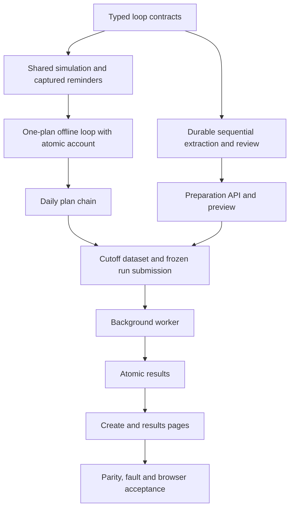

# Implementation Plan: Monitoring-loop Backtest

Status: implementation authorized on 2026-10-07, Asia/Shanghai, with isolation first. Business decisions come from [the proposal](../docs/specifications/backtesting/PROPOSAL-monitor-loop-backtest.md); final API approval and live/load acceptance remain pending. Executed checks: [verification](../docs/verification/monitor-loop-backtest.md). Chinese copy: [plan.zh-CN.md](plan.zh-CN.md). Active tasks: [todo.md](todo.md), IDs `ML-T01`–`ML-T39`; older completed tasks remain below them.

Whole-delivery acceptance gaps were recorded in [MV10](../docs/verification/monitor-loop-backtest.md#mv10-complete-acceptance-gap-register); current isolation wrap-up evidence is in [MV12](../docs/verification/monitor-loop-backtest.md#mv12-isolation-wrap-up-and-contract-review). The narrower startup-decoupling acceptance is [MV11](../docs/verification/monitor-loop-backtest.md#mv11-startup-decoupling-acceptance-only): **PASS**, with real application startup/restart, damaged-resource and cached first-use failure evidence recorded. Whole-delivery business/resource tasks are not startup-acceptance prerequisites. Cancelled protection work stays excluded; identify proposed new scope explicitly.

## IP01. Outcome and delivery boundary

Upload the first plan and all follow-ups once; extract them sequentially with AI; review the resulting immutable plan chain; initialize the account from the first plan; replay historical monitoring with daily plan updates, reminders, simulated responses and atomic account feedback. Carry forward a still-valid plan on missing-update days. The end date is optional and resolves once at run submission in Asia/Shanghai.

Deliver one complete path through preparation, existing backtest jobs, API, the existing `/backtests/new` page and results. Keep the single-plan live workflow and frozen historical runs compatible. Start with one symbol/account per run; no shared multi-symbol capital. Whole-quantity simulation and supported technical conditions retain the proposal's limits. An imported unsupported clause is a visible limitation or admission blocker, never silently discarded.

The earlier empty-WAL fix and CLI removal are already committed on main at the analysis baseline. The working tree has separate uncommitted Shengxin research artifacts; preserve them outside this task. The design update itself authorized no code; the user subsequently authorized implementation with strict slice boundaries. On 2026-10-07 the user subsequently authorized cleanup, commits and GitHub push of the current changes. Deployment remains outside this task. The existing plan and completed historical task record are retained and extended.

## IP02. Code findings that determine implementation order

| Existing location | Finding | Implementation consequence |
|---|---|---|
| `ai/plan_extraction.py`, `ai/extraction.py` | One-source extraction, source bindings and strict output validation already exist. | Add an explicit update-extraction contract; do not send all plans together or change old prompt meaning. |
| `web/ai_service.py` | Existing extraction uses process-local operations and one concurrent extraction slot. | A persistent preparation batch needs its own durable item state, reuses the extraction guards and runs sequentially. A new global AI budget is not a resource-isolation prerequisite. |
| `backtest/run_input.py` | One `plan_snapshot`, positive cash, run formulas v1–v4. | Introduce a separate loop input; allow explicit zero cash and separately represented unknown cash. Never use dummy cash. |
| `backtest/research_session.py` | One active plan; `_enqueue` is suppressed; execution calls a private HTTP helper. | Add a loop session with captured reminders and a shared application-level simulation participant. |
| `web/daily_service.py`, `state/daily_accounting.py` | Current execution checks and inventory transitions already exist. | Extract minimally, then prove online parity before adding research cash commitment. |
| `backtest/research_valuation.py` | Money changes after a monitoring receipt; initial valuation uses lot cost. | New mode needs atomic money/inventory updates and distinct historical cost versus opening market value. |
| `backtest/dataset.py`, historical profile validation | Current historical readiness is based on full-session evidence/profile rules. | Today's cutoff requires explicit partial-terminal-session coverage; never weaken existing full-session readiness. |
| `backtest/jobs/models.py` | Serialized job requests are capped at 256 KiB. | Store a frozen chain separately; queue a bounded verified reference rather than all plan text/snapshots. |
| `backtest/results.py` | Persisted inputs, publication checks and projections assume a single input model. | Extend decoding, verification and retention together; a new runner alone is insufficient. |
| `backtest/composition.py` | Submission already reserves idempotency before reading/fixing inputs. | Resolve the default end/cutoff once inside that reservation and reuse it on retry. |

Paths in this table are relative to `src/trade_plan_monitor/`.

## IP03. Architecture and vertical delivery slices



Implement in task order. First prove the risky reminder → fill → account → next evaluation path using manually constructed, reviewed test snapshots; this is a development fixture, not the final user's workflow. Then connect real batch preparation. Each slice has an executable check before the next slice depends on it. No proactive parallel-agent work is planned.

Preparation may call the configured AI provider only when explicitly submitted by a user. All development checks use fake responses. Replay never calls AI, market providers or notification channels; data acquisition stays in the existing separate sync operation.

## IP04. Models, storage and identity

### IP04.1 Typed contracts

Add focused modules rather than expanding the legacy runner into another large branch:

| Proposed module | Responsibility |
|---|---|
| `backtest/loop_input.py` | Immutable loop run, initial account, schedule references, response/fee settings and canonical identity. |
| `backtest/plan_schedule.py` | First-plan start, daily effective version, continuation, end/cutoff resolution and calendar transitions. |
| `backtest/preparation_models.py` | Batch/item/review state and change operations with source/base bindings. |
| `ai/plan_update_extraction.py` | First/follow-up extraction adapter with bounded historical context and separate prompt identity. |
| `backtest/plan_updates.py` | Deterministic application of validated add/modify/revoke/retain operations. |
| `backtest/loop_session.py`, `backtest/loop_runner.py` | Isolated current monitor participants and chronological event orchestration. |
| `backtest/reminder_capture.py`, `backtest/response_policy.py` | Delivery eligibility, captured reminder identity and delayed full-quantity intents. |
| `backtest/loop_account.py`, `backtest/loop_report.py` | Atomic monetary participant and typed audit/performance projection. |

Names are proposed new files unless already present when implementation starts. Python contracts are frozen/strict; no arbitrary dictionaries as public payloads. Money uses integer fen with exact Decimal calculations; initial unit cost retains its original precision through the exact total cost. Review status, extraction status and simulation authority are separate values.

Use proposed discriminators `monitor-loop-input-v1`, `monitor-loop-report-v1` and run hash domain `backtest-run-v5`, subject to a collision check in ML-T01. Preserve old v1–v4 encodings byte-for-byte. New public modes do not expose internal schema numbers as product choices. Hash semantic input and frozen policies; keep provider attempt IDs, batch UUIDs and task time outside semantic event identity. Future plan changes must not rename earlier events.

### IP04.2 Storage ownership

- **Preparation:** a separate `backtest-preparation.sqlite3` beside the configured backtest stores. It owns batches, item revisions, attempts, candidate changes, reviews and frozen manifests. Use a tagged schema/version and path-domain checks; refuse a live/market/result database path. Do not add preparation tables to the live monitor database. New empty-store initialization is supported; migrating an existing user database is not part of a development test.
- **Replay session:** a private temporary SQLite session. Store money entries and monitor inventory/signal/risk updates on the same connection and transaction. The shared execution participant must not commit internally; the owning research unit of work controls commit/rollback.
- **Submitted input:** copy the approved manifest and complete canonical loop input into durable result/input storage before acknowledging job submission. An immutable `(run_id, input_hash)` reference is sufficient for the queue; the worker must not depend on a mutable preparation batch. Atomic reservation binds this reference before queue admission. An interrupted reservation leaves either a recoverable binding or a collectable unreferenced artifact.
- **Results:** reuse existing staging and atomic completion. Extend input codecs and publication validation explicitly for the new discriminator. Prefer existing JSON storage where its schema safely supports it; any necessary result-store revision needs a documented migration and old-store fixture tests, not opportunistic `ALTER TABLE` at startup.
- **Retention:** retain the latest 30 materialized historical runs in total; after new publication, reuse bounded maintenance to remove the oldest excess runs with their summaries, fills and details. Pins do not exempt a run from the cap. Retained runs protect their input chains; pruning preparation cannot break a retained run or its compatible export. Protect queued/running job references and shared datasets/snapshots. Existing failed/canceled staging and job/idempotency expiry remain unchanged. No byte-based disk/log budget or free-space admission gate is added; the count policy belongs to ML-T21 and does not block ML-T34 isolation.

### IP04.3 Proposed bounded defaults

Before introducing constants, ML-T01 checks existing stricter limits; the new mode never increases legacy limits implicitly. Proposed first-release caps: 256 source plans per batch, 8 MiB total UTF-8 source bytes, existing 150,000-character per-source ceiling, one active AI extraction per batch, and at most 3 total attempts per item for retryable failures. Preserve ordinary extraction's existing concurrency guard. Semantic ambiguity goes directly to review. A timeout with an unknown provider outcome is recorded and is not blindly retried after restart.

Keep the 256 KiB job request limit, 200 initial lots, safe integer range and 70,000 monitoring evaluations including state refreshes. Bound each of captured reminders, response intents and execution attempts to 70,000 per run; stream records and fail visibly before exceeding a bound. These are proposed new-mode capacities, not claims of existing benchmark coverage. Test boundaries without replaying the unrelated expensive full-capacity suite.

## IP05. Extraction, review and execution algorithms

### IP05.1 Sequential preparation

Persist the batch and ordered source hashes first. Claim one item with a revision/generation fence; call AI outside transactions. The first item emits explicit initial-account facts and a rule candidate. A follow-up sees its own text and a validated predecessor with original evidence bindings, never future sources. Validate the returned diff and materialize a complete version. A late result for a changed source/base is rejected.

Reuse existing clause/field review semantics through an application participant that accepts the candidate and its multi-source evidence bundle. Bind inherited fields to their original text and the reviewed inheritance scope; never relabel inherited evidence as current-source text or create fake `HUMAN_SUPPLEMENT` evidence. A validated candidate can support extraction of its successor, but only a reviewed manifest can authorize replay. Batch review previews every effective snapshot and binds the chain hash; editing any ancestor invalidates affected dependent approvals.

Persist per-item progress/retry state. Restart reclaims unfinished work with a new generation and rejects stale completion. Preserve prior successful items. Separate request failure, semantic ambiguity and unknown provider outcome; expose actionable status instead of silently skipping a plan. Extract batch items sequentially and reuse existing extraction guards; introducing cross-entry global AI quota infrastructure does not gate resource isolation.

### IP05.2 Event loop and daily changes

Generate market-availability, calendar, plan-switch and permitted external-evidence events. At each timestamp: expose evidence/calendar → apply scheduled lifecycle changes → evaluate shared monitor → recheck/capture reminders → process ready intents → commit/refresh state → audit/valuation. Same-version continuation preserves occurrences; real replacement invalidates old ordinary intents while preserving account and risk obligations. A next-session signal invalidated by morning replacement is reported as such, not silently carried to a new version.

The response policy creates one stable intent per authorized occurrence and rechecks risk targets. The first eligible minute interval must start at or after the response ready time; consume its close only after availability. No signal-generating bar fill, arbitrary conflict ordering, partial substitute quantity or zero-time loop. Current shared checks still control T+1, CORE, capacity, risk and authority.

Compute price/slippage/fees and sufficient cash before mutation. In one private transaction: recheck revisions/eligibility → apply cash and lot changes → consume signal/fulfil risk → write receipt/audit → commit. Fault injection between any writes must leave all unchanged. A repeat intent returns the same result, not a second fill. Online simulation keeps its current behavior; the research-only monetary participant does not silently add a cash account to live monitoring.

### IP05.3 Coverage and end date

Preserve old full-session manifests. For the new loop mode, freeze a separately discriminated coverage description containing the resolved end and availability cutoff, complete historical sessions and an optional partial terminal session. Validate every required completed interval up to that cutoff; not-yet-completed intervals are outside scope, while missing required intervals are gaps. Preserve provider normalization and calendar semantics; do not label a partial session as a complete verified day. No network acquisition occurs in the replay worker.

At submission, resolve the default end/cutoff once after the idempotency reservation. A duplicate submitted tomorrow returns the original resolved input. Use the then-available complete evidence and report actual final evidence/mark times. Stop at the cutoff, retain open holdings and unfilled intents, and never invent a final liquidation. Opening market value and accounting cost remain distinct; a zero equity denominator yields no percentage return rather than division by zero.

## IP06. Application interfaces and page boundaries

Proposed new preparation resources, to be frozen in schema/API tasks before UI coding:

| Operation | Proposed path / purpose |
|---|---|
| Create preparation | `POST /api/v1/backtest-preparations` — ordered bounded source items; return durable identity and status. |
| Read progress/items | `GET /api/v1/backtest-preparations/{id}` and `GET /api/v1/backtest-preparations/{id}/items` — bounded paginated projections. |
| Correct source/schedule | `PATCH /api/v1/backtest-preparations/{id}/items/{itemId}` — expected revision; invalidate descendants. |
| Start/resume/retry extraction | `POST /api/v1/backtest-preparations/{id}/extraction-requests` — expected batch revision and optional failed item identity; stable idempotency. |
| Cancel preparation work | `POST /api/v1/backtest-preparations/{id}/cancellations` — stop new calls and fence late responses. |
| Review/freeze | `POST /api/v1/backtest-preparations/{id}/review-confirmations` — exact chain/source/evidence/revision bindings. |
| Submit replay | Existing `POST /api/v1/backtest-runs` with an additive discriminated loop command referencing the reviewed preparation revision, optional `endDate`, dataset and response settings. |

These paths are proposed, not current endpoints. The server is authoritative for eligibility, initial facts, merge results and resolved dates. Reuse same-origin/mutation guards, request idempotency and the existing error envelope. Body/schema/semantic validation errors use existing validation conventions; missing resources are 404, stale/conflicting revisions or payload reuse are 409, unavailable configured services are 503. No HTTP input accepts filesystem paths. Do not leak provider secrets, raw exceptions or arbitrary generated HTML.

The Web/API builds immutable reviewed-chain input and submits it to the existing background job coordinator. ML-T19 implements worker dispatch. Backtest CLI commands and dedicated compatibility logic are removed; no new CLI path or standalone command-owned coordinator is included.

| Vue responsibility | Proposed component/composable boundary |
|---|---|
| Upload ordered source plans | `PlanBatchSourceForm.vue`: source items in, edit/submit events out. |
| Item progress and retry | `PlanBatchProgress.vue`: server item states in, retry/cancel intents out. |
| Review changes and account | `PlanBatchReview.vue`: typed snapshots/diffs/issues in, correction/review intents out. |
| Preparation side effects | `usePlanBatch.ts`: API/polling/revision/error state; stop polling on unmount/terminal state. |
| Submit the run | Existing `BacktestRunForm.vue` / `useBacktestRunForm.ts`: reviewed chain, optional end and explicit assumptions. |
| Explain the run | `MonitorLoopTimeline.vue`, `PlanVersionTimeline.vue`: paginated event/version projections; existing charts use server valuation. |

Keep route views as composition surfaces. Use Vue Composition API, TypeScript and `<script setup>`; props down/events up. Do not reproduce plan merging, cash checks or reminder decisions in the browser.

## IP07. Task sequence and checkpoints

The authoritative checkboxes and file lists are in [todo.md](todo.md). Each task is limited to about five primary files including tests; split further if additional independent behavior or contract artifacts expand that scope.

| Checkpoint | Tasks | Working result / gate |
|---|---|---|
| ML-C01 | ML-T01–ML-T03 | Typed input plus shared simulation/recording adapters; online regression unchanged. |
| ML-C02 | ML-T04–ML-T06 | Offline one-plan and daily-chain cycles, atomic cash/inventory, no scripted future trades. |
| ML-C03 | ML-T07–ML-T09 | Durable preparation, bounded update extraction, traceable merged versions. |
| ML-C04 | ML-T10–ML-T12 | Restartable batch/review and real preparation API with fake AI. |
| ML-C05 | ML-T13–ML-T15 | Generated preparation contracts and upload/progress/review UI. |
| ML-C06 | ML-T16–ML-T18 | Cutoff-aware data, durable canonical input references and idempotent submission. |
| ML-C07 | ML-T19–ML-T21 | Worker to atomic stored report; cancellation publishes nothing complete. |
| ML-C08 | ML-T22–ML-T24 | Result APIs, unchanged existing export compatibility, generated contracts and normal run creation UI. |
| ML-C09 | ML-T25–ML-T27 | Results timeline, independent parity/fault checks and browser journey. |
| ML-C10 | ML-T28–ML-T29 | Bilingual operating evidence and reviewed contract/snapshot alignment. |

A failed gate is investigated before dependent work; no skipped assertion or downgraded invariant substitutes for evidence. Checkpoints are technical verification points, not automatic requests for permission after every few tasks. Genuine product-scope changes are surfaced with a concrete diff.

## IP08. Verification, known risks and completion

Use new focused pytest tests named in tasks, existing unified runtime/simulation/replay parity and frozen compatibility tests, fake-AI extraction tests, generated schema checks, Vitest, type checking/build, and a fake-provider Playwright journey. New test filenames are planned outputs and are not claimed to exist yet. Documentation-only planning runs no application suite or paid external requests.

Standard final commands from `trade-plan-monitor/`:

```text
.venv/Scripts/python.exe -m pytest tests/unit tests/contract -q -m "not live"
.venv/Scripts/python.exe -m pytest tests/integration/test_unified_runtime.py tests/integration/test_unified_simulation_transactions.py tests/integration/test_unified_replay.py tests/integration/test_unified_replay_parity.py tests/integration/test_backtest_compatibility.py tests/integration/test_openapi_snapshot.py -q -m "not live"
.venv/Scripts/python.exe -m ruff check src tests scripts
.venv/Scripts/python.exe scripts/generate_frontend_types.py --check
npm --prefix web run test -- --run
npm --prefix web run type-check
npm --prefix web run build
npm --prefix web run test:e2e
git diff --check
```

Run all newly added focused tests as well. Broaden integration only for changed shared participants. Preserve unaffected costly capacity evidence; do not relabel it as a new performance test. Do not run the entire expensive capacity suite by default.

| Risk / known limitation | Required treatment |
|---|---|
| AI inheritance drops or invents clauses | Multi-source bindings, explicit diff scope, independent semantic fixtures and human review. |
| Daily replacement cancels yesterday's ordinary signal | Retain documented behavior and explain cancellations in report; do not silently transfer authority. |
| Source mentions partial fills/fundamental exits | Explicitly classify unsupported clauses; obtain a scoped reviewed plan before execution. No claim to replay the entire Shengxin source under a narrower engine. |
| Money and inventory diverge on failure | Same transaction plus independent before/after and injected-failure assertions. |
| Current-date input is not a full trading day | New cutoff coverage discriminator and time-boundary fixtures; old profile unchanged. |
| Preparation result arrives after edit/restart | Source/base/revision/generation fences and stable per-intent idempotency. |
| OpenAPI approval and final interface review | MV12 reviewed and corrected the stale approval for the committed unified research API; preserve that historical failure separately. Review future monitoring-loop API differences before recording a newly approved digest in both languages; never silently stamp an unreviewed digest or alter the test. |
| Global input grows past queue limit | Frozen input reference plus hash verification and retention pinning. |

Completion requires ML-A01–ML-A24 evidence, working user-facing preparation/replay/results, preserved legacy bytes, and explicit unsupported-source/data limitations. No broker execution, real notifications, real AI certification, production migration or deployment is implied.

## IP09. Selected thread isolation and delivery order

The user selected same-process isolation with dedicated threads and preparation only on first explicit backtest use on 2026-10-07. ML14–ML17 and [ADR 0008](../docs/decisions/0008-isolate-backtest-service-lifecycle.md) now describe that choice. A child process is neither selected nor a mandatory later stage. Startup coupling comes from all-or-nothing lifecycle composition, not an inherent dependency of monitoring on replay.

Keep ML-T01–ML-T39 and completed history; revise pending isolation tasks in place. Deliver ML-T30 → ML-T31 → ML-T32 → ML-T33 → ML-T34: contracts, inert startup and first-use activation, bounded thread ownership, drain-aware recovery/cancellation, existing finite-work guard regression and local historical-sync pacing. ML-C11 verifies independent startup/ownership; ML-C12 verifies safe recovery and bounded admission. Existing business tasks retain their dependency graph: ML-T01 follows ML-T30, ML-T10/ML-T19 require ML-T34, and ML-T12/ML-T18 require ML-T33.

ML-T35 exposes service status/control after preparation/run APIs; ML-T39 generates transport contracts before ML-T36 UI. ML-T27 includes degradation/recovery navigation. ML-T37 validates the Windows thread/fault/load envelope, ML-T38 records operations. ML-T28 requires ML-T37, ML-T29 requires ML-T38/ML-T39. ML-C10 is final review, not permission to bypass unresolved gates.

| Added checkpoint | Tasks | Gate |
|---|---|---|
| ML-C11 | ML-T30–ML-T32 | Startup/status/shutdown opens no backtest resources; concurrent first use initializes once with metadata/execution separated, no child process or CLI. |
| ML-C12 | ML-T33–ML-T34 | Cancellation/publication fencing, physical drain before replacement, existing finite-work guard regression and local historical-sync pacing. |
| ML-C13 | ML-T35–ML-T39 | Independent API/UI, Windows fault/load measurements and paired recovery guidance. |

Composition changes: lifespan registers an inert lazy backtest manager only. First actual data/operation use requests single-flight preparation on lazily created owned executors; metadata reads never activate execution. Publish capability bindings only when ready. Keep the existing coordinator, repository executor, durable queue/result database and atomic publication. Separate backtest exception/cleanup ownership from monitoring. Application startup performs no backtest validation/I/O/warm-up or queue recovery. New submission authorizes its own job; historical pending jobs resume only after explicit selected authorization, never from a history read.

ML-T33 decision and verification, 2026-10-07: expired historical RUNNING/CANCEL_REQUESTED records remain unchanged and dormant until explicitly selected; they no longer occupy the execution slot. An unexpired or unknown/null lease blocks both new claims and selected recovery. The coordinator must wait for its physical worker to return even after lease expiry; manager replacement still requires physical drain. Selected recovery filters authorized IDs before ordering, preserves 30-second leases/at most 3 claim generations, and cannot revive old tokens for heartbeat/progress/publication. Existing cancellation and idempotency rules remain. No new status, schema migration or public API is required. ML-T33, ML-T34 and ML-C12 pass the offline checks in MV12; public controls/UI and full load acceptance remain separate tasks.

Initialization timeout and cancellation do not stop a thread. Track outstanding physical work, preserve stores needed by late workers, and forbid replacement until drain. Whole-process restart remains an explicit last resort for non-cooperative work and affects monitoring. No hard per-thread CPU/memory cap, IPC, spawn, Job Object or process-recovery promise is included.

On 2026-10-07 the user confirmed that low-frequency AI extraction is not a resource-isolation blocker and narrowed the live-capacity item to local historical-sync pacing. Preserve ordinary extraction guards and sequential batches. Keep monitoring request control unchanged. ML-T34 adds only a fixed minimum interval between serial sync request starts, reusing the existing 1.25-second pacing value, cancellation and timeout/error handling. No global quota pool, reserved capacity, cross-business scheduler, shared cooldown, account/interface registry, adaptive allocation or quota UI is planned. No new AI/monitor connection or general admission framework is required; implement in `backtest/sync.py`. Fake-call tests cover spacing and cancellation; whole-load acceptance stays separate. Replay has no network/AI/live-notification capabilities. Windows evidence uses temporary stores and fake services; paid requests and production migration remain outside scope. Current cleanup/commit/push authorization is recorded in IP01.

Completion requires ML-A01–ML-A24, 39 tasks and 13 checkpoints. The committed unified research API approval mismatch is resolved in MV12; future service/preparation API differences still require concrete final review before digest changes. Document checks validate paired IDs/dependencies/commands/files, unchanged completed history and relative links. Executed offline application/fault checks and remaining load work are distinguished in the verification record.

On 2026-10-07 the user limited exports to existing compatibility, with no new development. ML-T22 adds paginated loop result/detail APIs only; no new loop export format, download UI, bulk packaging, export jobs/scheduler or export mutex admission. Browser/load scope adds no export journey. Same-batch preparation must be reviewed and frozen before replay; submitted immutable inputs do not depend on a mutable batch. Preparing another batch and replaying an already frozen run have no inherent business conflict. Remove the proposed blanket preparation/replay mutex from this release; no measured contention evidence justifies it. Retain the existing single active sync/verify/replay slot and batch-level revision/freeze protections. Do not add a cross-operation lock, queue or scheduling layer. This scope update changes documentation only.

Storage scope, 2026-10-07: preserve existing independent default databases, path normalization and storage-domain rejection only. Add no deep Windows file-identity or cross-file alias checker. Existing guard regression remains in ML-T34; no new storage-protection implementation is required. The user subsequently adopted existing-only memory safeguards: retain finite inputs/events/queues, single execution, bounded threads and paging; remove new dynamic CPU/memory pressure admission/cancellation and the generic resource-control module. Keep offline load verification to measure actual contention. ML-T34 now adds only local sync pacing plus regression of existing guards.

On-demand details: ML16 defines NOT_INITIALIZED/READ_READY, single-flight/503 retry, inert status/prefetch/shutdown and explicit backlog resume. Existing pending tasks retain IDs/dependencies; no new conflict list is created.
