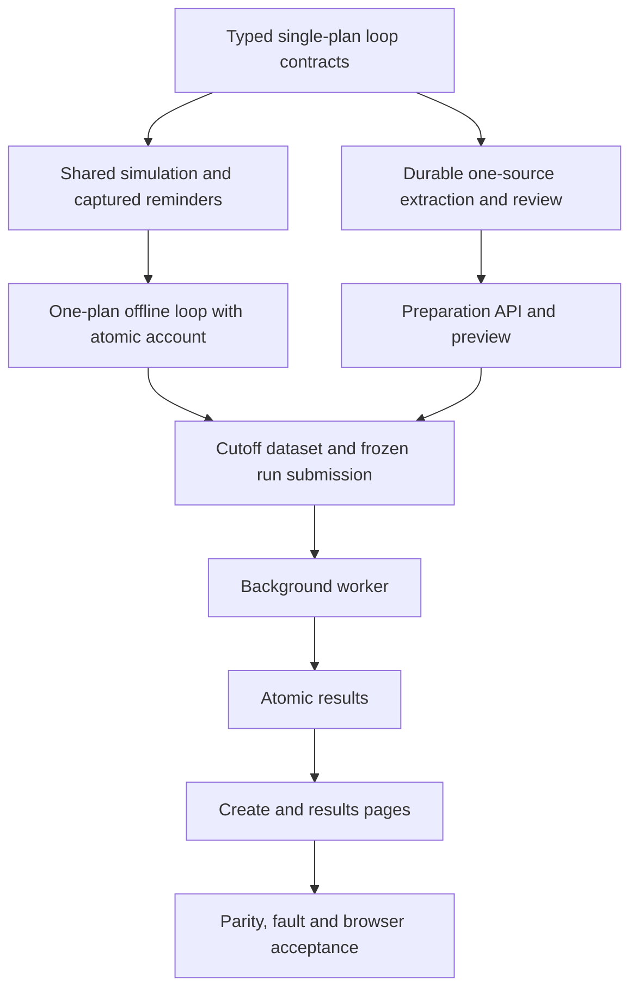

# Implementation Plan: Monitoring-loop Backtest

Status: implementation authorized on 2026-10-07, Asia/Shanghai, with isolation first. Business decisions come from [the proposal](../docs/specifications/backtesting/PROPOSAL-monitor-loop-backtest.md); final API approval and live/load acceptance remain pending. Executed checks: [verification](../docs/verification/monitor-loop-backtest.md). Chinese copy: [plan.zh-CN.md](plan.zh-CN.md). Active tasks: [todo.md](todo.md), IDs `ML-T01`–`ML-T39`; older completed tasks remain below them.

Whole-delivery acceptance gaps were recorded in [MV10](../docs/verification/monitor-loop-backtest.md#mv10-complete-acceptance-gap-register); current isolation wrap-up evidence is in [MV12](../docs/verification/monitor-loop-backtest.md#mv12-isolation-wrap-up-and-contract-review). The narrower startup-decoupling acceptance is [MV11](../docs/verification/monitor-loop-backtest.md#mv11-startup-decoupling-acceptance-only): **PASS**, with real application startup/restart, damaged-resource and cached first-use failure evidence recorded. Whole-delivery business/resource tasks are not startup-acceptance prerequisites. Cancelled protection work stays excluded; identify proposed new scope explicitly.

## IP01. Outcome and delivery boundary

Upload one plan; extract and explicitly review its complete immutable snapshot; initialize the account once; replay historical monitoring, reminders, simulated responses and atomic account feedback under that fixed plan. It may span multiple trading days while valid. The end date is optional and resolves once at run submission in Asia/Shanghai. The user cancelled daily switching, predecessor inheritance/merge and simultaneous multi-plan backtesting on 2026-10-07.

Deliver one complete path through preparation, existing backtest jobs, API, the existing `/backtests/new` page and results. Keep the single-plan live workflow and frozen historical runs compatible. Start with one symbol/account per run; no shared multi-symbol capital. Whole-quantity simulation and supported technical conditions retain the proposal's limits. An imported unsupported clause is a visible limitation or admission blocker, never silently discarded.

The earlier empty-WAL fix and CLI removal are already committed on main at the analysis baseline. The working tree has separate uncommitted Shengxin research artifacts; preserve them outside this task. The design update itself authorized no code; the user subsequently authorized implementation with strict slice boundaries. On 2026-10-07 the user subsequently authorized cleanup, commits and GitHub push of the current changes. Deployment remains outside this task. The existing plan and completed historical task record are retained and extended.

## IP02. Code findings that determine implementation order

| Existing location | Finding | Implementation consequence |
|---|---|---|
| `ai/plan_extraction.py`, `ai/extraction.py` | One-source extraction, source bindings and strict output validation already exist. | Reuse complete-plan extraction and extend only explicit opening-account facts; no update/inheritance contract. |
| `web/ai_service.py` | Existing extraction uses process-local operations and one concurrent extraction slot. | Persist one preparation candidate/revision and reuse extraction guards; no new global AI budget. |
| `backtest/run_input.py` | One `plan_snapshot`, positive cash, run formulas v1–v4. | Introduce a separate loop input; allow explicit zero cash and separately represented unknown cash. Never use dummy cash. |
| `backtest/research_session.py` | One active plan; `_enqueue` is suppressed; execution calls a private HTTP helper. | Add a loop session with captured reminders and a shared application-level simulation participant. |
| `web/daily_service.py`, `state/daily_accounting.py` | Current execution checks and inventory transitions already exist. | Extract minimally, then prove online parity before adding research cash commitment. |
| `backtest/research_valuation.py` | Money changes after a monitoring receipt; initial valuation uses lot cost. | New mode needs atomic money/inventory updates and distinct historical cost versus opening market value. |
| `backtest/dataset.py`, historical profile validation | Current historical readiness is based on full-session evidence/profile rules. | Today's cutoff requires explicit partial-terminal-session coverage; never weaken existing full-session readiness. |
| `backtest/jobs/models.py` | Serialized job requests are capped at 256 KiB. | Store the frozen snapshot separately; queue a bounded verified reference rather than raw text/snapshots. |
| `backtest/results.py` | Persisted inputs, publication checks and projections assume a single input model. | Extend decoding, verification and retention together; a new runner alone is insufficient. |
| `backtest/composition.py` | Submission already reserves idempotency before reading/fixing inputs. | Resolve the default end/cutoff once inside that reservation and reuse it on retry. |

Paths in this table are relative to `src/trade_plan_monitor/`.

## IP03. Architecture and vertical delivery slices



Implement in task order. First prove reminder → fill → account → next evaluation using one manually constructed reviewed snapshot; it is a development fixture, not the final user workflow. Then connect real one-source preparation. Each slice has an executable check before dependent work. No proactive parallel-agent work is planned.

Preparation may call the configured AI provider only when explicitly submitted by a user. All development checks use fake responses. Replay never calls AI, market providers or notification channels; data acquisition stays in the existing separate sync operation.

## IP04. Models, storage and identity

### IP04.1 Typed contracts

Add focused modules rather than expanding the legacy runner into another large branch:

| Proposed module | Responsibility |
|---|---|
| `backtest/loop_input.py` | Immutable one-plan run, opening account, initial binding, response/fee settings and canonical identity. |
| `backtest/plan_schedule.py` | One initial effective date, availability/validity, cross-day continuation and end/cutoff resolution; reject second entries. |
| `backtest/preparation_models.py` | One source/candidate/review state with revision and evidence bindings. |
| `ai/loop_plan_extraction.py` | Complete single-plan extraction adapter with explicit initial-account facts and separate versioned prompt identity. |
| `backtest/loop_session.py`, `backtest/loop_runner.py` | Isolated current monitor participants and chronological event orchestration. |
| `backtest/reminder_capture.py`, `backtest/response_policy.py` | Delivery eligibility, captured reminder identity and delayed full-quantity intents. |
| `backtest/loop_account.py`, `backtest/loop_report.py` | Atomic monetary participant and typed audit/performance projection. |

Names are proposed new files unless already present when implementation starts. Python contracts are frozen/strict; no arbitrary dictionaries as public payloads. Money uses integer fen with exact Decimal calculations; initial unit cost retains its original precision through the exact total cost. Review status, extraction status and simulation authority are separate values.

Use proposed discriminators `monitor-loop-input-v1`, `monitor-loop-report-v1` and run hash domain `backtest-run-v5`, with collision checks in ML-T01. Preserve old v1–v4 encodings byte-for-byte. New public modes do not expose internal schema numbers as product choices. Hash the single reviewed snapshot and frozen policies; keep provider attempt IDs, preparation UUIDs and task time outside semantic event identity. Future market evidence cannot rename earlier events.

### IP04.2 Storage ownership

- **Preparation:** separate `backtest-preparation.sqlite3` beside configured backtest stores, owning one source's revisions, attempts, complete candidate, review and frozen manifest. Use tagged schema/version and existing path-domain rejection. No live-monitor tables or production migration during development tests.
- **Replay session:** private temporary SQLite, with money and monitoring inventory/signal/risk on one connection/transaction. The caller owns commit/rollback.
- **Submitted input:** copy the approved manifest and complete canonical single-plan input into durable storage before acknowledging submission. Queue immutable `(run_id, input_hash)` references under reservation; workers do not depend on mutable preparation. Interrupted reservations leave recoverable bindings or collectable unreferenced artifacts.
- **Results:** existing staging/atomic completion, with explicit new discriminator decoding/publication validation. Any required store revision needs documented migration and old-store fixtures, not opportunistic `ALTER TABLE` at startup.
- **Retention:** latest 30 materialized historical runs total; bounded maintenance removes oldest excess summaries/fills/details after publication. Pins do not bypass the cap. Retained runs protect their frozen inputs and compatible exports; protect queued/running references and shared datasets/snapshots. Failed/cancelled staging and job/idempotency expiry remain unchanged. No new byte/disk/log budget; ML-T21 retention does not block ML-T34 isolation.

### IP04.3 Proposed bounded defaults

First-release plan/source count is exactly one. Preserve the existing 150,000-character source ceiling and 8 MiB UTF-8 guard (the character ceiling is stricter for one source). Reject any second source/entry, including identical versions. Evidence hashes for the one reviewed plan retain their independent bounded collection. Reuse ordinary extraction concurrency/provider guards, one active call and at most 3 retryable attempts. Semantic ambiguity goes to review; unknown provider outcomes are persisted and not blindly retried after restart.

Keep the 256 KiB job request limit, 200 initial lots, safe integer range and 70,000 monitoring evaluations including state refreshes. Bound each of captured reminders, response intents and execution attempts to 70,000 per run; stream records and fail visibly before exceeding a bound. These are proposed new-mode capacities, not claims of existing benchmark coverage. Test boundaries without replaying the unrelated expensive full-capacity suite.

## IP05. Extraction, review and execution algorithms

### IP05.1 Single-source preparation

Persist one source/revision first. Claim it with revision/generation fences and call AI outside transactions. Extract one complete plan and explicit opening-account facts; no predecessor context, diff operations or successor materialization. Reject late results after edits/cancel/restart.

Reuse existing source/clause/field review semantics. Bind original evidence and exact source/content/account revisions; no invented `HUMAN_SUPPLEMENT` or approval. Freeze only an explicitly reviewed snapshot. Editing the source invalidates its candidate/review while submitted inputs remain immutable.

Persist progress, bounded retry and restart state. Distinguish request failure, semantic ambiguity and unknown provider outcome. Preserve extraction guards; no cross-entry global AI quota infrastructure gates isolation.

ML-T10 implementation is split before expansion: first extend the existing preparation document with optional worker ownership/progress and add an exact read of the existing job admission reservation; then connect owned extraction and the configured provider. The two increments each have four primary files, with seven unique files including shared tests. Existing preparation records remain readable; no new job kind, queue, database, public route or global AI budget is introduced. Retain the admission token until physical calls end and the durable outcome is recorded; unknown paid outcomes require explicit confirmation of previous work ending before recovery.

### IP05.2 Event loop under one fixed plan

Generate market-availability, calendar and permitted external-evidence events. At each timestamp: expose evidence/calendar → advance supported lifecycle state under the same frozen plan → evaluate shared monitoring → recheck/capture reminders → process ready intents → commit/refresh state → audit/valuation. Preserve activation and occurrences across days; respect expiry/deactivation without substituting another plan. No plan-switch events or successor intent transfer exist.

The response policy creates one stable intent per authorized occurrence and rechecks risk targets. The first eligible minute interval must start at or after the response ready time; consume its close only after availability. No signal-generating bar fill, arbitrary conflict ordering, partial substitute quantity or zero-time loop. Current shared checks still control T+1, CORE, capacity, risk and authority.

Compute price/slippage/fees and sufficient cash before mutation. In one private transaction: recheck revisions/eligibility → apply cash and lot changes → consume signal/fulfil risk → write receipt/audit → commit. Fault injection between any writes must leave all unchanged. A repeat intent returns the same result, not a second fill. Online simulation keeps its current behavior; the research-only monetary participant does not silently add a cash account to live monitoring.

### IP05.3 Coverage and end date

Preserve old full-session manifests. For the new loop mode, freeze a separately discriminated coverage description containing the resolved end and availability cutoff, complete historical sessions and an optional partial terminal session. Validate every required completed interval up to that cutoff; not-yet-completed intervals are outside scope, while missing required intervals are gaps. Preserve provider normalization and calendar semantics; do not label a partial session as a complete verified day. No network acquisition occurs in the replay worker.

At submission, resolve the default end/cutoff once after the idempotency reservation. A duplicate submitted tomorrow returns the original resolved input. Use the then-available complete evidence and report actual final evidence/mark times. Stop at the cutoff, retain open holdings and unfilled intents, and never invent a final liquidation. Opening market value and accounting cost remain distinct; a zero equity denominator yields no percentage return rather than division by zero.

## IP06. Application interfaces and page boundaries

Proposed new preparation resources, to be frozen in schema/API tasks before UI coding:

| Operation | Proposed path / purpose |
|---|---|
| Create preparation | `POST /api/v1/backtest-preparations` — exactly one source; durable identity/status. |
| Read progress/items | `GET /api/v1/backtest-preparations/{id}` and `GET /api/v1/backtest-preparations/{id}/items` — bounded projection of the single source. |
| Correct source/initial binding | `PATCH /api/v1/backtest-preparations/{id}/items/{itemId}` — expected revision; invalidate this candidate/review. |
| Start/resume/retry extraction | `POST /api/v1/backtest-preparations/{id}/extraction-requests` — expected preparation revision; stable idempotency. |
| Cancel preparation work | `POST /api/v1/backtest-preparations/{id}/cancellations` — stop new calls and fence late responses. |
| Review/freeze | `POST /api/v1/backtest-preparations/{id}/review-confirmations` — exact single-source/content/account/evidence/revision bindings. |
| Submit replay | Existing `POST /api/v1/backtest-runs` with an additive discriminated loop command referencing the reviewed preparation revision, optional `endDate`, dataset and response settings. |

These paths are proposed, not current endpoints. The server owns eligibility, initial facts, review and resolved dates. Reuse same-origin/mutation guards, request idempotency and existing error envelopes. Body/schema/semantic validation follows existing conventions; missing resources are 404, stale/conflicting revisions/payload reuse 409, unavailable configured services 503. No HTTP input accepts filesystem paths. Do not leak provider secrets, raw exceptions or arbitrary generated HTML.

The Web/API builds one immutable reviewed-plan input and submits to the existing background coordinator. ML-T19 dispatches workers. Backtest CLI commands/dedicated compatibility logic are removed; no new CLI or standalone command-owned coordinator.

| Vue responsibility | Proposed component/composable boundary |
|---|---|
| Upload one source plan | `PlanPreparationSourceForm.vue`: one source in, edit/submit events out. |
| Source progress and retry | `PlanPreparationProgress.vue`: server state in, retry/cancel intents out. |
| Review plan and opening account | `PlanPreparationReview.vue`: complete snapshot/evidence/issues in, correction/review intents out. |
| Preparation side effects | `usePlanPreparation.ts`: API/polling/revision/error state; stop on unmount/terminal state. |
| Submit the run | Existing `BacktestRunForm.vue` / `useBacktestRunForm.ts`: one reviewed snapshot, optional end and explicit assumptions. |
| Explain the run | `MonitorLoopTimeline.vue`: paginated causal events and frozen plan provenance; existing charts use server valuation. |

Keep route views as composition surfaces. Use Vue Composition API, TypeScript and `<script setup>`; props down/events up. Do not duplicate cash checks or reminder decisions in the browser.

## IP07. Task sequence and checkpoints

The authoritative checkboxes and file lists are in [todo.md](todo.md). Each task is limited to about five primary files including tests; split further if additional independent behavior or contract artifacts expand that scope.

| Checkpoint | Tasks | Working result / gate |
|---|---|---|
| ML-C01 | ML-T01–ML-T03 | Typed input plus shared simulation/recording adapters; online regression unchanged. |
| ML-C02 | ML-T04–ML-T05 | Complete one-plan cycle, atomic cash/inventory, no scripted future trades; ML-T06 cancelled. |
| ML-C03 | ML-T07–ML-T08 | Durable single-source preparation and complete source-bound candidate; ML-T09 cancelled. |
| ML-C04 | ML-T10–ML-T12 | Restartable single preparation/review and real API with fake AI. |
| ML-C05 | ML-T13–ML-T15 | Generated preparation contracts and upload/progress/review UI. |
| ML-C06 | ML-T16–ML-T18 | Cutoff-aware data, durable canonical input references and idempotent submission. |
| ML-C07 | ML-T19–ML-T21 | Worker to atomic stored report; cancellation publishes nothing complete. |
| ML-C08 | ML-T22–ML-T24 | Result APIs, unchanged existing export compatibility, generated contracts and normal run creation UI. |
| ML-C09 | ML-T25–ML-T27 | Results timeline, independent parity/fault checks and browser journey. |
| ML-C10 | ML-T28–ML-T29 | Bilingual operating evidence and reviewed contract/snapshot alignment. |

A failed gate is investigated before dependent work; no skipped assertion or downgraded invariant substitutes for evidence. Checkpoints are technical verification points, not automatic requests for permission after every few tasks. Genuine product-scope changes are surfaced with a concrete diff.

## IP08. Verification, known risks and completion

Use new focused pytest tests named in tasks, existing unified runtime/simulation/replay parity and frozen compatibility tests, fake-AI extraction tests, generated schema checks, Vitest, type checking/build, and a fake-provider Playwright journey. New test filenames are planned outputs and are not claimed to exist yet. Documentation-only planning runs no application suite or paid external requests.

Standard final commands from `trade-plan-monitor/`:

```text
.venv/Scripts/python.exe -m pytest tests/unit tests/contract -q -m "not live"
.venv/Scripts/python.exe -m pytest tests/integration/test_unified_runtime.py tests/integration/test_unified_simulation_transactions.py tests/integration/test_unified_replay.py tests/integration/test_unified_replay_parity.py tests/integration/test_backtest_compatibility.py tests/integration/test_openapi_snapshot.py -q -m "not live"
.venv/Scripts/python.exe -m ruff check src tests scripts
.venv/Scripts/python.exe scripts/generate_frontend_types.py --check
npm --prefix web run test -- --run
npm --prefix web run type-check
npm --prefix web run build
npm --prefix web run test:e2e
git diff --check
```

Run all newly added focused tests as well. Broaden integration only for changed shared participants. Preserve unaffected costly capacity evidence; do not relabel it as a new performance test. Do not run the entire expensive capacity suite by default.

| Risk / known limitation | Required treatment |
|---|---|
| AI extraction drops or invents clauses | Source-bound complete candidate, independent semantic fixtures and explicit human review. |
| Frozen plan expires during replay | End ordinary authority without replacement; preserve account/risk obligations and explain the boundary. |
| Source mentions partial fills/fundamental exits | Explicitly classify unsupported clauses; obtain a scoped reviewed plan before execution. No claim to replay the entire Shengxin source under a narrower engine. |
| Money and inventory diverge on failure | Same transaction plus independent before/after and injected-failure assertions. |
| Current-date input is not a full trading day | New cutoff coverage discriminator and time-boundary fixtures; old profile unchanged. |
| Preparation result arrives after edit/restart | Source/revision/generation fences and stable per-intent idempotency. |
| OpenAPI approval and final interface review | MV12 reviewed and corrected the stale approval for the committed unified research API; preserve that historical failure separately. Review future monitoring-loop API differences before recording a newly approved digest in both languages; never silently stamp an unreviewed digest or alter the test. |
| Global input grows past queue limit | Frozen input reference plus hash verification and retention pinning. |

Completion requires active ML-A01–ML-A24 evidence excluding cancelled ML-A07, working single-plan preparation/replay/results, legacy byte compatibility and explicit source/data limitations. No broker execution, real notifications, live AI certification, production migration or deployment is implied.

## IP09. Selected thread isolation and delivery order

The user selected same-process isolation with dedicated threads and preparation only on first explicit backtest use on 2026-10-07. ML14–ML17 and [ADR 0008](../docs/decisions/0008-isolate-backtest-service-lifecycle.md) now describe that choice. A child process is neither selected nor a mandatory later stage. Startup coupling comes from all-or-nothing lifecycle composition, not an inherent dependency of monitoring on replay.

Keep ML-T01–ML-T39 and completed history; revise pending isolation tasks in place. Deliver ML-T30 → ML-T31 → ML-T32 → ML-T33 → ML-T34: contracts, inert startup and first-use activation, bounded thread ownership, drain-aware recovery/cancellation, existing finite-work guard regression and local historical-sync pacing. ML-C11 verifies independent startup/ownership; ML-C12 verifies safe recovery and bounded admission. Existing business tasks retain their dependency graph: ML-T01 follows ML-T30, ML-T10/ML-T19 require ML-T34, and ML-T12/ML-T18 require ML-T33.

ML-T35 exposes service status/control after preparation/run APIs; ML-T39 generates transport contracts before ML-T36 UI. ML-T27 includes degradation/recovery navigation. ML-T37 validates the Windows thread/fault/load envelope, ML-T38 records operations. ML-T28 requires ML-T37, ML-T29 requires ML-T38/ML-T39. ML-C10 is final review, not permission to bypass unresolved gates.

| Added checkpoint | Tasks | Gate |
|---|---|---|
| ML-C11 | ML-T30–ML-T32 | Startup/status/shutdown opens no backtest resources; concurrent first use initializes once with metadata/execution separated, no child process or CLI. |
| ML-C12 | ML-T33–ML-T34 | Cancellation/publication fencing, physical drain before replacement, existing finite-work guard regression and local historical-sync pacing. |
| ML-C13 | ML-T35–ML-T39 | Independent API/UI, Windows fault/load measurements and paired recovery guidance. |

Composition changes: lifespan registers an inert lazy backtest manager only. First actual data/operation use requests single-flight preparation on lazily created owned executors; metadata reads never activate execution. Publish capability bindings only when ready. Keep the existing coordinator, repository executor, durable queue/result database and atomic publication. Separate backtest exception/cleanup ownership from monitoring. Application startup performs no backtest validation/I/O/warm-up or queue recovery. New submission authorizes its own job; historical pending jobs resume only after explicit selected authorization, never from a history read.

ML-T33 concurrency correction, 2026-10-07: the latest user instruction supersedes the earlier expiry-releases-slot choice in MV12. Every unfinished QUEUED/RUNNING/CANCEL_REQUESTED record retains admission, including expired/unknown leases. No different new task or mutually exclusive sync/verify/replay may start. Explicit recovery selects one existing job and waits for physical worker drain; terminal completion/failure/cancellation releases the slot. Preserve 30-second leases/at most 3 claim generations, stale-token, publication, cancellation and idempotency fences. Historical records remain unchanged; legacy pending records require explicit reconciliation before new admission. No new status/schema/public fields. Executed evidence: MV18 and ADR 0009; controls/UI and full load acceptance remain pending.

Initialization timeout and cancellation do not stop a thread. Track outstanding physical work, preserve stores needed by late workers, and forbid replacement until drain. Whole-process restart remains an explicit last resort for non-cooperative work and affects monitoring. No hard per-thread CPU/memory cap, IPC, spawn, Job Object or process-recovery promise is included.

On 2026-10-07 the user confirmed low-frequency AI extraction is not an isolation blocker and narrowed live-capacity work to local historical-sync pacing. Preserve ordinary one-source extraction guards and monitor request control. ML-T34 adds only a fixed minimum interval between serial sync starts using existing 1.25-second pacing, cancellation and timeout/error handling in `backtest/sync.py`. No global quota pool, reserved capacity, cross-business scheduler, shared cooldown, account/interface registry, adaptive allocation, quota UI or general admission framework. Fake calls verify spacing/cancellation; whole-load acceptance stays separate. Replay has no network/AI/live-notification capabilities. Windows checks use temporary stores/fake services; paid requests and production migration remain excluded. Cleanup/commit/push authorization is recorded in IP01.

Completion requires active ML-A01–ML-A24 excluding cancelled ML-A07, 37 active tasks and 13 checkpoints. All 39 task IDs remain registered; ML-T06/ML-T09 are cancelled, not completed. MV12 resolves the committed unified research API approval mismatch; future APIs require final concrete review before digest changes. Document checks validate paired IDs/dependencies/commands/files, original completed history and relative links. Distinguish executed offline/fault checks from remaining load work.

On 2026-10-07 the user limited exports to existing compatibility. ML-T22 adds paginated loop results/details only; no new export format/download UI/bulk packaging/jobs/scheduler/mutex. Preparation requires explicit review/freeze; immutable submitted inputs remain independent. The latest instruction nevertheless requires one unfinished task and rejects mutually exclusive preparation/sync/verify/replay before termination. Enforce existing entry/transaction boundaries without a new queue, scheduler or generic lock module. ML-T07/ML-T08/ML-T10 private persistence/extraction/owned orchestration pass MV20–MV22; semantic review/freeze and preparation integration remain pending ML-T11–ML-T15 and must inherit the same global admission rule.

Storage scope, 2026-10-07: preserve existing independent default databases, path normalization and storage-domain rejection only. Add no deep Windows file-identity or cross-file alias checker. Existing guard regression remains in ML-T34; no new storage-protection implementation is required. The user subsequently adopted existing-only memory safeguards: retain finite inputs/events/queues, single execution, bounded threads and paging; remove new dynamic CPU/memory pressure admission/cancellation and the generic resource-control module. Keep offline load verification to measure actual contention. ML-T34 now adds only local sync pacing plus regression of existing guards.

On-demand details: ML16 defines NOT_INITIALIZED/READ_READY, single-flight/503 retry, inert status/prefetch/shutdown and explicit backlog resume. Existing pending tasks retain IDs/dependencies; no new conflict list is created.

## IP10. Single-plan scope correction

On 2026-10-07 the user required single-plan replay only. This overrides prior chain/batch choices. ML-T06/ML-T09 and ML-A07 are cancelled, retaining IDs and historical evidence. Active dependencies/checkpoints exclude them. Preparation accepts one source, review freezes one snapshot, and one initial binding controls the entire run while valid. Calendar/account/response/expiry/causality/isolation/publication safeguards remain. On 2026-10-08, thirteen tasks are completed; 24 of 37 active tasks remain. ML-T05/ML-C02 pass the private single-plan cycle (MV19): reminder-derived buy/sell timing, risk priority/expiry maintenance, exact account feedback and finite bounds. ML-T07 passes private source/attempt/candidate/review persistence, restart/idempotency and pending-cancellation fences (MV20). ML-T08/ML-C03 pass versioned complete-plan/opening-account extraction, exact source evidence, unknown-fact/unsupported-clause blockers and persistence round-trip (MV21). ML-T10 passes durable generation/progress, existing global admission through physical drain, configured owned calls and explicit unknown-outcome recovery (MV22). Semantic review/freeze and API/UI/report integration remain pending; ML-T11 is next. MV18 records single-task admission cleanup.
