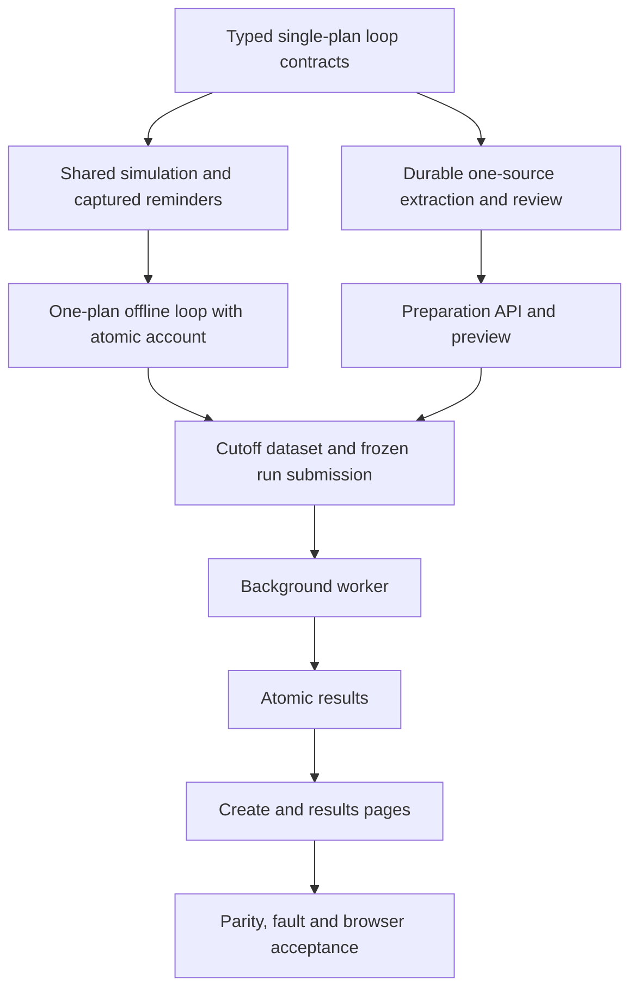

# Repair Plan: Restore Daily Plan Continuity

Current status — 2026-10-18, Asia/Shanghai: **functional acceptance complete within the agreed scope**, implementation baseline `7046d2e` merged into `main`. The 20 original repair tasks and delivered follow-up increments are complete. See [BA-01–BA-06](../docs/verification/2026-10-18-backtest-functional-acceptance.md) for scope, evidence and retained limits, and [current task status](todo.md). Chinese review copy: [plan.zh-CN.md](plan.zh-CN.md). Concrete API review remains recorded in RP-T14/U11. Dated progress below is historical; batch preparation and earlier scoped-execution limits are superseded by the linked acceptance record.


Implementation update, 2026-10-10: the user authorized this bounded repair in the current session. RP-T01 is complete: restored original ML01–ML13, concrete codec/order-edit matrix, 11 fixture checks and 14 fixture/legacy compatibility checks pass; deliberate 899500→899501 oracle mutation fails, exact bytes restored. Ruff, bilingual section/link checks and diff review pass. This validates the baseline only, not runtime continuity. **1 of 20 repair tasks complete.** Next: RP-T02. Historical planning-only authorization wording below is superseded by this instruction; concrete API review is still pending.

RP-T02 is complete: distinct v2 source/schedule/input codecs preserve v1 boundaries, canonical effective-day selection, first-day opening-account anchoring and causal authority. The independent review found and corrected nested subtype acceptance and skipped-first-day defects. 65 focused schedule/input/fixture/legacy compatibility checks pass; the successor-opening mutation is detected and restored. Ruff and diff checks pass. **2 of 20 repair tasks complete.** Next: RP-T03; RP-C01 is not yet passed.

RP-T03 is complete and RP-C01 passes: one private session traverses reviewed versions through the shared activation transaction, retains account/risk state, closes old ordinary intents and records context mismatches without inventing trades. Independent review corrected duplicate source snapshot identities and expired-event authority. 64 focused runtime/account/cycle/report/fixture/legacy checks pass, including 10 switch cases; deliberate removal of ordinary-intent closure fails and exact bytes are restored. Ruff and diff checks pass. **3 of 20 repair tasks complete.** Next: RP-T04. End-to-end preparation, publication and UI acceptance remain pending.

RP-T04 is complete: v2 ordered items share the existing tagged document store, preserve v1 records/receipts, enforce source and predecessor bindings, and invalidate only the changed suffix. Exact whole-chain review bindings and UNKNOWN/cancelling exclusion are checked. Independent review corrected constructed-source validation before persistence. 91 store/input checks pass; removing predecessor-base validation causes the expected failure and original bytes are restored. Ruff and diff review pass. **4 of 20 repair tasks complete.** Next: RP-T05. Sequential extraction and freezing remain RP-T07/RP-T08.

RP-T05 is complete: first-source extraction remains unchanged; follow-up extraction uses a distinct bounded contract containing only its source and validated past context, explicit scope/operations and non-authoritative account assertions. Independent review found and corrected cross-bucket quantity attribution and overlapping evidence. 144 extraction/provider checks pass, including 23 new follow-up cases; both account-attribution regressions failed before repair. Windows sandbox socket initialization blocked asyncio; the approved unsandboxed local fake-provider checks passed. Ruff and diff checks pass. **5 of 20 repair tasks complete.** Next: RP-T06; candidates remain unresolved until materialization and explicit review.

RP-T06 is complete and RP-C02 passes: deterministic full replacement and explicit add/modify/revoke/retain operations produce complete candidates and reviewable differences. Inherited fields retain original source spans, binding paths and human supplement hashes through index changes; later holdings remain comparison context. Independent review reproduced and corrected negated/hypothetical replacement and unsupported account-dependency attribution. 67 focused merge/binding/fixture/schedule checks pass, including 31 merge/binding cases and bounded evidence persistence through store restart. Narrow literal scope/dependency guards leave other wording unresolved for explicit review. Ruff and diff review pass. **6 of 20 repair tasks complete.** Next: RP-T07; worker integration and whole-chain freezing remain pending.

RP-T07 is complete. The user approved RP05-A01 on 2026-10-11; the two cancellation invariant regressions now pass. One owned operation processes items serially with source/base/generation fences, per-item retry budgets, explicit unknown recovery and exact edit receipts. Cancellation preserves validated predecessors and original attempt bindings, retains global exclusion until physical work ends, and rejects late completion. 169 preparation service/worker/store checks pass, including restart and real blocked fake-provider cancellation. Ruff, bilingual checks and independent diff review pass. **7 of 20 repair tasks complete.** Next: RP-T08.

RP-T08 is complete and RP-C03 passes: explicit item correction validates original source/base evidence, preserves the prefix and invalidates descendants; a separate explicit chain review freezes complete versions, provenance, schedule and one opening account. The frozen chain review hash binds account and extraction identities independently of causal version identity. Independent tests reproduced account/candidate tampering and six trusted-candidate source mismatches; all are fixed. 194 review/store/worker/legacy checks pass, including 30 collection cases. Ruff and independent diff review pass. **8 of 20 repair tasks complete.** Next: RP-T09; public collection endpoints remain RP-T12.

RP-T09 is complete: distinct scheduled dataset codecs freeze relevant plan bindings and the union of evidence requirements without changing v1 bytes. Each version checks history available at its activation; successor minute shortages stay visible without adding an admission gate. Frames follow only the currently selected version, and end-later sources do not affect the frozen dataset. 51 dataset/cutoff/publication/legacy checks pass, including 13 new cases. The missing successor minute warning was reproduced before repair. Ruff and independent diff review pass. **9 of 20 repair tasks complete.** Next: RP-T10.

RP-T10 is complete: the distinct stored-input codec copies the entire reviewed chain and immutable days, verifies exact account/schedule/requirements bindings, rejects copied-day swaps, and preserves v1 hashes. Composition uses the initial source and relevant requirement union under the existing reservation. The user approved RP05-A02 and standing authorization RP05-A03 on 2026-10-11; the two initial-snapshot lookups now support collection registration and reload. All 50 input-store/submission/legacy checks pass, including the two previously failing registration/submission cases. Ruff and independent diff review pass. **10 of 20 repair tasks complete.** Next: RP-T11.

RP-T18 allowances under RP05-A03: add `web/src/api/monitorLoopValues.ts` and `web/src/api/backtests.ts` for the approved v2 transport; `src/trade_plan_monitor/backtest/loop_publication.py`, `src/trade_plan_monitor/backtest/results.py`, `src/trade_plan_monitor/backtest/composition.py` and `tests/integration/test_monitor_loop_result_api.py` to project a complete verified v5 daily equity series through the existing bounded curve contract. Keep v4 behavior, unknown values, expiry, 2,000 points and 4 MiB limits. Correct only the review-test helper parameter type in `web/tests/unit/PlanPreparationReview.spec.ts`. RP-T19 also includes `tests/integration/test_monitor_loop_production_composition.py` solely for the real-browser fake-provider fixture. These are necessary repairs to RP-A08/original ML07–ML09, not new product scope.

RP-T19 reproduction allowance under RP05-A03: real complete-source extraction exposed missing SOURCE support for explicitly empty rule collections and false unsupported-capability warnings on an exact negative sentence. Add `src/trade_plan_monitor/ai/daily_review.py`, `src/trade_plan_monitor/ai/loop_plan_extraction.py`, and `src/trade_plan_monitor/ai/update_review.py` only for narrow literal evidence handling, with positive/negative tests in the existing production-composition fixture. No AI approval, inferred empty policy or unsupported trading capability is introduced. A later opening-account snapshot must also be verified against actual collection submission before any scoped start-time correction.

RP-T18 is complete: one continuous result shows the ordered version calendar, exact source/review bindings, replacement/continuation/no-authority events, account discrepancies and closed intents. A previously missing v5 curve now projects opening plus last daily valuations only after full event-chain verification in one read snapshot; unknowns and expiry remain explicit and v4 behavior is unchanged. All 37 result/publication checks and 61 result-component checks pass, along with full frontend type checking. Independent review passes. Fixture corrections use canonical timestamps, public equity projection and the existing 1,000-row retention batch; no assertion or limit is weakened. The earlier review-test helper type is corrected without behavioral changes. **18 of 20 repair tasks complete.** Next: RP-T19; full browser/business acceptance remains pending.

Independent adversarial regressions for the same RP-T19 evidence fixes may also use `tests/unit/test_daily_review.py` and `tests/unit/test_monitor_loop_extraction.py`; no other behavior or test threshold changes.

RP-T19 browser reproduction additionally requires `src/trade_plan_monitor/backtest/preparation_review.py`: the original-extraction reload and frozen v1 evidence validators must use the same narrowly scoped unsupported-source check. Otherwise a valid complete first source is incorrectly rejected as its successor context. No stored bytes or hash domains change.

RP-T19 also reproduces the third complete source failing on explicit inclusive-range Boolean evidence. The existing `daily_review.py` allowance covers only v5 `include_low`/`include_high` complete literal `path=true`/`path=false` SOURCE declarations, with adversarial unit checks; arbitrary Boolean inference remains rejected.

RP-T19 now reproduces HTTP 409 during whole-chain review with the original prior-evening source availability and first-day 09:00 opening account. Add `src/trade_plan_monitor/backtest/composition.py` and extend the existing `preparation_review.py` allowance only so v2 review/submission use the same maximum of source availability, first effective midnight and opening snapshot. Require that start remains on the first effective day; preserve v1 semantics and reject unavailable opening marks. This restores the declared RP-A09 input rather than shifting source dates.

Add `tests/integration/test_plan_preparation_review.py` only for independent first-day snapshot, later-day rejection and unavailable-opening-mark regressions for that RP-T19 start-time correction.

RP-T19 real-browser suffix retry reproduced HTTP 409 PREPARATION_ITEM_BINDING_CONFLICT after editing the third source. Add `web/src/composables/usePlanPreparation.ts` and `web/tests/unit/PlanPreparation.spec.ts` under RP05-A03 only to bind extraction to the current validated predecessor candidate from the complete revision-bound item list, rather than the invalidated item's cleared historical baseHash. Keep server checks, uncertain-command identity and retry limits unchanged.

RP-T19 is complete: the final real Chrome suite passes all 3 journeys (4.0 minutes), including four complete sources, middle-item retry, unchanged prefix/suffix invalidation, rejection of a competing unfinished operation, one chain review/submission, the literal continuous ledger and all 7 equity points. Console/page errors are empty. Full frontend: 1,028 passed; original 600/600-second load gates pass with 5 replay jobs. Independent review passes. **19 of 20 repair tasks complete.** Next: RP-T20 documentation reconciliation; no push.

RP-T20 is complete and RP-C07 passes: the operating guide now describes one ordered preparation, explicit whole-chain review, one continuous account/run, exact API discriminators, recovery and complete equity. RP-V20 maps RP-B01–RP-B10 to the original ML gates, including ML-A07/ML-A11/ML-A13/ML-A16–ML-A18 without cancellations. Independent bilingual review, section/literal/numeric/command/link parity and diff checks pass; both generated API profiles and the four U11 hashes remain exact. Historical failures and unrelated files are preserved. **20 of 20 repair tasks complete.** All required repair work is complete with local commits only; no push or deployment.

## RP01. Baseline and authority

The business baseline is ML01–ML13 in commit [e95de03](https://github.com/xiedc1227-bot/trade-plan-monitor/blob/e95de03ec809517cc0a3b2484c6145675418960c/docs/specifications/backtesting/PROPOSAL-monitor-loop-backtest.md), still present before narrowing in `0db69c9`. The implementation proposal at that commit supplies IP04–IP06 details, subject to the expressly retained constraints below. The 2026-10-10 user request requires a bounded repair of identified deviations. It does not authorize product expansion.

The fixed-version interpretation introduced in `91eca25` is withdrawn as a business requirement. Its statements that the user cancelled daily continuity are an assistant interpretation, not independent evidence of user authorization. Its executed checks remain historical evidence for that narrower implementation. They do not establish acceptance of the original workflow.

Terms are fixed: **task** = one admitted preparation/heavy operation or replay run; **plan version** = one immutable reviewed snapshot with an effective date; **continuous backtest** = one symbol, one account, one run identity/result, traversing the applicable versions in order. Preparing several versions does not create several replay jobs. Single-task exclusion continues to apply across preparation, sync, verification and replay.

Explicit later platform choices remain: same-process owned threads and lazy startup, one unfinished task including cancellation/unknown work, existing recovery/lease fences, local historical-sync pacing, latest 30 published results, existing export compatibility only, existing finite-work safeguards. Cancelled global quota, process-isolation, resource-pressure, disk-budget and log-budget projects do not return.

## RP02. Business rules that implementation must preserve

| ID | Required behavior | Original basis |
|---|---|---|
| RP-B01 | Supply the first and all follow-up sources in one preparation; extract sequentially; review the chain; submit once and receive one run/result. | ML01, ML09, ML13 |
| RP-B02 | Freeze source boundaries/order, hashes, authoring/availability times, effective dates, full accepted snapshots and evidence bindings before replay. Upload order, report date and import time are not substitutes for effective dates. | ML04, ML07, ML13 |
| RP-B03 | At each exchange-day boundary, apply that day's reviewed version before monitoring or execution. Carry forward the latest still-valid version when there is no update. The same version continues without reactivation; a changed version replaces it. | ML05, ML07 |
| RP-B04 | Initialize from the first source exactly once. Carry cash, lots, acquisition dates, sellability, costs and accumulated fees across versions. Later statements such as “now flat” are compared with the simulated account, never used to overwrite it. Incompatible account-dependent instructions remain blocked pending explicit interpretation. | ML04, ML07, ML-A13 |
| RP-B05 | Genuine replacement closes old ordinary authority and pending ordinary intents, including next-session daily intents. Preserve existing risk obligations; use the shared explicit reassessment rules. Draft edits do not switch the active plan. | ML05–ML07, ML-A07 |
| RP-B06 | Review complete replacements and explicitly supported updates with add/modify/revoke/retain differences and original evidence for inherited fields. Ambiguous scope cannot silently retain or remove rules. Reusing a rule ID does not transfer old execution authority. | ML13, ML-A16–ML-A18 |
| RP-B07 | Persist per-item progress and source/base revisions; retry only the affected item within existing limits. Editing an ancestor/order invalidates affected descendants and reviews. Stop dependent extraction on unresolved semantics; reject late results. Frozen submitted runs remain independent. | ML08, ML13 |
| RP-B08 | Preflight the union of required evidence for versions relevant to the run, but expose only the active version and then-available evidence to decisions. Freeze end/cutoff once at submission; future source/evidence changes cannot rename earlier semantic events. | ML04, ML08, ML-A04, ML-A11, ML-A15 |
| RP-B09 | Present a daily applicability preview and one causal report with version transitions, carry-forward/no-authority intervals, account-context differences and continuous account valuation. Preserve unknown/unsupported information visibly. | ML07, ML09 |
| RP-B10 | Preserve current shared monitoring, response modes, full-quantity fills, T+1, CORE, risk priority, costs, atomic settlement, cancellation and atomic publication. A plan update never invents strategy, trades or account facts. | ML03, ML05–ML08 |

Only complete trading-plan replies from the user's four-source example enter its acceptance input. Short position confirmations and incidental chat are not automatically promoted into versions. Restoring ML13 update semantics does not add a chat crawler or automatic conversation classifier.

A first source available intraday may initialize at its actual availability. Later content switches remain daily: a version must be available before the scheduled day's monitoring/execution; a later intraday source requires an explicitly corrected later effective day. Reject inconsistent dates; never silently shift dates or backdate availability. Sources after the frozen run end do not govern that run.

## RP03. Traceability from the nine deviations

| Deviation | Required repair | Tasks | Acceptance |
|---|---|---|---|
| One-source entry | One ordered preparation with multiple source items. | RP-T04, RP-T12, RP-T15, RP-T16 | RP-A01 |
| Independent extraction | Source-bound predecessor context and explicit changes. | RP-T05, RP-T06 | RP-A02 |
| Missing chain review/dependencies | Per-item recovery, descendant invalidation, whole-chain freeze. | RP-T07, RP-T08 | RP-A03 |
| One-row schedule | Effective-day selection, continuation and calendar preview. | RP-T02, RP-T16 | RP-A04 |
| No version replacement | Switch before evaluation/fill; close old ordinary intents; preserve risk. | RP-T03 | RP-A05 |
| Independent accounts | One initialization, continuous lots/cash and context-difference checks. | RP-T03, RP-T10 | RP-A06 |
| First-version evidence only | Union preflight with active-version causal access. | RP-T09 | RP-A07 |
| Fixed-version results | One identity, stored chain and auditable version/account timeline. | RP-T10, RP-T11, RP-T13, RP-T17, RP-T18 | RP-A08 |
| Rewritten acceptance | Restore original business gates and independent expected outcomes. | RP-T01, RP-T14, RP-T19, RP-T20 | RP-A09–RP-A12 |

## RP04. Limited implementation design

**Preparation.** Extend the existing preparation models/store/service/worker/review boundaries. Keep one preparation ID and one owned extraction operation, with an ordered bounded item collection inside it. Process one item at a time under the existing task exclusion; do not create an independently admitted job for each source or release/reacquire the slot between AI calls. Keep the slot while work is unfinished/unknown/cancelling. A settled preparation can later proceed to review/submission through existing admission rules.

Reuse current extraction/provider defenses. The first item emits opening facts and rules. A follow-up receives only its own source, the validated predecessor and required earlier evidence excerpts. Materialize complete snapshots deterministically using the original proposed `backtest/plan_updates.py` and `ai/update_review.py`; use a separately versioned `ai/plan_update_extraction.py` prompt adapter. Full replacements identify removed conditions; updates need explicit supported inheritance scope. No model output approves itself.

Keep the existing preparation SQLite tables, database ownership tag and JSON-document storage. Add a discriminated v2 document codec inside that storage, while retaining v1 read/operation semantics and idempotency receipts. Do not rewrite old documents automatically, add another database or perform production migration. Freeze the chain plus one opening account in the existing result-owned immutable input store.

**Runtime.** Extend `plan_schedule.py`, `loop_session.py` and `loop_runner.py` in place for scheduled versions. Reuse shared activation/replacement/risk participants and one private session database. Do not recreate the account/session at each switch. Rebuild current evidence requirements after replacement; do not expose future snapshots to the evaluator. Changes in `response_policy.py` are limited to closing replaced ordinary intents and retaining the shared risk rules. Switch/account failure aborts the run and cannot publish a completed report.

**Data and results.** Extend existing dataset manifest/coverage and frozen-input bindings to the relevant reviewed chain. Keep the job request as a bounded immutable reference and keep the submission reservation/cutoff behavior. Extend existing report events with version transition/carry-forward/no-authority and account-context evidence. Each event identifies its active version and causal past; only the run identity binds the whole future chain. Version/activation/event identities must not incorporate the full-chain hash or a later whole-chain review timestamp. The pre-run preview displays source account context/dependencies, not a predicted future simulated account; calculate actual differences from the ledger at version activation. Reuse existing valuations, charts, pagination, atomic publication and retention.

**Version compatibility.** New semantics use additive discriminated codecs; old serialized values keep their meaning and bytes. Proposed fixed names for this repair are `backtest-preparation-v2`, `prepared-loop-plan-v2`, `monitor-loop-input-v2`, `backtest-run-v6`, `monitor-loop-dataset-v2`, `monitor-loop-stored-input-v2`, `monitor-loop-event-v2` and `backtest-report-v5`. RP-T01 verifies collisions and records the concrete field matrix before dependent work. Existing job enums/reference semantics, fee formulas, copied market artifacts and old export formats stay unchanged. Public projections gain explicit new branches where their shape changes; they do not relabel old v1 data. These names are proposed design, not a claim that v2 is already implemented.

**API.** Reuse the existing preparation root and `/source`, `/extractions`, `/cancellations`, `/reviews`, `/recoveries` resources. The new creation branch supplies ordered `sources`; editing identifies the existing `source_id`; extraction/retry binds item/base revisions; review binds the complete chain. Bound pagination may add only `GET /api/v1/backtest-preparations/{preparation_id}/items` for item detail/progress. Correcting order/effective dates is confined to the preparation revision, never an active run. RP-T01 must spell out the smallest necessary order-edit payload in the existing source-edit command; no extra management endpoint is authorized. Submit through the existing `POST /api/v1/backtest-runs`, using one reviewed manifest and one `run_id`. Existing origin guards, errors, idempotency, status/recovery controls and two generated contract profiles remain.

**UI.** Extend existing preparation form/progress/review/controller, `/backtests/new` and current result components. One user upload/entry action provides the source collection; show item progress, differences and daily applicability before one review/submission. Preserve complete raw sources with per-item boundaries; do not merge all texts into one AI request. Use server-computed state and calendar; no browser-side strategy merge, execution or accounting. Do not add a new workspace, route family, batch-job dashboard or unrelated visual redesign.

**Bounds.** Restore the original proposed cap of 256 sources/schedule entries; retain 8 MiB aggregate UTF-8 source bytes, 150,000 characters per source, one extraction at a time, at most 3 retryable attempts per item, 200 opening lots and existing 70,000 evaluation/reminder/intent/attempt bounds. Count added lifecycle audit events within an explicitly bounded report envelope. Preserve the existing 256 KiB serialized job-reference limit and the Web's 4 MiB total request-body limit: a Web submission must satisfy both its domain limits and encoded HTTP size; reject before any partial admission. The 8 MiB domain limit does not promise that an 8 MiB Web request is accepted. No chunked-upload system or limit increase is authorized. Preserve latest-30 retention and the original platform/load thresholds.

## RP05. Change boundary and prohibited expansion

Handwritten source/test changes are limited to the exact files per task in [todo.md](todo.md). The only planned new production modules are the three original preparation helpers named in RP04. Existing shared monitor/state modules, job coordinator/repository, service lifecycle/threads, sync/provider behavior, origin guards and all unrelated modules are regression targets, not automatic edit permission. If an existing shared participant cannot express required replacement, record the precise missing behavior and proposed smallest diff before touching that boundary; do not copy the evaluator or silently rewrite shared semantics.

No parallel backtest jobs, multi-symbol shared cash, intraday content replacement, strategy generation during replay, real trading, new notifications, new execution/fee/risk rules, partial fills, new data providers, new dependencies, new export formats, generic workflow engine, global resource controls, production-data migration or unrelated refactor belongs to this repair. Keep existing unrelated research artifacts outside repair commits.

Each implementation increment names its RP task, original ML requirement, exact files and acceptance case before editing. Limit an increment to about five handwritten source/test files; split within the same agreed behavior if necessary. Mechanical contract outputs and paired documentation updates are listed separately. Splitting does not authorize new behavior. Differences in the business rules, public shape beyond RP04, limits, task exclusions or acceptance criteria require a concrete bilingual change proposal and explicit user instruction before dependent implementation. Ordinary in-scope function organization does not require repeated permission.

Do not write “user confirmed” for an inferred decision. Keep the user's actual instruction, original requirement and implementation inference separate. Never cancel a business gate, weaken an assertion, increase a threshold or replace a continuity test with rejection merely to make tests pass. Preserve old-mode rejection tests where they still define compatibility; new-mode tests must accept the reviewed sequence.

### RP05-A01. Approved narrow RP-T07 file allowance

Status: explicitly approved by the user on 2026-10-11, Asia/Shanghai. RP-T07 needs to preserve a started successor's cancellation attempt and its original predecessor `base_hash`. `CollectionPreparationRecord.bound` currently treats every `CANCELLED` item as unstarted and requires `base_hash=None`, while `PreparationItem.bound` requires each retained attempt's base to equal the item base. Consequently no valid record can preserve a cancelled successor's non-null predecessor binding; deleting history or reporting cancellation as failure is not acceptable.

Approved exact allowance: add only `src/trade_plan_monitor/backtest/preparation_models.py` to RP-T07 for this invariant repair (the file is already within the overall repair under RP-T08). In `CollectionPreparationRecord.bound`, apply normal predecessor validation to `CANCELLED` items that contain attempts; require null base only for never-started cancelled items. In `PreparationItem.bound`, require a cancelled item with attempts to end with a `CANCELLED` attempt. Keep the original source/base values and all attempt records. Existing RP-T07 worker tests will cover cancellation of the second item, restart, stale completion and unchanged v1 behavior. No fields, enums, limits, endpoints, migrations or platform controls change. The user explicitly authorized this model adjustment on 2026-10-11; other RP-T07 work remains within its original allowance.

### RP05-A02. Approved narrow RP-T10 result-store allowance

Status: explicitly approved by the user on 2026-10-11, Asia/Shanghai. RP-T10 must register and reload the complete frozen collection under the existing immutable input reference. `BacktestResultStore.record_loop_input` and `_get_loop_input_participant` currently select the relational snapshot through `stored.prepared.version.snapshot`; `prepared-loop-plan-v2` deliberately contains ordered `items`, not a single `version`. Both functions therefore fail for the new collection, even after its bundle is correctly persisted. The relational snapshot is only the initial plan anchor; the complete chain remains bound by the immutable bundle/input hashes.

Approved exact allowance: add `src/trade_plan_monitor/backtest/results.py` to RP-T10 only to replace these two expressions with `stored.run_input.schedule.entries[0].version.snapshot`, a shared v1/v2 path validated against the frozen preparation by the stored-input codec. This file is already scheduled for RP-T11; only this prerequisite selection moves earlier. Keep SQL, tables, source/account authority, hash domains, report behavior, job admission and limits unchanged. Do not add a misleading single-version alias to the collection or duplicate the result-store registration logic. The user approved these two changes on 2026-10-11; unaffected RP-T10 storage/composition work remains within its original allowance.

### RP05-A03. Standing authorization for necessary completion adjustments

On 2026-10-11, the user approved RP05-A02 and subsequent authorizations needed to complete the already requested RP-T01–RP-T20 repair. Necessary file-allowance adjustments and concrete review steps may proceed without another permission question. Record each adjustment and its evidence in both languages; this does not add unrelated business scope or weaken acceptance. RP-T14 still requires review of both actual generated API diffs and recording their exact verified identities before approval is recorded; permission need not be requested again.

## RP06. Acceptance fixed before implementation

| ID | Required evidence |
|---|---|
| RP-A01 | Four complete source items are entered once, extracted in order under one preparation, reviewed and submitted as one admitted replay job and one result. One-source input remains supported. |
| RP-A02 | Later extraction sees only its source and validated past context. Explicit full replacement/add/modify/revoke/retain cases produce complete snapshots, a reviewable diff and correct source bindings; ambiguity blocks dependent work. |
| RP-A03 | Retry an item without repeating unchanged predecessors. Ancestor/order edits invalidate affected descendants/reviews; stale responses cannot commit. Cancel/unknown work retains exclusion; restart cannot silently repeat a paid call. Already submitted input remains unchanged. |
| RP-A04 | Daily switch, still-valid carry-forward, same-version continuation, expiry/no authority, uncovered start, duplicate effective days, non-trading days and intraday availability obey RP-B02/RP-B03. No automatic date shifting. |
| RP-A05 | Replacement precedes the day's evaluation/fill, closes old ordinary next-session intent and does not transfer its authority. Existing risk obligation and account survive. Saving a draft has no effect. |
| RP-A06 | One opening account persists across all versions. Later zero/200-share descriptions produce differences, never resets or fictitious fills. Incompatible account-dependent instructions are blocked. Cash, lots, T+1, fees and costs have independently asserted values. |
| RP-A07 | All relevant versions' requirements are preflighted; absent successor evidence is explicit, never fallback to old strategy. Changing future content/evidence leaves earlier decisions and semantic event IDs unchanged. Submission/retry/end-cutoff behavior is unchanged. |
| RP-A08 | One report shows all applicable versions, switch/continuation/no-authority reasons, old-intent closures and continuous account curves. Each decision/fill is traceable to its version and evidence. Failure/cancellation publishes no completed partial result. |
| RP-A09 | A declared offline four-version fixture has literal expected results independent of implementation: opening cash 1,000,000 fen and no shares; a 100-share buy at 1,000 fen/share with 500 fen fee leaves 899,500 fen and 100 shares; a later eligible 100-share sell at 1,200 fen/share with 500 fen fee leaves 1,019,000 fen and zero shares. Total fees are 1,000 fen and realized gain is 19,000 fen. Fixture taxes/transfer fees/slippage are explicitly zero, with eligible future-bar execution and T+1; these are synthetic test assumptions, not the user's market plan. Intermediate version boundaries preserve the account exactly. |
| RP-A10 | Same facts, lifecycle transitions and fills produce independently checked online/research state/reminder semantics. Frozen old inputs/reports/hashes/export bytes and one-version behavior remain compatible. |
| RP-A11 | Real browser journey covers four-item preparation, correction/retry, calendar/review, one submission and one continuous result, including rejection of a second unfinished operation. Existing startup/recovery/cancellation/platform gates remain at their original thresholds. |
| RP-A12 | Completion traces every RP-B rule to executable evidence and restores original ML-A07/ML-A11/ML-A13/ML-A16–ML-A18 coverage. No missing original requirement is excluded from the completion denominator. Both languages, API diff and operational instructions agree. |

Use the four Shengxin sources only for source fidelity, grouped entry, chronology/review and visible blockers unless the missing facts are explicitly resolved. Do not invent cash, authoring/effective dates or numerical definitions of subjective conditions to make that example run. Zero fills are not a failure by themselves; that example cannot substitute for the independent transaction fixture.

## RP07. Order, verification and completion

Follow RP-T01–RP-T20 and the checkpoints in [todo.md](todo.md). Prove offline continuity before preparing the final UI. Preparation, data, submission and report changes integrate through existing services; no task may independently redefine a business rule.

Verification commands are recorded with each task. Use fake AI/providers, private stores and declared data. Changed assertions need an original-ML/RP reason; expected values cannot come from the same implementation under test. Final checks include focused chain tests, existing shared-runtime/accounting and frozen compatibility checks, generated-contract drift, frontend tests/type-check/build and the actual browser journey. Repeat the existing load experiment at unchanged thresholds when the changed batch/loop workload affects its measured assumptions; do not invent a larger capacity project.

A task is complete only with its acceptance evidence and reviewed diff. Checkpoints are verification points, not repeated permission requests. No task is currently complete. The earlier 37 completed tasks/20-item delivery remain a narrower historical implementation record; they do not count toward repair completion. Implementation starts only on a user instruction to implement this reviewed plan; this planning request alone is not recorded as that instruction.

RP-T11 allowance under RP05-A03: add `src/trade_plan_monitor/backtest/loop_replay.py` only to dispatch the persisted event codec for v1/v2 replay publication. Report/event domains remain distinct; no new production module or resource owner is introduced.

RP-T11 is complete and RP-C04 passes: one distinct v5 report publishes the whole schedule, continuous valuation/account and version-aware causal events through the existing atomic job completion. Old v4 bytes/readers and latest-30 artifact retention remain supported. Independent review reproduced a forged trail that omitted intermediate versions despite recomputed hashes; exact scheduled crossing checks now reject it. The six-file report/publication/retention/switch/worker/legacy suite passes 51 checks; the final crossing repair passes all 7 scheduled fast checks. Ruff and independent diff review pass. **11 of 20 repair tasks complete.** Next: RP-T12.

RP-T12 allowance under RP05-A03: add `src/trade_plan_monitor/backtest/preparation_store.py` only to reuse the existing immutable receipt lookup for `CORRECT_ITEM` commands before global admission. No new table or receipt format. Root progress/frozen confirmation use bounded references; revision-bound item pages expose original source and typed candidate evidence within the existing 2 MiB projection bound.

RP-T12 is complete: explicit v2 preparation branches support batch creation, exact source/order edits, selected extraction bindings, whole-operation controls, item correction and full-chain review. Revision-bound pages preserve complete text/evidence while adapting to the existing 2 MiB bound; malformed queries and oversized bodies fail before resource acquisition. Exact correction receipts replay under global exclusion. The independent HTTP reproduction initially returned 422 for valid collection creation; five paging preflight side effects were also reproduced and corrected. All 232 API/contract/worker/review checks pass, including both generated profiles and safe nested revisions. Ruff and independent diff review pass. **12 of 20 repair tasks complete.** Next: RP-T13.

RP-T13 allowance under RP05-A03: update only the two collection cases in `tests/integration/test_monitor_loop_submission.py` to use the now-required `schemaVersion: prepared-loop-plan-v2` command; their original cutoff/idempotency assertions remain. Public `monitor-loop-result-v2` carries lightweight ordered version/source bindings and a typed report header with `report_schema_version: backtest-report-v5`, excluding the private full schedule. The immutable full report is still verified before projection; the public header is not a separately hash-recomputable private report codec. This avoids duplicating up to 256 snapshots within the existing 4 MiB result bound.

RP-T13 is complete: a required prepared-loop-plan-v2 command submits one reviewed chain; bounded monitor-loop-result-v2 projects ordered source/version provenance and a typed backtest-report-v5 header, with version-aware event pages. Independent HTTP tests reproduced a legacy-union parser exception; the fix passes all 4 scheduled HTTP cases and 12 old result API cases. The submission suite passes 27 checks. Two unchanged snapshot checks await RP-T14 generation/review. Ruff and independent diff review pass. **13 of 20 repair tasks complete.** Next: RP-T14.

RP-T14 allowance under RP05-A03: independent concrete contract review found that collection creation advertised an optional discriminator while HTTP requires it. Add only `src/trade_plan_monitor/web/preparation_schemas.py` and `tests/integration/test_plan_preparation_contract.py` for a required public collection-create discriminator and its regression. The private input default and bytes remain unchanged; regenerate and review the concrete outputs again before approval.

RP-T14 is complete and RP-C05 passes: independent review of both actual generated profiles approves only one new item-page path, 10 additive existing-operation changes and 36 new schemas; three old schemas gain unions and all other old surfaces remain exact. The required public create discriminator was reproduced in both profiles before repair. U11 records all four reviewed artifact hashes under standing authorization. All 54 snapshot/preparation/result contract checks and both generator checks pass. Windows sandbox stalled the local contract run; the approved isolated rerun passed. Full frontend type checking identifies the new event-union consumers reserved for RP-T18; no checks were suppressed. Ruff and diff checks pass. **14 of 20 repair tasks complete.** Next: RP-T15.

RP-T15 is complete: the existing controller supports one ordered collection, revision-bound complete item pages, preserved local source edits, stable mutation receipts, explicit correction and exact whole-chain review. Independent tests reproduced mutable account data changing a same-key retry and a materialized candidate carrying the wrong source identity; both are fixed. All 128 preparation/controller/existing-review/new-view checks pass, including 82 controller/transport cases. T15 has no type errors; the two known event-union consumers remain RP-T18. Windows sandbox blocked Vitest temporary renames; the approved local rerun passed. Diff review passes. **15 of 20 repair tasks complete.** Next: RP-T16.

RP-T16 allowance under RP05-A03: `web/src/api/preparationReview.ts` receives only a readonly-compatible inspection parameter type so Vue projections can reuse the existing inspection without cloning or changing validation.

RP-T16 is complete: grouped entry preserves every source/date and file boundary, progress shows ordered item attempts, and review exposes complete materialized plans, inherited evidence, differences and comparison-only holdings. Initial supplements use explicit item correction; a corrected first item requires one explicitly entered opening account with unknown acknowledgement. Existing one-source entry remains selectable. Independent review reproduced uploaded files deleting a dated blank source; the fix preserves all authored rows. All 145 preparation/review/new-view checks pass, including 44 review-component cases. T16 has no type errors; known result-event consumers remain RP-T18. Independent diff review passes. **16 of 20 repair tasks complete.** Next: RP-T17.

RP-T17 allowance under RP05-A03: add `web/src/views/BacktestNewView.vue` only to bind its reviewed collection confirmation to the existing run form.

RP-T17 is complete and RP-C06 passes at controller/component level: one reviewed collection yields exactly one prepared-loop-plan-v2 request with one manifest, opening account, response/end settings and costs. The immutable original command/key survives unknown outcomes even if the external reviewed selection changes. All 41 run-form/new-view checks pass, including 22 run-form cases. Independent review found no additional blocker. Full browser acceptance remains RP-T19; known result-event consumers remain RP-T18. **17 of 20 repair tasks complete.** Next: RP-T18.

## RP-HISTORY. Superseded fixed-version delivery record

The following previous text is retained unchanged for traceability. Its fixed-version scope, inferred cancellation/authorization statements and whole-business completion claims are superseded by RP01–RP07. Do not use them to cancel repair requirements or authorize scope changes.

<!-- prior-delivery-record -->

# Implementation Plan: Monitoring-loop Backtest

Status: implementation authorized on 2026-10-07, Asia/Shanghai, with isolation first. Business decisions come from [the proposal](../docs/specifications/backtesting/PROPOSAL-monitor-loop-backtest.md); final API approval and live/load acceptance remain pending. Executed checks: [verification](../docs/verification/monitor-loop-backtest.md). Chinese copy: [plan.zh-CN.md](plan.zh-CN.md). Active tasks: [todo.md](todo.md), IDs `ML-T01`–`ML-T39`; older completed tasks remain below them.

Whole-delivery acceptance gaps were recorded in [MV10](../docs/verification/monitor-loop-backtest.md#mv10-complete-acceptance-gap-register); current isolation wrap-up evidence is in [MV12](../docs/verification/monitor-loop-backtest.md#mv12-isolation-wrap-up-and-contract-review). The narrower startup-decoupling acceptance is [MV11](../docs/verification/monitor-loop-backtest.md#mv11-startup-decoupling-acceptance-only): **PASS**, with real application startup/restart, damaged-resource and cached first-use failure evidence recorded. Whole-delivery business/resource tasks are not startup-acceptance prerequisites. Cancelled protection work stays excluded; identify proposed new scope explicitly.

## IP01. Outcome and delivery boundary

Upload one plan; extract and explicitly review its complete immutable snapshot; initialize the account once; replay historical monitoring, reminders, simulated responses and atomic account feedback under that fixed plan. It may span multiple trading days while valid. The end date is optional and resolves once at run submission in Asia/Shanghai. The user cancelled daily switching, predecessor inheritance/merge and simultaneous multi-plan backtesting on 2026-10-07.

Deliver one complete path through preparation, existing backtest jobs, API, the existing `/backtests/new` page and results. Keep the single-plan live workflow and frozen historical runs compatible. Start with one symbol/account per run; no shared multi-symbol capital. Whole-quantity simulation and supported technical conditions retain the proposal's limits. An imported unsupported clause is a visible limitation or admission blocker, never silently discarded.

The earlier empty-WAL fix and CLI removal are already committed on main at the analysis baseline. The working tree has separate uncommitted Shengxin research artifacts; preserve them outside this task. The design update itself authorized no code; the user subsequently authorized implementation with strict slice boundaries. On 2026-10-07 the user subsequently authorized cleanup, commits and GitHub push of the current changes. Deployment remains outside this task. The existing plan and completed historical task record are retained and extended.

## IP02. Code findings that determine implementation order

2026-10-09 sequencing correction after ML-T18: existing worker completion verifies staged reports atomically. Complete ML-T20's typed report and ML-T21's publication participant before ML-T19 consumes them; ML-T21 depends on frozen input/report (ML-T17/ML-T20), avoiding a dependency cycle. This preserves the existing completion bar and changes no task acceptance or deliverable count.

| Existing location | Finding | Implementation consequence |
|---|---|---|
| `ai/plan_extraction.py`, `ai/extraction.py` | One-source extraction, source bindings and strict output validation already exist. | Reuse complete-plan extraction and extend only explicit opening-account facts; no update/inheritance contract. |
| `web/ai_service.py` | Existing extraction uses process-local operations and one concurrent extraction slot. | Persist one preparation candidate/revision and reuse extraction guards; no new global AI budget. |
| `backtest/run_input.py` | One `plan_snapshot`, positive cash, run formulas v1–v4. | Introduce a separate loop input; allow explicit zero cash and separately represented unknown cash. Never use dummy cash. |
| `backtest/research_session.py` | One active plan; `_enqueue` is suppressed; execution calls a private HTTP helper. | Add a loop session with captured reminders and a shared application-level simulation participant. |
| `web/daily_service.py`, `state/daily_accounting.py` | Current execution checks and inventory transitions already exist. | Extract minimally, then prove online parity before adding research cash commitment. |
| `backtest/research_valuation.py` | Money changes after a monitoring receipt; initial valuation uses lot cost. | New mode needs atomic money/inventory updates and distinct historical cost versus opening market value. |
| `backtest/dataset.py`, historical profile validation | Current historical readiness is based on full-session evidence/profile rules. | Today's cutoff requires explicit partial-terminal-session coverage; never weaken existing full-session readiness. |
| `backtest/jobs/models.py` | Serialized job requests are capped at 256 KiB. | Store the frozen snapshot separately; queue a bounded verified reference rather than raw text/snapshots. |
| `backtest/results.py` | Persisted inputs, publication checks and projections assume a single input model. | Extend decoding, verification and retention together; a new runner alone is insufficient. |
| `backtest/composition.py` | Submission already reserves idempotency before reading/fixing inputs. | Resolve the default end/cutoff once inside that reservation and reuse it on retry. |

Paths in this table are relative to `src/trade_plan_monitor/`.

## IP03. Architecture and vertical delivery slices



Implement in task order. First prove reminder → fill → account → next evaluation using one manually constructed reviewed snapshot; it is a development fixture, not the final user workflow. Then connect real one-source preparation. Each slice has an executable check before dependent work. No proactive parallel-agent work is planned.

Preparation may call the configured AI provider only when explicitly submitted by a user. All development checks use fake responses. Replay never calls AI, market providers or notification channels; data acquisition stays in the existing separate sync operation.

## IP04. Models, storage and identity

### IP04.1 Typed contracts

Add focused modules rather than expanding the legacy runner into another large branch:

| Proposed module | Responsibility |
|---|---|
| `backtest/loop_input.py` | Immutable one-plan run, opening account, initial binding, response/fee settings and canonical identity. |
| `backtest/plan_schedule.py` | One initial effective date, availability/validity, cross-day continuation and end/cutoff resolution; reject second entries. |
| `backtest/preparation_models.py` | One source/candidate/review state with revision and evidence bindings. |
| `ai/loop_plan_extraction.py` | Complete single-plan extraction adapter with explicit initial-account facts and separate versioned prompt identity. |
| `backtest/loop_session.py`, `backtest/loop_runner.py` | Isolated current monitor participants and chronological event orchestration. |
| `backtest/reminder_capture.py`, `backtest/response_policy.py` | Delivery eligibility, captured reminder identity and delayed full-quantity intents. |
| `backtest/loop_account.py`, `backtest/loop_report.py` | Atomic monetary participant and typed audit/performance projection. |

Names are proposed new files unless already present when implementation starts. Python contracts are frozen/strict; no arbitrary dictionaries as public payloads. Money uses integer fen with exact Decimal calculations; initial unit cost retains its original precision through the exact total cost. Review status, extraction status and simulation authority are separate values.

Use proposed discriminators `monitor-loop-input-v1`, `monitor-loop-report-v1` and run hash domain `backtest-run-v5`, with collision checks in ML-T01. Preserve old v1–v4 encodings byte-for-byte. New public modes do not expose internal schema numbers as product choices. Hash the single reviewed snapshot and frozen policies; keep provider attempt IDs, preparation UUIDs and task time outside semantic event identity. Future market evidence cannot rename earlier events.

### IP04.2 Storage ownership

- **Preparation:** separate `backtest-preparation.sqlite3` beside configured backtest stores, owning one source's revisions, attempts, complete candidate, review and frozen manifest. Use tagged schema/version and existing path-domain rejection. No live-monitor tables or production migration during development tests.
- **Replay session:** private temporary SQLite, with money and monitoring inventory/signal/risk on one connection/transaction. The caller owns commit/rollback.
- **Submitted input:** copy the approved manifest and complete canonical single-plan input into durable storage before acknowledging submission. Queue immutable `(run_id, input_hash)` references under reservation; workers do not depend on mutable preparation. Interrupted reservations leave recoverable bindings or collectable unreferenced artifacts.
- **Results:** existing staging/atomic completion, with explicit new discriminator decoding/publication validation. Any required store revision needs documented migration and old-store fixtures, not opportunistic `ALTER TABLE` at startup.
- **Retention:** latest 30 materialized historical runs total; bounded maintenance removes oldest excess summaries/fills/details after publication. Pins do not bypass the cap. Retained runs protect their frozen inputs and compatible exports; protect queued/running references and shared datasets/snapshots. Failed/cancelled staging and job/idempotency expiry remain unchanged. No new byte/disk/log budget; ML-T21 retention does not block ML-T34 isolation.

### IP04.3 Proposed bounded defaults

First-release plan/source count is exactly one. Preserve the existing 150,000-character source ceiling and 8 MiB UTF-8 guard (the character ceiling is stricter for one source). Reject any second source/entry, including identical versions. Evidence hashes for the one reviewed plan retain their independent bounded collection. Reuse ordinary extraction concurrency/provider guards, one active call and at most 3 retryable attempts. Semantic ambiguity goes to review; unknown provider outcomes are persisted and not blindly retried after restart.

Keep the 256 KiB job request limit, 200 initial lots, safe integer range and 70,000 monitoring evaluations including state refreshes. Bound each of captured reminders, response intents and execution attempts to 70,000 per run; stream records and fail visibly before exceeding a bound. These are proposed new-mode capacities, not claims of existing benchmark coverage. Test boundaries without replaying the unrelated expensive full-capacity suite.

## IP05. Extraction, review and execution algorithms

### IP05.1 Single-source preparation

Persist one source/revision first. Claim it with revision/generation fences and call AI outside transactions. Extract one complete plan and explicit opening-account facts; no predecessor context, diff operations or successor materialization. Reject late results after edits/cancel/restart.

Reuse existing source/clause/field review semantics. Bind original evidence and exact source/content/account revisions; no invented `HUMAN_SUPPLEMENT` or approval. Freeze only an explicitly reviewed snapshot. Editing the source invalidates its candidate/review while submitted inputs remain immutable.

Persist progress, bounded retry and restart state. Distinguish request failure, semantic ambiguity and unknown provider outcome. Preserve extraction guards; no cross-entry global AI quota infrastructure gates isolation.

ML-T10 implementation is split before expansion: first extend the existing preparation document with optional worker ownership/progress and add an exact read of the existing job admission reservation; then connect owned extraction and the configured provider. The two increments each have four primary files, with seven unique files including shared tests. Existing preparation records remain readable; no new job kind, queue, database, public route or global AI budget is introduced. Retain the admission token until physical calls end and the durable outcome is recorded; unknown paid outcomes require explicit confirmation of previous work ending before recovery.

ML-T11 review is one explicit, revision-checked human operation. It may supply corrected draft/source mapping and an explicitly evidenced opening account; scoped human supplements originate only in this operation, never in AI output. Recompute source/clause/field and opening-fact checks rather than acknowledging unresolved technical clauses away. Persist one bounded immutable manifest inside the existing candidate payload and its exact review declaration in the same transaction; retain the original extraction hashes and account facts. The original review receipt remains readable after source corrections, while the current candidate/review is invalidated. Unknown account facts remain explicit for later run-admission checks; no cash, acquisition date, sellability or opening mark is inferred. Review uses existing global admission, metadata ownership and schema, adds no public route/table, and does not resolve the run end/cutoff or activate production plans.

ML-T12 is split before expansion into two increments of four primary files, with seven unique files including shared tests. First add create-receipt replay/global admission and preparation capability ownership to the existing store/service/composition; then mount typed HTTP commands in the existing app. The preparation store opens only on an explicit preparation request. Metadata operations never start the job coordinator or request AI; a fresh extraction alone captures the existing configured adapter after checking its original receipt. Reuse the existing lazy lifecycle and physically drained shutdown. Mount one-source create/read/source-edit/extraction/cancellation/review/recovery routes with bounded public projections and no private ownership/admission/provider diagnostics. Recovery only confirms prior work ended; it never resubmits. Preparation-store failure is cached and scoped to backtest. New routes remain mounted for HTTP verification with schema publication staged until ML-T13; current approved OpenAPI/types/digests stay unchanged. ML-T13 first publishes the route schema flag, then generates contracts for final concrete review; it does not self-approve a digest.

ML-T13 uses three increments (2 / 2 / 6 primary files, eight unique including shared tests). First make EXTRACTION/FROZEN/UNAVAILABLE a true discriminated candidate union and cap public nested review/attempt/frozen revisions at the existing safe integer limit, preserving successful wire fields and nulls. Then publish the already mounted router and document its actual cancellation 200/202 and bounded success/error headers. Finally extend the existing generator to normalize newly split input/output schema names while retaining old response names, then generate both existing contract profiles and prove unchanged old routes/schemas/types. Commit publication and generation together after drift verification. No preparation/store/job/UI behavior or approved digest/path baseline is changed; existing approval failures are reported for ML-T29 rather than suppressed.

### IP05.2 Event loop under one fixed plan

Generate market-availability, calendar and permitted external-evidence events. At each timestamp: expose evidence/calendar → advance supported lifecycle state under the same frozen plan → evaluate shared monitoring → recheck/capture reminders → process ready intents → commit/refresh state → audit/valuation. Preserve activation and occurrences across days; respect expiry/deactivation without substituting another plan. No plan-switch events or successor intent transfer exist.

The response policy creates one stable intent per authorized occurrence and rechecks risk targets. The first eligible minute interval must start at or after the response ready time; consume its close only after availability. No signal-generating bar fill, arbitrary conflict ordering, partial substitute quantity or zero-time loop. Current shared checks still control T+1, CORE, capacity, risk and authority.

Compute price/slippage/fees and sufficient cash before mutation. In one private transaction: recheck revisions/eligibility → apply cash and lot changes → consume signal/fulfil risk → write receipt/audit → commit. Fault injection between any writes must leave all unchanged. A repeat intent returns the same result, not a second fill. Online simulation keeps its current behavior; the research-only monetary participant does not silently add a cash account to live monitoring.

### IP05.3 Coverage and end date

Preserve old full-session manifests. For the new loop mode, freeze a separately discriminated coverage description containing the resolved end and availability cutoff, complete historical sessions and an optional partial terminal session. Validate every required completed interval up to that cutoff; not-yet-completed intervals are outside scope, while missing required intervals are gaps. Preserve provider normalization and calendar semantics; do not label a partial session as a complete verified day. No network acquisition occurs in the replay worker.

At submission, resolve the default end/cutoff once after the idempotency reservation. A duplicate submitted tomorrow returns the original resolved input. Use the then-available complete evidence and report actual final evidence/mark times. Stop at the cutoff, retain open holdings and unfilled intents, and never invent a final liquidation. Opening market value and accounting cost remain distinct; a zero equity denominator yields no percentage return rather than division by zero.

## IP06. Application interfaces and page boundaries

ML-T12 mounts the following single-source preparation resources. ML-T13 publishes their schema and generated contracts before UI coding; loop-run submission remains pending:

| Operation | Path / purpose |
|---|---|
| Create preparation | `POST /api/v1/backtest-preparations` — exactly one source; durable identity/status. |
| Read progress | `GET /api/v1/backtest-preparations/{preparation_id}` — bounded projection containing the single source and candidate. |
| Correct source/initial binding | `PUT /api/v1/backtest-preparations/{preparation_id}/source` — expected revision; invalidate this candidate/review. |
| Start/retry extraction | `POST /api/v1/backtest-preparations/{preparation_id}/extractions` — expected preparation revision; stable idempotency. |
| Cancel preparation work | `POST /api/v1/backtest-preparations/{preparation_id}/cancellations` — stop new calls and fence late responses. |
| Review/freeze | `POST /api/v1/backtest-preparations/{preparation_id}/reviews` — exact single-source/content/account/evidence/revision bindings. |
| Confirm ended work | `POST /api/v1/backtest-preparations/{preparation_id}/recoveries` — exact generation/revision and literal `confirmedEnded: true`; never resubmit. |
| Submit replay | Existing `POST /api/v1/backtest-runs` with an additive discriminated loop command referencing the reviewed preparation revision, optional `endDate`, dataset and response settings. |

Preparation commands use camel-case envelope fields and retain embedded research field names. Create accepts `input`, edits accept `source` and `expectedRevision`, extraction/cancellation accept `expectedRevision`, review accepts `review`, and recovery accepts `generation`, `expectedRevision` and `confirmedEnded`. Progress exposes bounded state, source, attempts and typed candidate/frozen values without private ownership/admission/provider diagnostics. The server owns eligibility, initial facts, review and resolved dates. Reuse same-origin/mutation guards, request idempotency and existing error envelopes. Body/schema/semantic validation follows existing conventions; missing resources are 404, stale/conflicting revisions/payload reuse 409, unavailable configured services 503. No HTTP input accepts filesystem paths. Do not leak provider secrets, raw exceptions or arbitrary generated HTML.

The Web/API builds one immutable reviewed-plan input and submits to the existing background coordinator. ML-T19 dispatches workers. Backtest CLI commands/dedicated compatibility logic are removed; no new CLI or standalone command-owned coordinator.

| Vue responsibility | Proposed component/composable boundary |
|---|---|
| Upload one source plan | `PlanPreparationSourceForm.vue`: one source in, edit/submit events out. |
| Source progress and retry | `PlanPreparationProgress.vue`: server state in, retry/cancel intents out. |
| Review plan and opening account | `PlanPreparationReview.vue`: complete snapshot/evidence/issues in, correction/review intents out. |
| Preparation side effects | `usePlanPreparation.ts`: API/polling/revision/error state; stop on unmount/terminal state. |
| Submit the run | Existing `BacktestRunForm.vue` / `useBacktestRunForm.ts`: one reviewed snapshot, optional end and explicit assumptions. |
| Explain the run | `MonitorLoopTimeline.vue`: paginated causal events and frozen plan provenance; existing charts use server valuation. |

Keep route views as composition surfaces. Use Vue Composition API, TypeScript and `<script setup>`; props down/events up. Do not duplicate cash checks or reminder decisions in the browser.

ML-T14 uses three increments (2 / 2 / 4 primary files, five unique including shared tests): preparation transport, one controller, then source/progress components with unsaved-evidence and stale-read refresh fences in the same controller. The source form accepts one UTF-8 text/Markdown file or pasted text with optional Shanghai chronology, keeps errors and edits visible, and emits controlled source/submit intents. Progress receives readonly authoritative state and emits extract/cancel/refresh/same-request-retry or explicit ended-confirmation intents. The controller retains one immutable mutation payload/key while its result is uncertain, ignores stale reads and original old receipts, and stops polling on idle/terminal drained states or unmount. CANCEL_REQUESTED/UNKNOWN/unended work keeps fresh actions blocked even when an apparent terminal status is present. Edited evidence must be saved before extraction. Recovery never implies extraction. Use the existing tokens and accessible labels/status/errors. Temporary browser harnesses verify these components; production route composition and reviewed-plan preview remain ML-T15. No queue, shared lock, backend change or API approval is introduced.

ML-T15 uses four increments (5 / 3 / 2 / 5 primary files, eight unique including shared tests): bounded preparation review transport/preview checks, explicit single-preparation review/controller, then route composition and distinct `PreparationFrozenView` receipt correction. Route composition and the correction are committed together after real HTTP and final gates pass. Keep readonly complete rules, original source/account facts and unresolved items visible; confirmation binds current source/candidate/review revisions and clears on change. Unsaved/unfinished/uncertain work blocks new mutually exclusive actions. Unknown cash is distinct from zero, missing chronology remains a blocker, and source corrections require re-extraction. Review never activates production or submits a loop run; ML-T24 handles run submission. Preserve existing run creation, server semantics and generated/approved contracts.

## IP07. Task sequence and checkpoints

The authoritative checkboxes and file lists are in [todo.md](todo.md). Each task is limited to about five primary files including tests; split further if additional independent behavior or contract artifacts expand that scope.

| Checkpoint | Tasks | Working result / gate |
|---|---|---|
| ML-C01 | ML-T01–ML-T03 | Typed input plus shared simulation/recording adapters; online regression unchanged. |
| ML-C02 | ML-T04–ML-T05 | Complete one-plan cycle, atomic cash/inventory, no scripted future trades; ML-T06 cancelled. |
| ML-C03 | ML-T07–ML-T08 | Durable single-source preparation and complete source-bound candidate; ML-T09 cancelled. |
| ML-C04 | ML-T10–ML-T12 | Restartable single preparation/review and real API with fake AI. |
| ML-C05 | ML-T13–ML-T15 | Generated preparation contracts and upload/progress/review UI. |
| ML-C06 | ML-T16–ML-T18 | Cutoff-aware data, durable canonical input references and idempotent submission. |
| ML-C07 | ML-T19–ML-T21 | Worker to atomic stored report; cancellation publishes nothing complete. |
| ML-C08 | ML-T22–ML-T24 | Result APIs, unchanged existing export compatibility, generated contracts and normal run creation UI. |
| ML-C09 | ML-T25–ML-T27 | Results timeline, independent parity/fault checks and browser journey. |
| ML-C10 | ML-T28–ML-T29 | Bilingual operating evidence and reviewed contract/snapshot alignment. |

A failed gate is investigated before dependent work; no skipped assertion or downgraded invariant substitutes for evidence. Checkpoints are technical verification points, not automatic requests for permission after every few tasks. Genuine product-scope changes are surfaced with a concrete diff.

## IP08. Verification, known risks and completion

Use new focused pytest tests named in tasks, existing unified runtime/simulation/replay parity and frozen compatibility tests, fake-AI extraction tests, generated schema checks, Vitest, type checking/build, and a fake-provider Playwright journey. New test filenames are planned outputs and are not claimed to exist yet. Documentation-only planning runs no application suite or paid external requests.

Standard final commands from `trade-plan-monitor/`:

```text
.venv/Scripts/python.exe -m pytest tests/unit tests/contract -q -m "not live"
.venv/Scripts/python.exe -m pytest tests/integration/test_unified_runtime.py tests/integration/test_unified_simulation_transactions.py tests/integration/test_unified_replay.py tests/integration/test_unified_replay_parity.py tests/integration/test_backtest_compatibility.py tests/integration/test_openapi_snapshot.py -q -m "not live"
.venv/Scripts/python.exe -m ruff check src tests scripts
.venv/Scripts/python.exe scripts/generate_frontend_types.py --check
npm --prefix web run test -- --run
npm --prefix web run type-check
npm --prefix web run build
npm --prefix web run test:e2e
git diff --check
```

Run all newly added focused tests as well. Broaden integration only for changed shared participants. Preserve unaffected costly capacity evidence; do not relabel it as a new performance test. Do not run the entire expensive capacity suite by default.

| Risk / known limitation | Required treatment |
|---|---|
| AI extraction drops or invents clauses | Source-bound complete candidate, independent semantic fixtures and explicit human review. |
| Frozen plan expires during replay | End ordinary authority without replacement; preserve account/risk obligations and explain the boundary. |
| Source mentions partial fills/fundamental exits | Explicitly classify unsupported clauses; obtain a scoped reviewed plan before execution. No claim to replay the entire Shengxin source under a narrower engine. |
| Money and inventory diverge on failure | Same transaction plus independent before/after and injected-failure assertions. |
| Current-date input is not a full trading day | New cutoff coverage discriminator and time-boundary fixtures; old profile unchanged. |
| Preparation result arrives after edit/restart | Source/revision/generation fences and stable per-intent idempotency. |
| OpenAPI approval and final interface review | MV12 reviewed and corrected the stale approval for the committed unified research API; preserve that historical failure separately. Review future monitoring-loop API differences before recording a newly approved digest in both languages; never silently stamp an unreviewed digest or alter the test. |
| Global input grows past queue limit | Frozen input reference plus hash verification and retention pinning. |

Completion requires active ML-A01–ML-A24 evidence excluding cancelled ML-A07, working single-plan preparation/replay/results, legacy byte compatibility and explicit source/data limitations. No broker execution, real notifications, live AI certification, production migration or deployment is implied.

## IP09. Selected thread isolation and delivery order

The user selected same-process isolation with dedicated threads and preparation only on first explicit backtest use on 2026-10-07. ML14–ML17 and [ADR 0008](../docs/decisions/0008-isolate-backtest-service-lifecycle.md) now describe that choice. A child process is neither selected nor a mandatory later stage. Startup coupling comes from all-or-nothing lifecycle composition, not an inherent dependency of monitoring on replay.

Keep ML-T01–ML-T39 and completed history; revise pending isolation tasks in place. Deliver ML-T30 → ML-T31 → ML-T32 → ML-T33 → ML-T34: contracts, inert startup and first-use activation, bounded thread ownership, drain-aware recovery/cancellation, existing finite-work guard regression and local historical-sync pacing. ML-C11 verifies independent startup/ownership; ML-C12 verifies safe recovery and bounded admission. Existing business tasks retain their dependency graph: ML-T01 follows ML-T30, ML-T10/ML-T19 require ML-T34, and ML-T12/ML-T18 require ML-T33.

ML-T35 exposes service status/control after preparation/run APIs; ML-T39 generates transport contracts before ML-T36 UI. ML-T27 includes degradation/recovery navigation. ML-T37 validates the Windows thread/fault/load envelope, ML-T38 records operations. ML-T28 requires ML-T37, ML-T29 requires ML-T38/ML-T39. ML-C10 is final review, not permission to bypass unresolved gates.

| Added checkpoint | Tasks | Gate |
|---|---|---|
| ML-C11 | ML-T30–ML-T32 | Startup/status/shutdown opens no backtest resources; concurrent first use initializes once with metadata/execution separated, no child process or CLI. |
| ML-C12 | ML-T33–ML-T34 | Cancellation/publication fencing, physical drain before replacement, existing finite-work guard regression and local historical-sync pacing. |
| ML-C13 | ML-T35–ML-T39 | Independent API/UI, Windows fault/load measurements and paired recovery guidance. |

Composition changes: lifespan registers an inert lazy backtest manager only. First actual data/operation use requests single-flight preparation on lazily created owned executors; metadata reads never activate execution. Publish capability bindings only when ready. Keep the existing coordinator, repository executor, durable queue/result database and atomic publication. Separate backtest exception/cleanup ownership from monitoring. Application startup performs no backtest validation/I/O/warm-up or queue recovery. New submission authorizes its own job; historical pending jobs resume only after explicit selected authorization, never from a history read.

ML-T33 concurrency correction, 2026-10-07: the latest user instruction supersedes the earlier expiry-releases-slot choice in MV12. Every unfinished QUEUED/RUNNING/CANCEL_REQUESTED record retains admission, including expired/unknown leases. No different new task or mutually exclusive sync/verify/replay may start. Explicit recovery selects one existing job and waits for physical worker drain; terminal completion/failure/cancellation releases the slot. Preserve 30-second leases/at most 3 claim generations, stale-token, publication, cancellation and idempotency fences. Historical records remain unchanged; legacy pending records require explicit reconciliation before new admission. No new status/schema/public fields. Executed evidence: MV18 and ADR 0009; controls/UI and full load acceptance remain pending.

Initialization timeout and cancellation do not stop a thread. Track outstanding physical work, preserve stores needed by late workers, and forbid replacement until drain. Whole-process restart remains an explicit last resort for non-cooperative work and affects monitoring. No hard per-thread CPU/memory cap, IPC, spawn, Job Object or process-recovery promise is included.

On 2026-10-07 the user confirmed low-frequency AI extraction is not an isolation blocker and narrowed live-capacity work to local historical-sync pacing. Preserve ordinary one-source extraction guards and monitor request control. ML-T34 adds only a fixed minimum interval between serial sync starts using existing 1.25-second pacing, cancellation and timeout/error handling in `backtest/sync.py`. No global quota pool, reserved capacity, cross-business scheduler, shared cooldown, account/interface registry, adaptive allocation, quota UI or general admission framework. Fake calls verify spacing/cancellation; whole-load acceptance stays separate. Replay has no network/AI/live-notification capabilities. Windows checks use temporary stores/fake services; paid requests and production migration remain excluded. Cleanup/commit/push authorization is recorded in IP01.

Completion requires active ML-A01–ML-A24 excluding cancelled ML-A07, 37 active tasks and 13 checkpoints. All 39 task IDs remain registered; ML-T06/ML-T09 are cancelled, not completed. MV12 resolves the committed unified research API approval mismatch; future APIs require final concrete review before digest changes. Document checks validate paired IDs/dependencies/commands/files, original completed history and relative links. Distinguish executed offline/fault checks from remaining load work.

On 2026-10-07 the user limited exports to existing compatibility. ML-T22 adds paginated loop results/details only; no new export format/download UI/bulk packaging/jobs/scheduler/mutex. Preparation requires explicit review/freeze; immutable submitted inputs remain independent. The latest instruction nevertheless requires one unfinished task and rejects mutually exclusive preparation/sync/verify/replay before termination. Enforce existing entry/transaction boundaries without a new queue, scheduler or generic lock module. ML-T07/ML-T08/ML-T10/ML-T11 private persistence/extraction/owned orchestration/review-freeze pass MV20–MV23; ML-T12/ML-C04 preparation HTTP integration passes MV24 with the same global admission rule. Generated preparation contracts pass ML-T13/MV25; Source/progress components pass ML-T14/MV26; route/review UI passes ML-T15/ML-C05 in MV27 and API approval remains pending ML-T29.

Storage scope, 2026-10-07: preserve existing independent default databases, path normalization and storage-domain rejection only. Add no deep Windows file-identity or cross-file alias checker. Existing guard regression remains in ML-T34; no new storage-protection implementation is required. The user subsequently adopted existing-only memory safeguards: retain finite inputs/events/queues, single execution, bounded threads and paging; remove new dynamic CPU/memory pressure admission/cancellation and the generic resource-control module. Keep offline load verification to measure actual contention. ML-T34 now adds only local sync pacing plus regression of existing guards.

On-demand details: ML16 defines NOT_INITIALIZED/READ_READY, single-flight/503 retry, inert status/prefetch/shutdown and explicit backlog resume. Existing pending tasks retain IDs/dependencies; no new conflict list is created.

## IP10. Single-plan scope correction

On 2026-10-07 the user limited replay to one plan, superseding earlier chain/batch scope. ML-T06/ML-T09 and ML-A07 are cancelled with stable IDs and historical evidence retained. Preparation freezes one complete plan and opening account, with one cutoff for the entire run; calendar/account/response/expiry/causality/isolation/publication safeguards remain. On 2026-10-09, 37 tasks are completed; 0 of 37 active tasks remain. Preparation, native worker, atomic ledger, causal reports, latest-30 retention and frontend are delivered; service status/repair/stop never automatically authorize backlog. MV42–MV44 cover real browser journeys, the original Windows ten-stock load gates and final relevant checks. ML-T38 records lifecycle operation guidance; ML-T29 completes concrete both-profile API review, bilingual approval and the exact allowlist. All 37 active tasks and 13 checkpoints, including ML-C10, are complete. The increments below preserve evidence as recorded at each step.


Current increment: ML-T26 / MV38 — 89 backend checks pass, including independent 15-evaluation online parity, two literal expected fills and account/publication/worker/preparation faults. Causal identity mutation fails as expected; exact bytes restored. Actual HTTP fixture refreshed. ML-T35 follows; final approval remains ML-T29.


Current increment: ML-T35 / MV39 — 77 checks pass with one existing environment skip. Epoch/revision/idempotency, one selected resume, cached first-use failure, physical-drain repair, inert status/stop and bounded 1000-receipt history pass. Removing the epoch fence produces one expected failure; exact bytes restored. ML-T39 follows.


Current increment: ML-T39 / MV40 — 37 contract checks and frontend type checking pass; both generated profiles are current. The two existing approval gates remain pending ML-T29 with snapshot dde2866b81a9710a51bf7817eeeb30513cfb4e844437adba7a2ef202fd52caa0. Expanding resume bounds produces two expected failures; exact bytes restored. ML-T36 follows.


Current increment: ML-T36 / MV41 — All 935 frontend checks, type checking and production build pass. Real Chrome verifies readonly history and one explicitly confirmed resume at 1440/390/320 pixels, with no runtime error or overflow. Removing 503 intent retention produces one expected failure; exact bytes restored. ML-T27 follows.


Current increment: ML-T27 / MV42 — Two real Chrome journeys, 75 backend checks, 96 frontend checks and type checking pass. The browser found and verified narrow navigation and authoritative frozen identity corrections. Removing the frozen identity projection produces one expected failure; exact bytes restored. C09 passes; ML-T37 follows.


Current increment: ML-T37 / MV43 — Windows 600/600-second ten-stock load passes with 5 completed sequential native runs, 12000 exact evaluations and no duplicated/missing semantic reminders. The final 209-case affected regression and 131 shared runtime/accounting checks pass with one existing environment skip; Ruff passes. Public fill identities remain stable with run-bound internal storage; legacy exact retry passes. Initial unpaced failure is retained; all original gates remain. ML-T37 completes; ML-T28 follows.


Current increment: ML-T28 / MV44 — Paired operations cover the implemented single-plan source/review/run/result workflow, exact account/cutoff semantics, single unfinished task, cancellation/unknown recovery, export compatibility and measured-load limits. Final relevant checks pass: 58 backend, 935 frontend, type checking, build, 34 real Chrome journeys, Ruff and both generated profiles. Two unchanged exact API approval gates remain pending ML-T29; their actual failures are retained. ML-T28 completes; ML-T38 follows.


Current increment: ML-T38 / MV45 — Paired guidance records dormant startup, explicit metadata/execution authority, one selected resume, scoped repair, accepted controls versus physical drain, boot/revision/idempotency fences and accepted shared-process limits. Actual MV43 load and MV44 final/browser evidence are referenced without rerunning or broadening them. C13 completes; only ML-T29/C10 final reviewed approval remains.


Current increment: ML-T29 / MV46 — Final review retains all 52 original paths, approves exactly 10 additions and the documented additive native branches, preserving historical identities. Both reviewed snapshots/types match committed source. The exact allowlist, bilingual approval, public-error and generated TypeScript gates pass: 51 integration plus 18 service-value checks. Removing one approved path fails; exact bytes restored and the gate passes. C10 completes; all 37 active tasks and the user-requested 20-task sequence are complete.


## PUT-P01. Approved plan update timeline, 2026-10-19

The user approved [PUT01–PUT09](../docs/specifications/backtesting/SPEC-plan-update-timeline.md), including the editable end date defaulting to the current Asia/Shanghai date. Implement within the existing prepared-plan page: pure exact-path projection → timeline open/update and existing preparation loading → automatic existing composition freeze before run → editable date default → original continuity/history/audit/layout regressions. Keep the workbench single-version entry, public contracts and stores unchanged. Component map: `ReviewedPlanLibrary.vue` renders timeline/path selection and emits open/new/update/refresh; `planLibraryPresentation.ts` derives exact paths without writes; `usePlanLibrary.ts` owns explicit selection/freeze/retry; `usePlanPreparation.ts` safely loads one exact preparation; `BacktestNewView.vue` wires these to the existing source/review/run components. `useBacktestRunForm.ts` retains captured submission values and invokes one narrow pre-submission freeze hook. No unrelated changes are included.


PUT completion: PUT-T01–PUT-T06 complete. Full frontend 1147 passed; backend continuity/input/results/contracts 145 passed; final complete Chrome 20 passed in 6.0 minutes. Types/build/generated profiles pass. Independent review closed the historical-inspection P2; source/risk/execution gates and real preparation/result database hashes remain unchanged. See [verification](../docs/verification/2026-10-19-plan-update-timeline.md).
