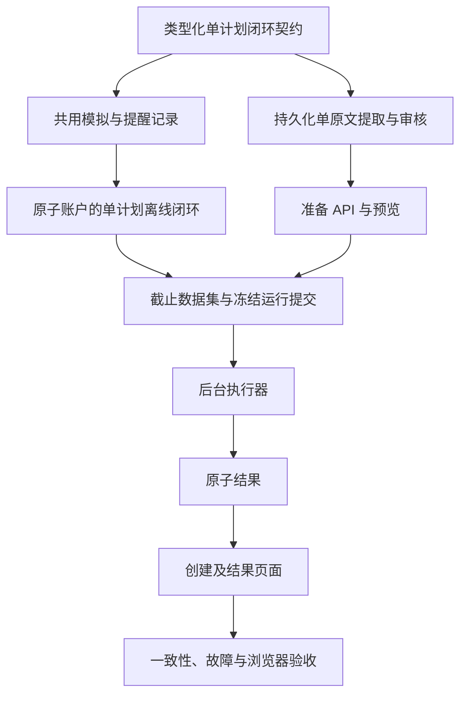

# 修复方案：恢复按日计划连续回测

状态：受限实施已授权，2026-10-10，Asia/Shanghai。**20 项修复任务，完成 17 项。** 具体 API 审查已通过 RP-T14/U11。[英文权威版](plan.md)；修复任务：[todo.zh-CN.md](todo.zh-CN.md)，`RP-T01`–`RP-T20`。


实施进度，2026-10-10：用户已在当前会话授权本受限修复。RP-T01 完成：恢复原始 ML01–ML13、具体编解码/顺序编辑矩阵；11 项夹具检查及 14 项夹具/旧格式兼容检查通过；故意将账本预期 899500 改为 899501 后失败，已恢复精确字节。Ruff、双语章节/链接检查和差异审阅通过。这里只验证基准，不代表运行时连续性通过。**20 项修复任务，完成 1 项。** 下一项 RP-T02。下文历史仅规划授权措辞由本指令覆盖，具体 API 审查仍待完成。

RP-T02 完成：独立的 v2 原文/日程/输入编解码保持 v1 边界，实现规范生效日选择、首日初始账户锚定及因果权限身份。独立审阅发现并修复嵌套子类绕过和跳过首日问题。65 项日程/输入/夹具/旧格式兼容检查通过；后续版本开盘可用性变异被检出并恢复。Ruff 和差异检查通过。**20 项修复任务，完成 2 项。** 下一项 RP-T03；RP-C01 尚未通过。

RP-T03 完成，RP-C01 通过：一个私有会话经共享激活事务遍历已审核版本，保留账户/风险状态，关闭旧普通意图，记录背景差异而不虚构交易。独立审阅修复重复原始快照身份及失效事件权限问题。64 项运行时/账户/循环/报告/夹具/旧格式检查通过，其中包含 10 项切换用例；故意移除普通意图关闭后失败，已恢复精确字节。Ruff 和差异检查通过。**20 项修复任务，完成 3 项。** 下一项 RP-T04。端到端准备、发布及界面验收仍待完成。

RP-T04 完成：v2 有序条目复用既有带标记文档存储，保留 v1 记录/回执，执行原文及前项绑定，只使变更后缀失效。已检查整链审核精确绑定及 UNKNOWN/取消中排他。独立审阅修复持久化前对构造原文对象的重新校验。91 项存储/输入检查通过；移除前项基础绑定校验后按预期失败，已恢复原始字节。Ruff 和差异审阅通过。**20 项修复任务，完成 4 项。** 下一项 RP-T05。顺序提取和冻结仍属 RP-T07/RP-T08。

RP-T05 完成：首份原文提取保持不变；后续提取采用独立受限契约，仅包含本份原文、已校验前项上下文、明确范围/操作及不具账户修改权限的持仓陈述。独立审阅发现并修复跨仓位数量错配及重叠证据。144 项提取/提供方检查通过，其中新增 23 项后续提取用例；两项账户归属回归在修复前失败。Windows 沙箱阻塞 asyncio 本机连接初始化，经批准在沙箱外运行本地模拟提供方检查后通过。Ruff 和差异检查通过。**20 项修复任务，完成 5 项。** 下一项 RP-T06；候选仍须程序整理及显式审核。

RP-T06 完成，RP-C02 通过：确定性的完整替换及显式新增/修改/撤销/保留操作生成完整候选和可审核差异。索引变化后，继承字段仍保留原始来源片段、绑定路径和人工补充哈希；后续持仓只作为比较背景。独立审阅复现并修复否定/假设替换及缺乏依据的账户依赖归属。67 项合并/绑定/夹具/日程检查通过，其中 31 项合并/绑定用例覆盖受限证据经存储重启后的保留。有限的字面范围/依赖检查让其他措辞继续待显式审核。Ruff 和差异审阅通过。**20 项修复任务，完成 6 项。** 下一项 RP-T07；工作线程集成及整链冻结仍待完成。

RP-T07 完成。用户于 2026-10-11 批准 RP05-A01，两项取消不变量回归现已通过。同一自有操作串行处理条目，执行原文/前项/代次校验、逐项重试预算、显式未知结果恢复及精确编辑回执。取消保留已校验前项和原始尝试绑定，实际调用结束前持续全局互斥，并拒绝晚到完成。169 项准备服务/工作线程/存储检查通过，包含重启及实际阻塞模拟提供方的取消。Ruff、双语检查及独立差异审阅通过。**20 项修复任务，完成 7 项。** 下一项 RP-T08。

RP-T08 完成，RP-C03 通过：显式逐项纠正校验原始来源/前项证据，保留前缀并使后项失效；独立的整链显式审核冻结完整版本、来源证据、日程及一份期初账户。整链审核哈希绑定账户和提取身份，与版本因果身份分离。独立测试复现账户/候选篡改及六项已审核候选来源错配，均已修复。194 项审核/存储/工作线程/旧格式检查通过，其中包含 30 项集合用例。Ruff 和独立差异审阅通过。**20 项修复任务，完成 8 项。** 下一项 RP-T09；集合公开端点仍属 RP-T12。

RP-T09 完成：独立的版本链数据编解码冻结相关版本绑定及证据需求并集，不改变 v1 字节。每个版本检查生效时已可用的历史，后续分钟历史不足保留可见提示，不增加准入门槛。回放帧仅跟随当前选中版本，截止范围之后的原文不影响冻结数据集。51 项数据/截止/发布/旧格式检查通过，包含 13 项新增用例；后续分钟历史提示缺失已先复现再修复。Ruff 和独立差异审阅通过。**20 项修复任务，完成 9 项。** 下一项 RP-T10。

RP-T10 完成：独立的存储输入编解码复制完整审核链及不可变行情日，校验账户/日程/需求精确绑定，拒绝行情日顺序调换，并保留 v1 哈希。组装流程在既有预留下使用初始原文和相关需求并集。用户于 2026-10-11 批准 RP05-A02 及后续授权 RP05-A03，两处首项快照读取现已支持集合登记与重新读取。50 项输入存储/提交/旧格式检查全部通过，包含此前失败的两项登记与提交用例。Ruff 和独立差异审阅通过。**20 项修复任务，完成 10 项。** 下一项 RP-T11。

RP05-A03 下 RP-T18 的必要文件补充：增加 `web/src/api/monitorLoopValues.ts` 和 `web/src/api/backtests.ts` 以读取已批准的 v2 契约；增加 `src/trade_plan_monitor/backtest/loop_publication.py`、`src/trade_plan_monitor/backtest/results.py`、`src/trade_plan_monitor/backtest/composition.py` 和 `tests/integration/test_monitor_loop_result_api.py`，通过现有有界曲线契约投影完整、已验证的 v5 每日权益。保持 v4 行为、未知值、过期状态、2,000 点及 4 MiB 上限。`web/tests/unit/PlanPreparationReview.spec.ts` 仅修正审核测试辅助函数的参数类型。RP-T19 另补充 `tests/integration/test_monitor_loop_production_composition.py`，仅用于真实浏览器的伪供应商夹具。这些是 RP-A08／原 ML07–ML09 所需修复，不扩展产品范围。

RP05-A03 下 RP-T19 的复现补充：真实完整原文提取暴露出显式空规则集合无法使用 SOURCE 证据、明确否定能力的整句被误报不支持两处缺口。仅补充 `src/trade_plan_monitor/ai/daily_review.py`、`src/trade_plan_monitor/ai/loop_plan_extraction.py` 和 `src/trade_plan_monitor/ai/update_review.py`，处理严格的字面证据，并在现有生产组合夹具中加入正反例。不会引入 AI 自行批准、推断空策略或不支持的交易能力。较晚的期初账户快照还必须先通过真实整链提交复现，再做受限的开始时间修正。

## RP01. 基准与依据

业务基准为提交 [e95de03](https://github.com/xiedc1227-bot/trade-plan-monitor/blob/e95de03ec809517cc0a3b2484c6145675418960c/docs/specifications/backtesting/PROPOSAL-monitor-loop-backtest.zh-CN.md) 中的 ML01–ML13，收窄前的 `0db69c9` 仍保留该流程。同一提交的实施方案提供 IP04–IP06 技术细节，受下述明确保留的后续限制约束。2026-10-10 用户要求针对已确认偏离制定受限修复方案，没有授权扩展产品范围。

撤销 `91eca25` 引入的固定单版本业务解释。其中“用户取消按日连续性”的记录属于助手解释，不能独立证明用户授权。已经执行的检查保留为较窄实现的历史证据，不能证明原流程通过验收。

固定术语：**任务**指一次已准入的准备/重型操作或回测运行；**计划版本**指一份不可变、已审核且有生效日期的快照；**连续回测**指一个标的、一个账户、一个运行身份/结果，依次使用适用版本。准备多个版本不创建多个回测任务。准备、同步、验证和回放继续遵守单任务互斥。

保留已明确的后续平台选择：同进程自有线程与按需启动、包括取消中/未知工作在内的一个未完成任务、既有恢复/租约防护、本地历史同步限速、最新 30 个已发布结果、仅兼容既有导出、既有有限工作量防护。已取消的全局配额、进程隔离、资源压力、磁盘预算和日志预算项目不得重新加入。

## RP02. 实施必须保持的业务规则

| ID | 必须实现的行为 | 原始依据 |
|---|---|---|
| RP-B01 | 首份及全部后续原文进入同一准备流程，按顺序提取、统一审核版本链，只提交一次并产生一个运行/结果。 | ML01, ML09, ML13 |
| RP-B02 | 回放前冻结原文分段/顺序、哈希、编写/可用时间、生效日期、完整已接受快照和证据绑定。上传顺序、报告日期、导入时间均不能代替生效日期。 | ML04, ML07, ML13 |
| RP-B03 | 每个交易日边界在监控或执行前应用当天已审核版本；无更新时沿用最近仍有效版本。同版本延续不重新激活，不同版本执行替换。 | ML05, ML07 |
| RP-B04 | 仅从首份原文初始化一次账户。跨版本继承现金、批次、取得日期、可卖量、成本及累计费用。后续“已空仓”等描述只与模拟账户比较，不能覆盖账本；依赖不兼容账户状态的指令须阻断，等待明确解释。 | ML04, ML07, ML-A13 |
| RP-B05 | 真正替换时关闭旧普通权限及待执行普通意图，包括下一交易日日线意图；保留已有风险义务，沿用共用的明确重评规则。修改草稿不切换活动计划。 | ML05–ML07, ML-A07 |
| RP-B06 | 审核完整替换和明确支持的更新，展示新增/修改/撤销/保留差异，继承字段保留原始证据。作用域不明时不能静默保留或删除规则。复用规则 ID 不转移旧执行权限。 | ML13, ML-A16–ML-A18 |
| RP-B07 | 保存逐项进度与原文/前版修订；按既有上限只重试受影响项。修改前序原文/顺序使受影响后续候选及审核失效；语义未解决时停止依赖提取，拒绝晚到结果。已提交冻结运行独立保存。 | ML08, ML13 |
| RP-B08 | 预检本次运行相关版本的数据需求并集，但决策只可读取当前活动版本与当时可用证据。结束日期/截止在提交时只冻结一次；修改未来原文/证据不能重命名早期语义事件。 | ML04, ML08, ML-A04, ML-A11, ML-A15 |
| RP-B09 | 提供逐日适用计划预览和一份因果报告，包含版本切换、沿用/无权限区间、账户背景差异及连续估值。未知和不支持信息保持可见。 | ML07, ML09 |
| RP-B10 | 保持既有共用监控、响应模式、完整数量成交、T+1、CORE、风险优先级、费用、原子结算、取消和原子发布。计划更新不能凭空生成策略、成交或账户事实。 | ML03, ML05–ML08 |

用户四份示例的验收输入仅收录完整交易计划回复，不把简短持仓确认或零散聊天自动提升为版本。恢复 ML13 更新语义不包含聊天抓取器或自动对话分类器。

首份原文盘中可用时，可在其实际可用时间初始化。后续内容切换仍按日进行：版本必须在计划生效日的监控/执行前已经可用；当天盘中才可用的后续原文，需要明确修正为更晚的生效交易日。日期冲突须拒绝，不得静默顺延或倒填可用时间。冻结结束日期之后的原文不支配本次运行。

## RP03. 九处偏离的修复对应

| 偏离 | 必须修复的内容 | 任务 | 验收 |
|---|---|---|---|
| 单份录入 | 同一有序准备流程包含多份原文条目。 | RP-T04, RP-T12, RP-T15, RP-T16 | RP-A01 |
| 独立提取 | 带原文绑定的前版上下文及明确变化。 | RP-T05, RP-T06 | RP-A02 |
| 缺少版本链审核/依赖 | 逐项恢复、后续失效及完整链冻结。 | RP-T07, RP-T08 | RP-A03 |
| 单条日程 | 生效日选择、沿用和日历预览。 | RP-T02, RP-T16 | RP-A04 |
| 无版本替换 | 评估/成交前切换，关闭旧普通意图并保留风险。 | RP-T03 | RP-A05 |
| 独立账户 | 一次初始化、连续批次/现金和背景差异核对。 | RP-T03, RP-T10 | RP-A06 |
| 只准备首版数据 | 需求并集预检和当前版本的因果读取。 | RP-T09 | RP-A07 |
| 固定版本结果 | 一个身份、耐久版本链及可审计的版本/账户时间线。 | RP-T10, RP-T11, RP-T13, RP-T17, RP-T18 | RP-A08 |
| 验收被改写 | 恢复原业务门槛和独立预期结果。 | RP-T01, RP-T14, RP-T19, RP-T20 | RP-A09–RP-A12 |

## RP04. 受限实现设计

**准备。** 扩展既有准备模型/存储/服务/工作线程/审核边界。保持一个准备 ID 和一个自有提取操作，内部保存有序、有界的条目集合。在既有任务互斥下逐份处理，不为每份原文创建独立准入任务，不在 AI 调用之间释放并重新占用任务槽。未完成、未知或取消中的工作持续占槽。已实际结束的准备流程随后按既有准入规则进行审核/提交。

复用当前提取器和供应商防护。首项生成期初事实及规则；后续项仅接收自身原文、已校验前版和必要的更早证据片段。使用原方案已提出的 `backtest/plan_updates.py` 和 `ai/update_review.py` 确定性形成完整快照，使用独立版本的 `ai/plan_update_extraction.py` 提示适配。完整替换列出移除条件，增量更新须有明确支持的继承范围。模型输出不能自我批准。

保留既有准备 SQLite 表、数据库归属标记和 JSON 文档存储；在其中新增可判别的 v2 文档编解码，保留 v1 读取/操作语义和幂等回执。不自动重写旧文档，不新增数据库，不执行生产迁移。在既有结果所属不可变输入存储中冻结完整链和一份期初账户。

**运行。** 在 `plan_schedule.py`、`loop_session.py` 和 `loop_runner.py` 内扩展日程版本支持，复用共用激活/替换/风险参与者及同一个私有会话数据库。每次切换不得重建账户/会话。替换后重建当前数据需求，不将未来快照暴露给求值器。`response_policy.py` 的修改仅限关闭被替换的普通意图并保留共用风险规则。切换/账户处理失败时终止运行，不得发布完成报告。

**数据与结果。** 将既有数据集清单/覆盖和冻结输入绑定扩展至相关已审核版本链。任务载荷仍为有界不可变引用，提交预留/截止逻辑保持。既有报告增加版本切换/沿用/无权限和账户背景证据；每个事件标识其活动版本及因果过去，只有运行身份绑定完整未来版本链。版本/激活/事件身份不得混入完整链哈希或更晚的整链审核时间。运行前预览只展示原文账户背景/依赖，不预测尚未发生的模拟账户；真实差异在版本生效时按账本计算。复用现有估值、图表、分页、原子发布和保留机制。

**版本兼容。** 新语义采用新增可判别编解码，旧序列化值保留原含义与字节。本次修复拟固定使用 `backtest-preparation-v2`、`prepared-loop-plan-v2`、`monitor-loop-input-v2`、`backtest-run-v6`、`monitor-loop-dataset-v2`、`monitor-loop-stored-input-v2`、`monitor-loop-event-v2` 和 `backtest-report-v5`。RP-T01 在依赖工作开始前检查冲突并记录具体字段矩阵。既有任务枚举/引用语义、费用公式、已复制行情产物和旧导出格式保持。公开投影形状改变时增加明确分支，不重新标记旧 v1 数据。这些名称是拟议设计，不表示 v2 已实现。

**API。** 复用既有准备根资源及 `/source`、`/extractions`、`/cancellations`、`/reviews`、`/recoveries` 资源。新创建分支提供有序 `sources`；编辑指明已有 `source_id`；提取/重试绑定条目/前版修订；审核绑定完整链。有界分页仅允许增加 `GET /api/v1/backtest-preparations/{preparation_id}/items`，用于条目详情/进度。顺序/生效日期修改限定于准备修订，不能修改活动运行。RP-T01 须在既有原文编辑命令中明确最小顺序编辑载荷，不授权另加管理接口。通过既有 `POST /api/v1/backtest-runs` 提交一份已审核清单并取得一个 `run_id`。既有来源防护、错误、幂等、状态/恢复控制和两套生成契约保持。

**UI。** 扩展既有准备表单/进度/审核/控制器、`/backtests/new` 和结果组件。用户一次上传/录入原文集合，先看逐项进度、差异和逐日适用情况，再统一审核/提交。保留逐项分段的完整原文，不把全部文本拼成一次 AI 请求。使用服务端计算的状态和日历，不在浏览器合并策略、执行交易或记账。不增加新工作区、路由系列、批量任务看板或无关视觉改版。

**上限。** 恢复原方案提出的 256 份原文/日程条目上限；保留原文合计 8 MiB UTF-8、每份 150,000 字符、同时一个提取、每项最多 3 次可重试尝试、200 个期初批次和既有 70,000 次评估/提醒/意图/尝试上限。新增生命周期审计事件计入明确有界的报告容量。保留 256 KiB 序列化任务引用上限和 Web 既有 4 MiB 总请求体上限：Web 提交须同时满足领域限制及编码后的 HTTP 大小，任何部分准入前即拒绝超限。8 MiB 领域上限不表示接受 8 MiB Web 请求。不授权分块上传系统或提高上限。保留最新 30 次结果及原平台/负载阈值。

## RP05. 修改边界与禁止扩展

手写源代码/测试仅限 [todo.zh-CN.md](todo.zh-CN.md) 每项列出的确切文件。计划新增的生产模块仅为 RP04 中来自原方案的三个准备辅助模块。既有共用监控/状态模块、任务协调器/仓储、服务生命周期/线程、同步/供应商行为、来源防护及所有无关模块是回归对象，不自动获得修改权限。若现有共用参与者无法表达所需替换，须先记录确切缺失行为和最小拟议差异，再处理该边界；不得复制求值器或静默重写共用语义。

本修复不包含并行回测任务、多标的共用资金、盘中内容切换、回放中生成策略、真实交易、新通知、新执行/费用/风险规则、部分成交、新数据供应商、新依赖、新导出格式、通用工作流引擎、全局资源控制、生产数据迁移或无关重构。既有无关研究产物不得混入修复提交。

每个实现增量在编辑前注明 RP 任务、原始 ML 要求、确切文件和验收用例。每个增量控制在约五个手写源代码/测试文件以内，需要时按同一已约定行为拆分；机械生成的契约和双语文档更新单独列明。拆分不授权新增行为。业务规则、RP04 之外的公开结构、上限、任务互斥或验收标准发生变化时，须先提供具体双语变更方案，取得用户明确指令后才能执行依赖实现。范围内普通函数组织不需要重复请求许可。

不得将推断写成“用户已确认”，必须区分用户原话、原始要求和实现推断。不得为测试通过取消业务门槛、削弱断言、提高阈值或把连续性测试改为拒绝输入。仍定义历史兼容性的旧模式拒绝测试继续保留，新模式必须验证已审核序列能够运行。

### RP05-A01. 已授权的 RP-T07 最小文件范围补充

状态：用户已于 2026-10-11（Asia/Shanghai）明确批准。RP-T07 需要保留已启动后续项的取消尝试及其原始前项 `base_hash`。目前 `CollectionPreparationRecord.bound` 把所有 `CANCELLED` 条目视为未启动并要求 `base_hash=None`，而 `PreparationItem.bound` 要求保留的每次尝试与条目的基础绑定相同。因此没有合法记录能同时保留已取消后续项的非空前项绑定；删除历史或把取消报告成失败均不可接受。

已批准的确切范围：只为该不变量修正，将 `src/trade_plan_monitor/backtest/preparation_models.py` 补入 RP-T07（该文件已在整体修复 RP-T08 范围内）。在 `CollectionPreparationRecord.bound` 中，对包含尝试的 `CANCELLED` 条目执行正常前项校验；只有从未启动的取消条目要求空基础绑定。在 `PreparationItem.bound` 中，要求包含尝试的取消条目以 `CANCELLED` 尝试结束。保留原始原文/前项值及所有尝试记录。既有 RP-T07 工作线程测试将覆盖第二项取消、重启、过期完成及 v1 行为不变。不改变字段、枚举、限额、端点、迁移或平台控制。用户已于 2026-10-11 明确授权该模型调整；其他 RP-T07 工作仍按原白名单推进。

### RP05-A02. 已授权的 RP-T10 结果存储最小范围补充

状态：用户已于 2026-10-11（Asia/Shanghai）明确批准。RP-T10 必须通过既有不可变输入引用登记并重新读取完整冻结集合。`BacktestResultStore.record_loop_input` 与 `_get_loop_input_participant` 目前通过 `stored.prepared.version.snapshot` 选择关联快照；`prepared-loop-plan-v2` 按设计包含有序 `items`，没有单个 `version`。因此即使集合文件已正确持久化，这两个函数仍会失败。关联快照只作为初始计划锚点，完整链仍由不可变集合/输入哈希绑定。

已批准的确切范围：将 `src/trade_plan_monitor/backtest/results.py` 补入 RP-T10，仅将上述两处表达式改为 `stored.run_input.schedule.entries[0].version.snapshot`。这是 v1/v2 共用路径，由存储输入编解码校验其与冻结准备的一致性。该文件原本已在 RP-T11 内，只把此项前置选择提前。保持 SQL、表、来源/账户权限、哈希域、报告行为、任务准入及限额不变。不为集合添加易误导的单版本别名，也不复制结果存储登记逻辑。用户已于 2026-10-11 批准这两处修改；不受影响的 RP-T10 存储和组装工作仍按原白名单推进。

### RP05-A03. 完成既定修复所需调整的持续授权

用户于 2026-10-11 批准 RP05-A02，并批准完成已要求的 RP-T01–RP-T20 修复所需的后续授权。必要的文件范围调整和具体审核步骤可继续执行，无须再次请求许可。每项调整及证据仍须以双语记录；这不增加无关业务范围，也不降低验收要求。RP-T14 仍须审阅两份实际生成的 API 差异，并记录经过核验的精确身份后才能登记批准，但无须重复询问许可。

## RP06. 实施前固定的验收标准

| ID | 必须提供的证据 |
|---|---|
| RP-A01 | 四份完整原文一次录入，同一准备流程顺序提取、审核并提交为一个准入回测任务和一个结果；仍支持仅一份原文。 |
| RP-A02 | 后续提取仅看到自身原文和已校验历史上下文。明确的完整替换/新增/修改/撤销/保留用例产生完整快照、可审核差异和正确来源绑定；歧义阻断依赖工作。 |
| RP-A03 | 单项重试不重复未变前序。修改前序/顺序使受影响后续及审核失效，陈旧响应不能提交。取消/未知工作持续互斥，重启不能静默重发付费调用；已提交输入保持不变。 |
| RP-A04 | 按日切换、有效沿用、同版本延续、到期/无权限、起点无覆盖、生效日重复、非交易日及盘中可用时间符合 RP-B02/RP-B03；不自动调整日期。 |
| RP-A05 | 替换先于当日评估/成交，关闭旧普通下一交易日意图，不转移其权限。既有风险义务和账户保持；保存草稿无影响。 |
| RP-A06 | 四个版本共用一次初始化的账户。后续零股/200 股描述产生差异，不重置、不编造成交；不兼容的账户依赖指令被阻断。现金、批次、T+1、费用和成本有独立预期值。 |
| RP-A07 | 预检全部相关版本需求；后继缺证据明确显示，不退回旧策略。修改未来内容/证据不影响此前决策及语义事件 ID。提交/重试/结束截止行为保持。 |
| RP-A08 | 一份报告展示全部适用版本、切换/沿用/无权限原因、旧意图关闭及连续账户曲线；每次决策/成交可追溯到版本及证据。失败/取消不发布已完成的部分结果。 |
| RP-A09 | 明确声明的离线四版本夹具使用独立于实现的字面量预期：期初现金 1,000,000 分、零股；以每股 1,000 分买入 100 股并收取 500 分费用后，余额 899,500 分、持仓 100 股；之后在合法时机以每股 1,200 分卖出 100 股并收取 500 分费用后，余额 1,019,000 分、零股。累计费用 1,000 分、已实现收益 19,000 分。夹具税费/过户费/滑点明确设为零，并满足后续行情成交和 T+1；这是合成测试假设，不是用户的市场计划。中间版本边界精确保留账户。 |
| RP-A10 | 相同事实、生命周期变化和成交产生独立核对的在线/研究状态与提醒语义；旧冻结输入/报告/哈希/导出字节及单版本行为保持兼容。 |
| RP-A11 | 真实浏览器覆盖四项准备、修正/重试、日历/审核、一次提交和一个连续结果，并验证第二个未完成操作被拒绝。既有启动/恢复/取消/平台门槛保持原阈值。 |
| RP-A12 | 完成时将每条 RP-B 规则对应到可执行证据，恢复原 ML-A07/ML-A11/ML-A13/ML-A16–ML-A18 覆盖；不得把缺失原需求排除出完成分母。双语、接口差异和操作说明一致。 |

盛新锂能四份原文在缺失事实明确解决前，仅用于原文保真、整批录入、时间映射/审核和可见阻断验证。不得为跑通示例编造现金、成文/生效日期或主观条件的数值定义。无成交本身不算失败；该示例不能替代独立成交夹具。

## RP07. 顺序、验证与完成条件

按 [todo.zh-CN.md](todo.zh-CN.md) 中 RP-T01–RP-T20 及检查点执行。先证明离线连续性，再接通最终 UI。准备、数据、提交和报告通过既有服务集成，任何任务不得独立重定义业务规则。

每项记录验证命令，使用虚拟 AI/供应商、私有存储和已声明数据。修改断言须有原始 ML/RP 依据，不能由被测实现生成同一测试的预期值。最终检查覆盖版本链针对性测试、既有共用运行时/记账和冻结兼容、生成契约漂移、前端测试/类型/构建及真实浏览器流程。批次/循环负载改变已有测量前提时，按原阈值重跑既有负载实验，不另建更大容量项目。

任务只有取得验收证据并审阅差异后才能完成。检查点是验证节点，不是反复请求许可的节点。当前没有任何修复任务完成。此前 37 个完成任务/20 项交付保留为较窄实现的历史记录，不计入修复完成。用户明确要求实施这份经审阅方案后才开始实现，本次制定方案的请求不记作该实施指令。

RP-T11 依据 RP05-A03 补充范围：加入 `src/trade_plan_monitor/backtest/loop_replay.py`，仅用于回放发布时按 v1/v2 分派持久化事件解码。报告/事件哈希域保持独立，不新增生产模块或资源所有者。

RP-T11 完成，RP-C04 通过：独立 v5 报告通过既有原子任务完成流程发布完整日程、连续估值/账户和带版本的因果事件。保留 v4 字节/读取及最新 30 次产物留存。独立审阅复现了重算哈希后仍可隐藏中间版本的伪造轨迹，逐个日程生效边界检查现已拒绝该轨迹。报告/发布/留存/切换/工作线程/旧格式六文件测试共 51 项通过，最终边界修复后的 7 项版本链快速检查全部通过。Ruff 和独立差异审阅通过。**20 项修复任务，完成 11 项。** 下一项 RP-T12。

RP-T12 依据 RP05-A03 补充范围：加入 `src/trade_plan_monitor/backtest/preparation_store.py`，仅复用既有不可变回执查询，在全局准入前重放 `CORRECT_ITEM` 命令。不新增表或回执格式。根进度/冻结确认使用有界引用，绑定修订的条目分页在既有 2 MiB 响应限制内提供原文及有类型的候选证据。

RP-T12 完成：显式 v2 准备分支支持批量创建、精确原文/排序编辑、选定条目的提取绑定、整项操作控制、条目纠正和整链审核。绑定修订的分页完整保留原文/证据，并适配既有 2 MiB 上限；非法查询及超限请求体在获取资源前拒绝。精确纠正回执可在全局互斥占用时重放。独立 HTTP 复现最初对合法集合创建返回 422，另有五项分页预校验提前初始化问题均已复现并修复。232 项 API/契约/工作线程/审核检查全部通过，包含两套生成 profile 和嵌套修订安全整数。Ruff 和独立差异审阅通过。**20 项修复任务，完成 12 项。** 下一项 RP-T13。

RP-T13 依据 RP05-A03 补充范围：仅更新 `tests/integration/test_monitor_loop_submission.py` 的两项集合用例，使用现已必需的 `schemaVersion: prepared-loop-plan-v2` 命令，保留原始截止/幂等断言。公开 `monitor-loop-result-v2` 提供轻量有序版本/来源绑定，以及含 `report_schema_version: backtest-report-v5` 的有类型报告头，不重复私有完整日程。投影前仍校验不可变完整报告，公开报告头不是可独立重算哈希的私有报告编解码。这样避免在既有 4 MiB 结果上限内重复最多 256 份快照。

RP-T13 已完成：必须显式使用 prepared-loop-plan-v2 命令提交一条已复核计划链；有界 monitor-loop-result-v2 投影有序来源/版本证据、带类型的 backtest-report-v5 报告摘要和版本事件分页。独立 HTTP 测试复现了旧格式联合解析异常；修复后 4 项连续结果 HTTP 检查和 12 项旧结果接口检查全部通过，提交套件 27 项检查通过。两项未改动的快照检查等待 RP-T14 生成与审查。Ruff 和独立差异审查通过。**20 项修复任务，完成 13 项。** 下一项：RP-T14。

RP-T14 按 RP05-A03 增补：独立具体接口审查发现，批量创建类型把格式标识公布为可选，但 HTTP 实际要求必填。仅增补 `src/trade_plan_monitor/web/preparation_schemas.py` 和 `tests/integration/test_plan_preparation_contract.py`，增加格式标识必填的公开创建类型及回归测试。私有输入默认值与字节保持不变；审批前重新生成并审查具体产物。

RP-T14 已完成，RP-C05 通过：两套实际生成契约的独立审查仅批准一条新条目分页路径、10 个既有操作的增量修改和 36 个新模型；三个旧模型增加联合分支，其余旧接口精确不变。先在两套配置复现公开创建格式标识未必填问题，再完成修复。U11 在持续授权下记录四份已审查产物哈希。54 项快照/准备/结果契约检查及两套生成一致性检查全部通过。Windows 沙箱中的本地契约运行停滞，获准使用隔离环境重新运行后通过。完整前端类型检查发现计划由 RP-T18 处理的新事件联合类型使用处，未屏蔽检查。Ruff 与差异检查通过。**20 项修复任务，完成 14 项。** 下一项：RP-T15。

RP-T15 已完成：现有控制器支持一条有序集合、绑定修订的完整条目分页、保留本地原文修改、稳定变更回执、显式条目修正与精确整链复核。独立测试复现了可变账户数据改变同 key 重试内容，以及合并候选来源身份错配，两项均已修复。128 项准备/控制器/既有复核/创建页面检查全部通过，其中控制器与传输层 82 项。T15 无类型错误；两个已知事件联合类型使用处仍由 RP-T18 适配。Windows 沙箱阻断 Vitest 临时文件重命名，获准本地重跑后通过。差异审查通过。**20 项修复任务，完成 15 项。** 下一项：RP-T16。

RP-T16 按 RP05-A03 增补：`web/src/api/preparationReview.ts` 仅调整检查参数的只读兼容类型，使 Vue 投影复用既有检查，无需复制数据或改变校验行为。

RP-T16 已完成：分组录入保留各原文/日期及文件边界，进度展示有序条目尝试次数，复核展示完整合并计划、继承证据、差异和仅供比较的持仓。初始补充通过显式条目修正提交；修正后的首项必须人工输入唯一期初账户，并确认未知事实。保留可选单份原文录入。独立审查复现上传文件删除已填日期空白来源的问题，修复后保留全部已编写条目。145 项准备/复核/创建页面检查全部通过，其中复核组件 44 项。T16 无类型错误；已知结果事件使用处仍由 RP-T18 适配。独立差异审查通过。**20 项修复任务，完成 16 项。** 下一项：RP-T17。

RP-T17 按 RP05-A03 增补：仅增加 `web/src/views/BacktestNewView.vue`，把已复核集合确认绑定到既有回测表单。

RP-T17 已完成，RP-C06 在控制器/组件层通过：一条已复核集合只生成一次 prepared-loop-plan-v2 请求，绑定唯一清单、期初账户、响应/结束设置及费用。即使外部复核选择变化，未知结果也继续使用不可变的原命令与 key。41 项回测表单/创建页面检查全部通过，其中回测表单 22 项；独立审查无新增阻塞。完整浏览器验收仍待 RP-T19，已知结果事件使用处仍由 RP-T18 适配。**20 项修复任务，完成 17 项。** 下一项：RP-T18。

## RP-HISTORY. 已被替代的固定版本交付记录

下文原样保留以供追溯。其中固定版本范围、推断的取消/授权记录和完整业务完成声明已由 RP01–RP07 纠正，不得据此取消修复要求或授权扩展范围。

<!-- prior-delivery-record -->

# 实施方案：监控闭环回测

状态：用户于 2026-10-07（Asia/Shanghai）授权先隔离再实施。业务决策来自[设计方案](../docs/specifications/backtesting/PROPOSAL-monitor-loop-backtest.zh-CN.md)，最终 API 批准及真实环境/负载验收仍待完成。实际检查：[验证记录](../docs/verification/monitor-loop-backtest.zh-CN.md)。英文版：[plan.md](plan.md)。当前任务：[todo.zh-CN.md](todo.zh-CN.md)，编号 `ML-T01`–`ML-T39`；此前已完成任务保留在其后。

完整交付验收缺口已记录于 [MV10](../docs/verification/monitor-loop-backtest.zh-CN.md#mv10-完整验收缺口清单)，当前隔离收尾证据见 [MV12](../docs/verification/monitor-loop-backtest.zh-CN.md#mv12-隔离收尾与契约审阅)。用户较窄的启动解耦验收见 [MV11](../docs/verification/monitor-loop-backtest.zh-CN.md#mv11-仅启动解耦验收)：**PASS**，已记录真实应用启动/重启、损坏资源及首次使用失败缓存证据。完整交付的业务/资源任务不是启动验收前置条件。已取消保护工作继续排除，提出新增范围时明确标注。

## IP01. 目标与交付边界

上传一份计划，提取并明确审核完整不可变快照，账户初始化一次，在该固定计划下回放历史监控、提醒、模拟响应与原子账户反馈。计划有效时可跨多个交易日。结束日期可选，在运行提交时按 Asia/Shanghai 一次解析。用户于 2026-10-07 取消按日切换、前版继承/合并及多计划同时回测。

贯通准备、既有回测任务、API、现有 `/backtests/new` 页面和结果。保持在线单份计划流程与冻结历史运行兼容。首版每次运行一个股票/账户，不做跨股票共享资金。完整数量模拟和受支持技术条件沿用设计限制。不支持的导入条款明确展示为限制或准入阻断，不能静默丢弃。

此前空 WAL 修复与 CLI 移除已在分析基线 main 提交。工作区有独立未提交的盛新锂能研究产物，保留在本任务范围外。设计更新自身未授权代码；用户随后授权严格按薄片边界实施。用户随后于 2026-10-07 授权清理、提交并推送当前改动至 GitHub。部署仍在本任务范围外。保留并扩展现有方案及已完成历史任务记录。

## IP02. 决定实施顺序的代码现状

2026-10-09，ML-T18 后调整顺序：既有工作线程完成流程原子验证暂存报告。先完成 ML-T20 的类型化报告及 ML-T21 的发布参与者，再由 ML-T19 消费；ML-T21 依赖冻结输入/报告（ML-T17/ML-T20），避免依赖循环。保留既有完成标准，不改变任务验收或交付数量。

| 现有位置 | 已确认事实 | 对实施的影响 |
|---|---|---|
| `ai/plan_extraction.py`、`ai/extraction.py` | 已有单份原文提取、来源绑定及严格输出校验。 | 复用完整计划提取，仅扩展明确期初账户事实；无需更新/继承契约。 |
| `web/ai_service.py` | 既有提取使用进程内操作及一个并发提取槽。 | 持久化一份准备候选/修订并复用提取防护；不新增全局 AI 预算。 |
| `backtest/run_input.py` | 单个 `plan_snapshot`、正数现金、运行公式 v1–v4。 | 新增独立闭环输入，允许明确零现金，未知现金单独表示，禁止假现金。 |
| `backtest/research_session.py` | 单活动计划，禁止 `_enqueue`，执行调用私有 HTTP 辅助函数。 | 增加记录提醒的闭环会话，并提取共用应用层模拟参与者。 |
| `web/daily_service.py`、`state/daily_accounting.py` | 已有执行校验与持仓转换。 | 最小提取并先证明在线一致性，再加入研究现金提交。 |
| `backtest/research_valuation.py` | 监测回执后才修改资金，期初估值使用持仓成本。 | 新模式需要资金/库存原子更新，区分历史成本与期初市值。 |
| `backtest/dataset.py`、历史 profile 校验 | 当前历史数据就绪依赖完整交易日证据/profile 规则。 | 截至今天需要明确的末日部分时段覆盖，不能削弱既有完整交易日就绪条件。 |
| `backtest/jobs/models.py` | 序列化任务请求上限为 256 KiB。 | 单独存储冻结快照，队列传有界已验证引用，不传原文/快照全文。 |
| `backtest/results.py` | 输入持久化、发布检查和投影假设单输入模型。 | 同时扩展解码、校验、保留期，不能只增加运行器。 |
| `backtest/composition.py` | 提交已有幂等预留，再读取/固定输入。 | 在预留内一次确定默认结束/截止时间，重试复用。 |

表中路径相对 `src/trade_plan_monitor/`。

## IP03. 架构与分段交付



按任务顺序实施。先用一份手工构造的已审核快照证明提醒 → 成交 → 账户 → 下一轮求值，这是开发夹具，最终用户使用真实单原文准备流程。再接通真实准备。每个切片通过可执行检查后才进行依赖工作，不安排主动并行代理。

只有用户明确提交准备操作时，准备过程才调用配置的 AI 供应商。开发检查全部使用虚拟响应。回放不调用 AI、行情供应商或通知通道，数据获取仍属于既有独立同步操作。

## IP04. 模型、存储与身份

### IP04.1 强类型契约

增加职责明确的模块，不继续把旧运行器扩成另一大分支：

| 建议模块 | 职责 |
|---|---|
| `backtest/loop_input.py` | 不可变单计划运行、期初账户、初始绑定、响应/费用设置和规范身份。 |
| `backtest/plan_schedule.py` | 一个初始生效日、可用/有效性、跨日延续及结束/截止解析，拒绝第二条目。 |
| `backtest/preparation_models.py` | 一份原文/候选/审核状态及修订、证据绑定。 |
| `ai/loop_plan_extraction.py` | 完整单计划提取适配器，包含明确期初账户事实及独立版本化提示身份。 |
| `backtest/loop_session.py`、`backtest/loop_runner.py` | 隔离当前监控参与者及按时间排序的事件编排。 |
| `backtest/reminder_capture.py`、`backtest/response_policy.py` | 发送资格、提醒身份和延迟完整数量意图。 |
| `backtest/loop_account.py`、`backtest/loop_report.py` | 原子资金参与者与强类型审计/绩效投影。 |

除实施开始时已经存在者外，以上均为建议新增文件。Python 契约严格且不可变，公共载荷不用任意字典。资金采用整数分和精确 Decimal 运算，期初单股成本通过准确总成本保留原精度。审核状态、提取状态和模拟权限相互区分。

使用建议判别符 `monitor-loop-input-v1`、`monitor-loop-report-v1` 及运行哈希域 `backtest-run-v5`，ML-T01 检查冲突。旧 v1–v4 编码逐字节保持一致。新公开模式不把内部版本号作为产品选择。哈希覆盖单份已审核快照和冻结策略；供应商尝试 ID、准备 UUID、任务时间不进入语义事件身份。未来行情不能改名早期事件。

### IP04.2 存储归属

- **准备：** 配置回测库旁独立 `backtest-preparation.sqlite3`，保存一份原文的修订、尝试、完整候选、审核及冻结清单。使用标记化模式/版本和既有路径域拒绝，不添加在线监控表，开发测试不迁移生产库。
- **回放会话：** 私有临时 SQLite，资金和监控持仓/信号/风险使用同一连接/事务，调用方负责提交/回滚。
- **已提交输入：** 确认提交前，将已批准清单与完整规范单计划输入复制到持久存储。预约绑定不可变 `(run_id, input_hash)` 引用后入队；执行器不依赖可变准备。中断预约留下可恢复绑定或可回收未引用产物。
- **结果：** 使用既有暂存/原子完成，明确扩展新判别符解码/发布校验。必要存储升级需记录迁移及旧库夹具，不在启动时临时 `ALTER TABLE`。
- **保留：** 总共最新 30 条已物化历史运行，发布后由有界维护删除最旧超额摘要/成交/详情，置顶不绕过上限。保留运行保护冻结输入及兼容导出；保护排队/运行引用及共享数据集/快照。失败/取消暂存与任务/幂等到期不变。不新增字节/磁盘/日志预算，ML-T21 保留策略不阻塞 ML-T34 隔离。

### IP04.3 建议有界默认值

首期计划/原文数恰好为一。保留既有 150,000 字符上限及 8 MiB UTF-8 防护（单份原文时字符上限更严格）。拒绝第二份原文/条目，包括相同版本。单份已审核计划的证据哈希保留独立有界集合。复用普通提取并发/供应商防护，一次活动调用，至多 3 次可重试尝试。语义歧义进入审核，未知供应商结果持久化，重启后不盲重试。

保留任务请求 256 KiB、初始批次 200 个、安全整数范围，以及包含状态刷新的 70,000 次监控评估上限。每次运行的提醒、响应意图和执行尝试分别上限 70,000，流式记录并在超限前明确失败。这是建议的新模式容量，不代表已有性能验收。用边界测试验证，不为此重跑无关的高成本全量容量套件。

## IP05. 提取、审核与执行算法

### IP05.1 单原文准备

先持久化一份原文/修订，以修订/代次防护认领，在事务外调用 AI。提取完整计划及明确期初账户事实，不含前版上下文、差异操作或后继物化。编辑/取消/重启后拒绝晚到结果。

复用既有来源/条款/字段审核语义，绑定原始证据及精确原文/内容/账户修订，不编造 `HUMAN_SUPPLEMENT` 或批准。仅冻结明确审核快照。编辑原文使其候选/审核失效，已提交输入保持不可变。

持久化进度、有界重试及重启状态，区分请求失败、语义歧义和未知供应商结果。保留提取防护，不将跨入口全局 AI 配额基础设施作为隔离门槛。

ML-T10 在扩展前拆分实施：先给既有准备文档增加可选工作线程归属/进度并增加既有任务准入预留的精确读取，再接通自有提取与配置供应商。两个切片分别包含四个主要文件，含共用测试共七个不同文件。既有准备记录保持可读，不新增任务类型、队列、数据库、公开路由或全局 AI 预算。实际调用结束且耐久结果已记录前保留准入令牌；未知付费结果恢复前须明确确认此前工作已结束。

ML-T11 审核为一次明确、检查修订的人工操作。可提供修正后的草稿/来源映射及带明确证据的期初账户；按字段限定的人工补充只能来自本操作，不能来自 AI 输出。重新计算原文/条款/字段及期初事实检查，不能通过已阅确认消除未解决技术条款。在同一事务中将一份有界不可变清单写入既有候选载荷并记录精确审核声明，保留原始提取哈希和账户事实。原文修正后，原始审核回执仍可读取，当前候选/审核则失效。未知账户事实保持显式状态，交由后续运行准入检查；不推断现金、取得日期、可卖数量或期初价格。审核复用既有全局准入、元数据归属和数据库结构，不新增公开路由/表，不解析运行结束日期/截点，也不启用生产计划。

ML-T12 在扩展前拆成两个切片，每个四个主要文件，含共用测试共七个不同文件。先在既有存储/服务/组合中增加创建收据重放、全局准入和准备能力归属，再在既有应用挂载类型化 HTTP 命令。准备库仅在明确准备请求时打开。元数据操作不启动任务协调器或请求 AI；只有新提取在检查原始收据后捕获既有配置适配器。复用既有惰性生命周期及实际排空后的关闭。挂载单原文创建/读取/原文编辑/提取/取消/审核/恢复路由，公开投影有界且不暴露私有归属/准入/供应商诊断。恢复仅确认旧工作结束，不重新提交。准备库故障缓存并限定在回测。新路由保持挂载供 HTTP 验证，模式发布暂存至 ML-T13；当前已批准 OpenAPI/类型/摘要保持不变。ML-T13 先发布路由模式标记，再生成契约供最终具体审阅，不自行批准摘要。

ML-T13 分三个切片（2 / 2 / 6 个主要文件，含共用测试共八个不同文件）。先将 EXTRACTION/FROZEN/UNAVAILABLE 建成真正可判别的候选联合，将公开内嵌审核/尝试/冻结修订限制在既有安全整数范围，保持成功传输字段及 null 值。再发布已挂载路由，记录实际取消 200/202 状态及有界成功/错误响应头。最后扩展现有生成器，规范化新出现的输入/输出模式名称并保留旧响应名称，再生成两种既有契约 profile，证明原路由/模式/类型不变。漂移验证通过后共同提交发布及生成产物。不改变准备/存储/任务/UI 行为或已批准摘要/路径基线；既有批准失败留给 ML-T29 记录，不抑制。

### IP05.2 同一固定计划下的事件循环

生成行情可用、日历及许可外部证据事件。每个时刻：暴露证据/日历 → 在同一冻结计划下推进支持的生命周期状态 → 共用监控求值 → 复核/记录提醒 → 处理就绪意图 → 提交/刷新状态 → 审计/估值。跨日保留激活和信号次数，到期/停用时遵守授权而不替换另一计划。不生成计划切换事件或转移后继意图。

响应策略为每个授权发生创建一个稳定意图，并重新检查风险目标。首根合格分钟区间起点不早于响应就绪时间，收盘价只能在证据可用后消费。禁止信号同根成交、任意冲突排序、部分数量替代和零时间循环。现有共用检查继续控制 T+1、CORE、容量、风险及权限。

变更前计算价格/滑点/费用和现金是否充足。在一个私有事务中：复核修订/资格 → 应用现金与批次变化 → 消费信号/完成风险 → 写回执/审计 → 提交。在任意写入之间注入故障均须整体不变。重复意图返回同一结果，不二次成交。在线模拟保持现有行为，研究资金参与者不能静默给在线监控增加现金账户。

### IP05.3 覆盖与结束日期

保留旧完整交易日清单。新闭环模式冻结独立区分的覆盖描述，包括解析结束日期、可用截止、完整历史交易日及可选末日部分时段。校验截止前所有要求的完整区间；尚未完成区间不在范围内，要求区间缺失才是缺口。保留供应商规范化和日历语义，不把部分交易日标为完整已验证交易日。回放工作者不获取网络数据。

提交时在幂等预留后一次解析默认结束/截止，同一请求次日重试返回原输入。使用当时可用的完整证据，报告实际末条证据/估值时间。到截止后停止，保留持仓和未成交意图，不编造末日清仓。期初市值与会计成本独立，期初权益分母为零时不提供百分比收益，不能除零。

## IP06. 应用接口与页面边界

ML-T12 挂载下列单原文准备资源。ML-T13 发布其模式及生成契约后再编写 UI；闭环运行提交仍待完成：

| 操作 | 路径/用途 |
|---|---|
| 创建准备 | `POST /api/v1/backtest-preparations` — 恰好一份原文；持久身份/状态。 |
| 读取进度 | `GET /api/v1/backtest-preparations/{preparation_id}` — 包含单份原文及候选的有界投影。 |
| 修正原文/初始绑定 | `PUT /api/v1/backtest-preparations/{preparation_id}/source` — 预期修订；使本候选/审核失效。 |
| 开始/重试提取 | `POST /api/v1/backtest-preparations/{preparation_id}/extractions` — 预期准备修订；稳定幂等。 |
| 取消准备工作 | `POST /api/v1/backtest-preparations/{preparation_id}/cancellations` — 停止新调用，阻止晚到响应提交。 |
| 审核/冻结 | `POST /api/v1/backtest-preparations/{preparation_id}/reviews` — 精确单原文/内容/账户/证据/修订绑定。 |
| 确认工作结束 | `POST /api/v1/backtest-preparations/{preparation_id}/recoveries` — 精确代次/修订及字面值 `confirmedEnded: true`；不重新提交。 |
| 提交回放 | 既有 `POST /api/v1/backtest-runs` 增量接受有区分值的闭环命令，引用已审核准备修订、可选 `endDate`、数据集和响应设置。 |

准备命令封装字段使用 camel-case，内嵌研究字段保留原名。创建接受 `input`，编辑接受 `source` 及 `expectedRevision`，提取/取消接受 `expectedRevision`，审核接受 `review`，恢复接受 `generation`、`expectedRevision` 及 `confirmedEnded`。进度公开有界状态、原文、尝试及类型化候选/冻结值，不公开私有归属/准入/供应商诊断。服务端负责资格、期初事实、审核及解析日期，复用同源/变更防护、请求幂等和既有错误封装。请求体/模式/语义校验沿用既有约定；缺失资源为 404，过时/冲突修订或载荷复用为 409，配置服务不可用为 503。HTTP 输入不接受文件系统路径，不泄露供应商秘密、原始异常或任意生成 HTML。

Web/API 构造一份不可变已审核计划输入并提交既有后台协调器，由 ML-T19 分派执行器。移除回测 CLI 命令/专用兼容逻辑，不新增 CLI 或独立命令所属协调器。

| Vue 职责 | 建议组件/composable 边界 |
|---|---|
| 上传一份原文计划 | `PlanPreparationSourceForm.vue`：输入一份原文，输出编辑/提交事件。 |
| 原文进度及重试 | `PlanPreparationProgress.vue`：输入服务端状态，输出重试/取消意图。 |
| 审核计划和期初账户 | `PlanPreparationReview.vue`：输入完整快照/证据/问题，输出修正/审核意图。 |
| 准备副作用 | `usePlanPreparation.ts`：API/轮询/修订/错误状态，在卸载/终态停止。 |
| 提交运行 | 既有 `BacktestRunForm.vue` / `useBacktestRunForm.ts`：单份已审核快照、可选结束及明确假设。 |
| 解释运行 | `MonitorLoopTimeline.vue`：分页因果事件及冻结计划来源，既有图表使用服务端估值。 |

路由视图保持组合职责，使用 Vue Composition API、TypeScript 和 `<script setup>`，属性向下、事件向上。浏览器不重复资金检查或提醒决策。

ML-T14 使用三个切片（2 / 2 / 4 个主要文件，含共用测试共五个不同文件）：准备传输、单份控制器、原文/进度组件，并在同一控制器补齐未保存原文及旧读取刷新保护。原文表单接受一份 UTF-8 文本/Markdown 文件或粘贴文本，可选填写上海时间边界，保持错误及编辑可见，并发出受控原文/提交意图。进度接收只读权威状态，发出提取/取消/刷新/同请求重试或明确结束确认意图。控制器在结果未确认时保留一份不可变变更载荷/键，忽略过时读取和旧原始回执，在空闲/终态且实际排空或卸载时停止轮询。CANCEL_REQUESTED/UNKNOWN/未结束工作继续阻止新操作，即使表面状态已进入终态。修改后的原文先保存才可提取。恢复不隐含提取。采用既有设计变量及无障碍标签/状态/错误。临时浏览器界面验证组件；生产页面组合及审核预览仍在 ML-T15。不引入队列、共用锁、后端修改或 API 批准。

ML-T15 使用四个切片（5 / 3 / 2 / 5 个主要文件，含共用测试共八个不同文件）：有界准备审核传输/预览校验、明确单份准备审核/控制器、页面组合及独立 `PreparationFrozenView` 凭据修正。页面组合与修正在真实 HTTP 和最终门禁通过后共同提交。保留只读完整规则、原始来源/账户事实及待解决项可见；确认绑定当前原文/候选/审核修订，变化时清除。未保存/未结束/未确认工作阻止新的互斥操作。未知现金与零值区分，缺失时间仍为阻断项，原文修正后重新提取。审核不启用生产计划、不提交闭环回测；ML-T24 负责运行提交。保留既有回测创建、后端语义及生成/已批准契约。

## IP07. 任务顺序与检查点

权威勾选状态和文件清单位于 [todo.zh-CN.md](todo.zh-CN.md)。每项约五个主要文件以内，包含测试；若额外独立行为或契约产物扩大范围，应继续拆分。

| 检查点 | 任务 | 可运行结果/门槛 |
|---|---|---|
| ML-C01 | ML-T01–ML-T03 | 强类型输入、共用模拟/提醒记录适配，在线回归不变。 |
| ML-C02 | ML-T04–ML-T05 | 完整单计划闭环、原子资金/持仓，无未来交易脚本；ML-T06 取消。 |
| ML-C03 | ML-T07–ML-T08 | 持久单原文准备及完整来源绑定候选；ML-T09 取消。 |
| ML-C04 | ML-T10–ML-T12 | 可重启单份准备/审核及使用假 AI 的真实 API。 |
| ML-C05 | ML-T13–ML-T15 | 生成准备契约，上传/进度/审核 UI。 |
| ML-C06 | ML-T16–ML-T18 | 截止数据、耐久规范输入引用、幂等提交。 |
| ML-C07 | ML-T19–ML-T21 | 工作者到原子存储报告，取消不发布完成结果。 |
| ML-C08 | ML-T22–ML-T24 | 结果 API、既有导出兼容保持不变、生成契约和常规创建运行 UI。 |
| ML-C09 | ML-T25–ML-T27 | 结果时间线、独立一致性/故障检查、浏览器流程。 |
| ML-C10 | ML-T28–ML-T29 | 双语操作证据及经审阅的契约/快照一致。 |

门槛失败先定位，再继续依赖工作；不能以跳过断言或降低约束替代证据。检查点属于技术验证，不是每完成几项就自动请求许可。真正改变产品范围时提供具体差异再讨论。

## IP08. 验证、已知风险与完成标准

使用任务列出的新增针对性 pytest、现有统一运行/模拟/回放一致性和冻结兼容测试、虚拟 AI 提取测试、生成模式检查、Vitest、类型检查/构建及虚拟供应商 Playwright 流程。新测试文件名是计划产物，不声称已存在。本次文档规划不运行应用套件或付费外部请求。

最终标准命令，从 `trade-plan-monitor/` 执行：

```text
.venv/Scripts/python.exe -m pytest tests/unit tests/contract -q -m "not live"
.venv/Scripts/python.exe -m pytest tests/integration/test_unified_runtime.py tests/integration/test_unified_simulation_transactions.py tests/integration/test_unified_replay.py tests/integration/test_unified_replay_parity.py tests/integration/test_backtest_compatibility.py tests/integration/test_openapi_snapshot.py -q -m "not live"
.venv/Scripts/python.exe -m ruff check src tests scripts
.venv/Scripts/python.exe scripts/generate_frontend_types.py --check
npm --prefix web run test -- --run
npm --prefix web run type-check
npm --prefix web run build
npm --prefix web run test:e2e
git diff --check
```

另运行全部新增针对性测试。只按共用参与者变化扩大集成范围，保留未受影响的高成本容量证据，不标为新性能验收，不默认运行整个昂贵容量套件。

| 风险/已知限制 | 必须处理 |
|---|---|
| AI 提取遗漏或编造条款 | 来源绑定完整候选、独立语义夹具及明确人工审核。 |
| 冻结计划在回放中到期 | 结束普通授权且不替换，保留账户/风险义务并解释边界。 |
| 原文含部分成交/基本面退出 | 明确不支持条款，执行前取得限定范围的已审核计划，不能以较窄引擎宣称复现全部盛新锂能原文。 |
| 故障导致资金/库存分离 | 同事务、独立前后断言和故障注入。 |
| 当前日期不是完整交易日 | 新截止覆盖区分值与时间边界夹具，旧 profile 不变。 |
| 准备结果在编辑/重启后到达 | 原文/修订/代次防护及稳定意图幂等。 |
| OpenAPI 批准与最终接口审阅 | MV12 已审阅并纠正既有统一研究 API 的陈旧批准，单独保留原失败。未来监控闭环 API 差异须具体审阅后才在双语文档记录新批准摘要，不能静默填入未经审阅摘要或修改测试。 |
| 完整输入超过队列限制 | 冻结输入引用、哈希验证和保留期固定。 |

完成需具备 ML-A01–ML-A24 中除已取消 ML-A07 外的活动验收证据、可用单计划准备/回放/结果、旧字节兼容及明确原文/数据限制。不包含券商执行、真实通知、在线 AI 认证、生产迁移或部署。

## IP09. 已选线程隔离与交付顺序

用户于 2026-10-07 选择同进程专用线程隔离，首次明确使用回测才准备。ML14–ML17 与[ADR 0008](../docs/decisions/0008-isolate-backtest-service-lifecycle.zh-CN.md) 已描述该选择。未选择子进程，也不把它作为必经后续阶段。启动耦合源于“全部成功”的生命周期组合，不是监控依赖回放的固有业务关系。

保留 ML-T01–ML-T39 和完成历史，就地修订未完成隔离任务。交付 ML-T30 → ML-T31 → ML-T32 → ML-T33 → ML-T34：契约、无副作用启动与首次激活、有界线程归属、感知排空的恢复/取消、既有有限工作防护回归及历史同步本地限速。ML-C11 验证独立启动/归属，ML-C12 验证安全恢复和有界准入。业务任务沿用依赖图：ML-T01 依赖 ML-T30，ML-T10/ML-T19 依赖 ML-T34，ML-T12/ML-T18 依赖 ML-T33。

准备/运行 API 后 ML-T35 公开服务状态/控制，ML-T39 先生成传输契约再实施 ML-T36 UI。ML-T27 加入降级/恢复导航。ML-T37 验证 Windows 线程/故障/负载范围，ML-T38 记录操作。ML-T28 依赖 ML-T37，ML-T29 依赖 ML-T38/ML-T39。ML-C10 为最终审阅，不能绕过未解决门槛。

| 新增检查点 | 任务 | 门槛 |
|---|---|---|
| ML-C11 | ML-T30–ML-T32 | 启动/状态/关闭不打开回测资源，并发首次使用只初始化一次，元数据与执行分开，无子进程或 CLI。 |
| ML-C12 | ML-T33–ML-T34 | 取消/发布保护，物理排空后替换，既有有限工作防护回归及历史同步本地限速。 |
| ML-C13 | ML-T35–ML-T39 | 独立 API/UI、Windows 故障/负载测量及双语恢复指导。 |

组合改动：lifespan 只注册无副作用惰性回测管理器。首次真正数据/操作使用请求 single-flight 准备，通过按需创建的自有执行器完成，元数据读取不激活执行。能力就绪后才发布绑定。保留现有协调器、仓库执行器、耐久队列/结果库和原子发布。回测异常/清理归属与监控分开。应用启动零回测校验/I/O/预热/队列恢复。新提交只授权自己的任务，历史待处理任务仅明确选中授权后恢复，不能由历史读取触发。

ML-T33 并发纠正，2026-10-07：用户最新要求覆盖 MV12 中此前的过期释放任务槽选择。所有未完成 QUEUED/RUNNING/CANCEL_REQUESTED 记录继续占用准入，包括过期/未知租约。不同的新任务及互斥同步/验证/回放不能启动。明确恢复只选一个既有任务，等待物理工作线程排空；完成/失败/取消终态释放任务槽。保留 30 秒租约/最多 3 代领取，以及过期 token、发布、取消和幂等保护。历史记录保持，遗留待处理记录须明确核对处理后才准入新任务。不新增状态/数据库结构/公开字段。实际证据：MV18 与 ADR 0009；控制/UI 及完整负载验收仍待完成。

初始化超时和取消不能停止线程。记录未完成物理工作，保留晚到工作所需存储，排空前禁止替换。不协作工作时整个进程重启仍是明确最终手段，并影响监控。不包括每线程硬 CPU/内存上限、IPC、spawn、Job Object 或进程恢复保证。

用户于 2026-10-07 确认低频 AI 提取不阻塞隔离，并将在线容量工作收窄为本地历史同步节流。保留普通单原文提取防护及监控请求控制。ML-T34 仅在 `backtest/sync.py` 使用既有 1.25 秒间隔、取消及超时/错误处理，为串行同步请求增加固定最小启动间隔。不新增全局配额池、预留容量、跨业务调度、共享冷却、账户/接口注册、动态分配、配额 UI 或通用准入框架。假调用验证间隔/取消，整体负载验收独立。回放无网络/AI/真实通知能力；Windows 检查使用临时库/假服务，付费请求及生产迁移仍排除。IP01 记录清理/提交/推送授权。

完成需 ML-A01–ML-A24 中除已取消 ML-A07 外的活动验收、37 个活动任务及 13 个检查点。39 个任务 ID 全部保留，ML-T06/ML-T09 为取消而非完成。MV12 解决已提交统一研究 API 审批不匹配；未来 API 修改摘要前仍需最终具体审阅。文档检查覆盖双语 ID/依赖/命令/文件、原始已完成历史及相对链接。区分已执行离线/故障检查和剩余负载工作。

用户于 2026-10-07 将导出限定为既有兼容。ML-T22 只增加分页闭环结果/详情，不新增导出格式/下载 UI/批量打包/任务/调度器/互斥。准备要求明确审核/冻结，已提交不可变输入继续独立。用户最新要求同时限定一个未完成任务，终态前拒绝互斥准备/同步/验证/回放。在现有入口/事务边界落实，不新增队列、调度器或通用锁模块。ML-T07/ML-T08/ML-T10/ML-T11 私有持久化/提取/自有编排/审核冻结已通过 MV20–MV23；ML-T12/ML-C04 的准备 HTTP 集成以相同全局准入规则通过 MV24。准备生成契约已通过 ML-T13/MV25；原文/进度组件已通过 ML-T14/MV26；页面/审核 UI 已在 MV27 通过 ML-T15/ML-C05，API 批准仍待 ML-T29。

存储范围，2026-10-07：仅保留既有独立默认数据库、路径规范化及存储领域拒绝。不新增深度 Windows 文件身份或跨文件别名检查。ML-T34 保留既有防护回归，不要求新增存储保护实现。用户随后采用仅保留既有内存防护的建议：保留有限输入/事件/队列、单执行、有界线程及分页，移除新增动态 CPU/内存压力准入/取消及通用资源控制模块。保留离线负载验证以测量实际竞争。ML-T34 现仅新增本地同步限速并回归既有防护。

按需细节：ML16 定义 NOT_INITIALIZED/READ_READY、single-flight/503 重试、无副作用状态/预取/关闭及明确积压恢复。现有未完成任务保留 ID/依赖，不新建冲突清单。

## IP10. 单计划范围纠正

2026-10-07 用户限定单计划回测，覆盖此前计划链/批次范围。ML-T06/ML-T09 与 ML-A07 取消，保留稳定编号及历史证据。来源准备冻结一份完整计划和期初账户，一次截止时间控制整个运行；保留日历/账户/响应/到期/因果/隔离/发布保护。2026-10-09 已完成 37 个任务，37 个活动任务中剩余 0 个。准备、原生工作线程、原子账本、因果报告、最新 30 次保留及前端已交付，服务状态/修复/停止不自动授权积压任务。MV42–MV44 覆盖真实浏览器流程、原门槛 Windows 十股票负载及最终相关检查。ML-T38 已记录生命周期操作说明，ML-T29 已完成两份接口实际差异审阅、双语批准和精确白名单检查。全部 37 个活动任务及 13 个检查点，包括 ML-C10，均完成。以下增量保留各项当时的验证证据。


当前增量: ML-T26 / MV38 — 89 项后端检查通过，包括独立在线 15 次评估、两笔成交的字面量预期值及账户/发布/工作线程/准备故障。因果身份变异按预期失败并恢复精确字节；实际 HTTP 夹具已刷新。下一项 ML-T35，最终批准仍为 ML-T29。


当前增量: ML-T35 / MV39 — 77 项检查通过，另有 1 项既有环境跳过。启动身份/修订/幂等、单个指定恢复、首次失败缓存、实际排空后修复、无启动副作用的状态/停止及 1000 回执上限均通过。移除启动身份保护产生 1 项预期失败并恢复精确字节。下一项 ML-T39。


当前增量: ML-T39 / MV40 — 37 项契约检查及前端类型检查通过，两套生成契约均为最新。两项既有批准门禁仍待 ML-T29，快照为 dde2866b81a9710a51bf7817eeeb30513cfb4e844437adba7a2ef202fd52caa0。扩大恢复数量上限产生两项预期失败并恢复精确字节。下一项 ML-T36。


当前增量: ML-T36 / MV41 — 前端全部 935 项检查、类型检查及生产构建通过。真实 Chrome 验证只读历史及一次明确勾选恢复，在 1440/390/320 像素下无运行错误或溢出。移除 503 请求保留产生 1 项预期失败并恢复精确字节。下一项 ML-T27。


当前增量: ML-T27 / MV42 — 2 条真实 Chrome 流程、75 项后端检查、96 项前端检查和类型检查通过。浏览器发现并验证了局部导航与权威冻结身份修正。移除冻结身份投影产生 1 个预期失败，已精确恢复。C09 通过；接续 ML-T37。


当前增量: ML-T37 / MV43 — Windows 600/600 秒十股票负载通过，完成 5 次顺序原生运行及精确 12000 次评估，无重复/缺失语义提醒。最终 209 项相关回归及 131 项共享运行时/账本检查通过，1 项既有环境条件跳过；Ruff 通过。公开成交身份稳定，内部存储绑定运行，旧记录精确重试通过。保留首次无节奏失败，全部原有门槛保持。ML-T37 完成，接续 ML-T28。


当前增量: ML-T28 / MV44 — 双语操作说明覆盖已实现单计划来源/审核/运行/结果、精确账户/截止语义、单个未完成任务、取消/未知恢复、导出兼容及实测负载边界。最终相关检查通过：58 项后端、935 项前端、类型检查、构建、34 项真实 Chrome 流程、Ruff 及两份生成接口。两项不变的精确接口审批门禁仍待 ML-T29，保留其真实失败。ML-T28 完成，接续 ML-T38。


当前增量: ML-T38 / MV45 — 双语说明记录休眠启动、明确元数据/执行权限、只恢复一个明确选择的任务、局部修复、控制确认与实际排空、启动/修订/幂等防护及已接受共同进程限制。引用实际 MV43 负载及 MV44 最终/浏览器证据，不重跑或扩大其结论。C13 完成，仅余 ML-T29/C10 最终审阅批准。


当前增量: ML-T29 / MV46 — 最终审阅保留全部 52 条原路径，仅批准 10 条新增路径及已记录原生增量分支，并保留历史身份。两份已审阅快照/类型与已提交源码一致。精确白名单、双语批准、公共错误及生成 TypeScript 门禁通过：51 项集成与 18 项服务值检查。删除一条批准路径会失败，精确恢复字节后通过。C10 完成，全部 37 个活动任务及用户要求本轮 20 项完成。
