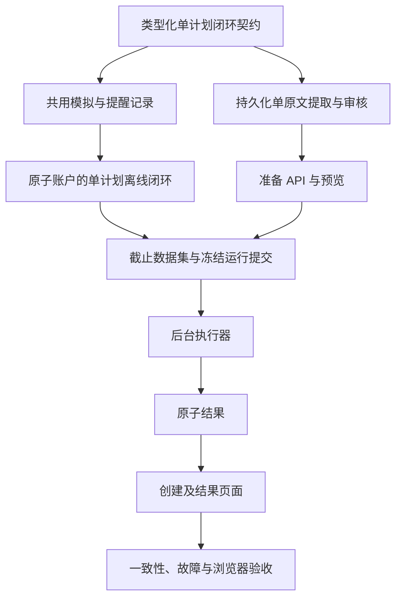

# 实施方案：监控闭环回测

状态：用户于 2026-10-07（Asia/Shanghai）授权先隔离再实施。业务决策来自[设计方案](../docs/specifications/backtesting/PROPOSAL-monitor-loop-backtest.zh-CN.md)，最终 API 批准及真实环境/负载验收仍待完成。实际检查：[验证记录](../docs/verification/monitor-loop-backtest.zh-CN.md)。英文版：[plan.md](plan.md)。当前任务：[todo.zh-CN.md](todo.zh-CN.md)，编号 `ML-T01`–`ML-T39`；此前已完成任务保留在其后。

完整交付验收缺口已记录于 [MV10](../docs/verification/monitor-loop-backtest.zh-CN.md#mv10-完整验收缺口清单)，当前隔离收尾证据见 [MV12](../docs/verification/monitor-loop-backtest.zh-CN.md#mv12-隔离收尾与契约审阅)。用户较窄的启动解耦验收见 [MV11](../docs/verification/monitor-loop-backtest.zh-CN.md#mv11-仅启动解耦验收)：**PASS**，已记录真实应用启动/重启、损坏资源及首次使用失败缓存证据。完整交付的业务/资源任务不是启动验收前置条件。已取消保护工作继续排除，提出新增范围时明确标注。

## IP01. 目标与交付边界

上传一份计划，提取并明确审核完整不可变快照，账户初始化一次，在该固定计划下回放历史监控、提醒、模拟响应与原子账户反馈。计划有效时可跨多个交易日。结束日期可选，在运行提交时按 Asia/Shanghai 一次解析。用户于 2026-10-07 取消按日切换、前版继承/合并及多计划同时回测。

贯通准备、既有回测任务、API、现有 `/backtests/new` 页面和结果。保持在线单份计划流程与冻结历史运行兼容。首版每次运行一个股票/账户，不做跨股票共享资金。完整数量模拟和受支持技术条件沿用设计限制。不支持的导入条款明确展示为限制或准入阻断，不能静默丢弃。

此前空 WAL 修复与 CLI 移除已在分析基线 main 提交。工作区有独立未提交的盛新锂能研究产物，保留在本任务范围外。设计更新自身未授权代码；用户随后授权严格按薄片边界实施。用户随后于 2026-10-07 授权清理、提交并推送当前改动至 GitHub。部署仍在本任务范围外。保留并扩展现有方案及已完成历史任务记录。

## IP02. 决定实施顺序的代码现状

2026-10-09，ML-T18 后调整顺序：既有工作线程完成流程原子验证暂存报告。先完成 ML-T20 的类型化报告及 ML-T21 的发布参与者，再由 ML-T19 消费；ML-T21 依赖冻结输入/报告（ML-T17/ML-T20），避免依赖循环。保留既有完成标准，不改变任务验收或交付数量。

| 现有位置 | 已确认事实 | 对实施的影响 |
|---|---|---|
| `ai/plan_extraction.py`、`ai/extraction.py` | 已有单份原文提取、来源绑定及严格输出校验。 | 复用完整计划提取，仅扩展明确期初账户事实；无需更新/继承契约。 |
| `web/ai_service.py` | 既有提取使用进程内操作及一个并发提取槽。 | 持久化一份准备候选/修订并复用提取防护；不新增全局 AI 预算。 |
| `backtest/run_input.py` | 单个 `plan_snapshot`、正数现金、运行公式 v1–v4。 | 新增独立闭环输入，允许明确零现金，未知现金单独表示，禁止假现金。 |
| `backtest/research_session.py` | 单活动计划，禁止 `_enqueue`，执行调用私有 HTTP 辅助函数。 | 增加记录提醒的闭环会话，并提取共用应用层模拟参与者。 |
| `web/daily_service.py`、`state/daily_accounting.py` | 已有执行校验与持仓转换。 | 最小提取并先证明在线一致性，再加入研究现金提交。 |
| `backtest/research_valuation.py` | 监测回执后才修改资金，期初估值使用持仓成本。 | 新模式需要资金/库存原子更新，区分历史成本与期初市值。 |
| `backtest/dataset.py`、历史 profile 校验 | 当前历史数据就绪依赖完整交易日证据/profile 规则。 | 截至今天需要明确的末日部分时段覆盖，不能削弱既有完整交易日就绪条件。 |
| `backtest/jobs/models.py` | 序列化任务请求上限为 256 KiB。 | 单独存储冻结快照，队列传有界已验证引用，不传原文/快照全文。 |
| `backtest/results.py` | 输入持久化、发布检查和投影假设单输入模型。 | 同时扩展解码、校验、保留期，不能只增加运行器。 |
| `backtest/composition.py` | 提交已有幂等预留，再读取/固定输入。 | 在预留内一次确定默认结束/截止时间，重试复用。 |

表中路径相对 `src/trade_plan_monitor/`。

## IP03. 架构与分段交付



按任务顺序实施。先用一份手工构造的已审核快照证明提醒 → 成交 → 账户 → 下一轮求值，这是开发夹具，最终用户使用真实单原文准备流程。再接通真实准备。每个切片通过可执行检查后才进行依赖工作，不安排主动并行代理。

只有用户明确提交准备操作时，准备过程才调用配置的 AI 供应商。开发检查全部使用虚拟响应。回放不调用 AI、行情供应商或通知通道，数据获取仍属于既有独立同步操作。

## IP04. 模型、存储与身份

### IP04.1 强类型契约

增加职责明确的模块，不继续把旧运行器扩成另一大分支：

| 建议模块 | 职责 |
|---|---|
| `backtest/loop_input.py` | 不可变单计划运行、期初账户、初始绑定、响应/费用设置和规范身份。 |
| `backtest/plan_schedule.py` | 一个初始生效日、可用/有效性、跨日延续及结束/截止解析，拒绝第二条目。 |
| `backtest/preparation_models.py` | 一份原文/候选/审核状态及修订、证据绑定。 |
| `ai/loop_plan_extraction.py` | 完整单计划提取适配器，包含明确期初账户事实及独立版本化提示身份。 |
| `backtest/loop_session.py`、`backtest/loop_runner.py` | 隔离当前监控参与者及按时间排序的事件编排。 |
| `backtest/reminder_capture.py`、`backtest/response_policy.py` | 发送资格、提醒身份和延迟完整数量意图。 |
| `backtest/loop_account.py`、`backtest/loop_report.py` | 原子资金参与者与强类型审计/绩效投影。 |

除实施开始时已经存在者外，以上均为建议新增文件。Python 契约严格且不可变，公共载荷不用任意字典。资金采用整数分和精确 Decimal 运算，期初单股成本通过准确总成本保留原精度。审核状态、提取状态和模拟权限相互区分。

使用建议判别符 `monitor-loop-input-v1`、`monitor-loop-report-v1` 及运行哈希域 `backtest-run-v5`，ML-T01 检查冲突。旧 v1–v4 编码逐字节保持一致。新公开模式不把内部版本号作为产品选择。哈希覆盖单份已审核快照和冻结策略；供应商尝试 ID、准备 UUID、任务时间不进入语义事件身份。未来行情不能改名早期事件。

### IP04.2 存储归属

- **准备：** 配置回测库旁独立 `backtest-preparation.sqlite3`，保存一份原文的修订、尝试、完整候选、审核及冻结清单。使用标记化模式/版本和既有路径域拒绝，不添加在线监控表，开发测试不迁移生产库。
- **回放会话：** 私有临时 SQLite，资金和监控持仓/信号/风险使用同一连接/事务，调用方负责提交/回滚。
- **已提交输入：** 确认提交前，将已批准清单与完整规范单计划输入复制到持久存储。预约绑定不可变 `(run_id, input_hash)` 引用后入队；执行器不依赖可变准备。中断预约留下可恢复绑定或可回收未引用产物。
- **结果：** 使用既有暂存/原子完成，明确扩展新判别符解码/发布校验。必要存储升级需记录迁移及旧库夹具，不在启动时临时 `ALTER TABLE`。
- **保留：** 总共最新 30 条已物化历史运行，发布后由有界维护删除最旧超额摘要/成交/详情，置顶不绕过上限。保留运行保护冻结输入及兼容导出；保护排队/运行引用及共享数据集/快照。失败/取消暂存与任务/幂等到期不变。不新增字节/磁盘/日志预算，ML-T21 保留策略不阻塞 ML-T34 隔离。

### IP04.3 建议有界默认值

首期计划/原文数恰好为一。保留既有 150,000 字符上限及 8 MiB UTF-8 防护（单份原文时字符上限更严格）。拒绝第二份原文/条目，包括相同版本。单份已审核计划的证据哈希保留独立有界集合。复用普通提取并发/供应商防护，一次活动调用，至多 3 次可重试尝试。语义歧义进入审核，未知供应商结果持久化，重启后不盲重试。

保留任务请求 256 KiB、初始批次 200 个、安全整数范围，以及包含状态刷新的 70,000 次监控评估上限。每次运行的提醒、响应意图和执行尝试分别上限 70,000，流式记录并在超限前明确失败。这是建议的新模式容量，不代表已有性能验收。用边界测试验证，不为此重跑无关的高成本全量容量套件。

## IP05. 提取、审核与执行算法

### IP05.1 单原文准备

先持久化一份原文/修订，以修订/代次防护认领，在事务外调用 AI。提取完整计划及明确期初账户事实，不含前版上下文、差异操作或后继物化。编辑/取消/重启后拒绝晚到结果。

复用既有来源/条款/字段审核语义，绑定原始证据及精确原文/内容/账户修订，不编造 `HUMAN_SUPPLEMENT` 或批准。仅冻结明确审核快照。编辑原文使其候选/审核失效，已提交输入保持不可变。

持久化进度、有界重试及重启状态，区分请求失败、语义歧义和未知供应商结果。保留提取防护，不将跨入口全局 AI 配额基础设施作为隔离门槛。

ML-T10 在扩展前拆分实施：先给既有准备文档增加可选工作线程归属/进度并增加既有任务准入预留的精确读取，再接通自有提取与配置供应商。两个切片分别包含四个主要文件，含共用测试共七个不同文件。既有准备记录保持可读，不新增任务类型、队列、数据库、公开路由或全局 AI 预算。实际调用结束且耐久结果已记录前保留准入令牌；未知付费结果恢复前须明确确认此前工作已结束。

ML-T11 审核为一次明确、检查修订的人工操作。可提供修正后的草稿/来源映射及带明确证据的期初账户；按字段限定的人工补充只能来自本操作，不能来自 AI 输出。重新计算原文/条款/字段及期初事实检查，不能通过已阅确认消除未解决技术条款。在同一事务中将一份有界不可变清单写入既有候选载荷并记录精确审核声明，保留原始提取哈希和账户事实。原文修正后，原始审核回执仍可读取，当前候选/审核则失效。未知账户事实保持显式状态，交由后续运行准入检查；不推断现金、取得日期、可卖数量或期初价格。审核复用既有全局准入、元数据归属和数据库结构，不新增公开路由/表，不解析运行结束日期/截点，也不启用生产计划。

ML-T12 在扩展前拆成两个切片，每个四个主要文件，含共用测试共七个不同文件。先在既有存储/服务/组合中增加创建收据重放、全局准入和准备能力归属，再在既有应用挂载类型化 HTTP 命令。准备库仅在明确准备请求时打开。元数据操作不启动任务协调器或请求 AI；只有新提取在检查原始收据后捕获既有配置适配器。复用既有惰性生命周期及实际排空后的关闭。挂载单原文创建/读取/原文编辑/提取/取消/审核/恢复路由，公开投影有界且不暴露私有归属/准入/供应商诊断。恢复仅确认旧工作结束，不重新提交。准备库故障缓存并限定在回测。新路由保持挂载供 HTTP 验证，模式发布暂存至 ML-T13；当前已批准 OpenAPI/类型/摘要保持不变。ML-T13 先发布路由模式标记，再生成契约供最终具体审阅，不自行批准摘要。

ML-T13 分三个切片（2 / 2 / 6 个主要文件，含共用测试共八个不同文件）。先将 EXTRACTION/FROZEN/UNAVAILABLE 建成真正可判别的候选联合，将公开内嵌审核/尝试/冻结修订限制在既有安全整数范围，保持成功传输字段及 null 值。再发布已挂载路由，记录实际取消 200/202 状态及有界成功/错误响应头。最后扩展现有生成器，规范化新出现的输入/输出模式名称并保留旧响应名称，再生成两种既有契约 profile，证明原路由/模式/类型不变。漂移验证通过后共同提交发布及生成产物。不改变准备/存储/任务/UI 行为或已批准摘要/路径基线；既有批准失败留给 ML-T29 记录，不抑制。

### IP05.2 同一固定计划下的事件循环

生成行情可用、日历及许可外部证据事件。每个时刻：暴露证据/日历 → 在同一冻结计划下推进支持的生命周期状态 → 共用监控求值 → 复核/记录提醒 → 处理就绪意图 → 提交/刷新状态 → 审计/估值。跨日保留激活和信号次数，到期/停用时遵守授权而不替换另一计划。不生成计划切换事件或转移后继意图。

响应策略为每个授权发生创建一个稳定意图，并重新检查风险目标。首根合格分钟区间起点不早于响应就绪时间，收盘价只能在证据可用后消费。禁止信号同根成交、任意冲突排序、部分数量替代和零时间循环。现有共用检查继续控制 T+1、CORE、容量、风险及权限。

变更前计算价格/滑点/费用和现金是否充足。在一个私有事务中：复核修订/资格 → 应用现金与批次变化 → 消费信号/完成风险 → 写回执/审计 → 提交。在任意写入之间注入故障均须整体不变。重复意图返回同一结果，不二次成交。在线模拟保持现有行为，研究资金参与者不能静默给在线监控增加现金账户。

### IP05.3 覆盖与结束日期

保留旧完整交易日清单。新闭环模式冻结独立区分的覆盖描述，包括解析结束日期、可用截止、完整历史交易日及可选末日部分时段。校验截止前所有要求的完整区间；尚未完成区间不在范围内，要求区间缺失才是缺口。保留供应商规范化和日历语义，不把部分交易日标为完整已验证交易日。回放工作者不获取网络数据。

提交时在幂等预留后一次解析默认结束/截止，同一请求次日重试返回原输入。使用当时可用的完整证据，报告实际末条证据/估值时间。到截止后停止，保留持仓和未成交意图，不编造末日清仓。期初市值与会计成本独立，期初权益分母为零时不提供百分比收益，不能除零。

## IP06. 应用接口与页面边界

ML-T12 挂载下列单原文准备资源。ML-T13 发布其模式及生成契约后再编写 UI；闭环运行提交仍待完成：

| 操作 | 路径/用途 |
|---|---|
| 创建准备 | `POST /api/v1/backtest-preparations` — 恰好一份原文；持久身份/状态。 |
| 读取进度 | `GET /api/v1/backtest-preparations/{preparation_id}` — 包含单份原文及候选的有界投影。 |
| 修正原文/初始绑定 | `PUT /api/v1/backtest-preparations/{preparation_id}/source` — 预期修订；使本候选/审核失效。 |
| 开始/重试提取 | `POST /api/v1/backtest-preparations/{preparation_id}/extractions` — 预期准备修订；稳定幂等。 |
| 取消准备工作 | `POST /api/v1/backtest-preparations/{preparation_id}/cancellations` — 停止新调用，阻止晚到响应提交。 |
| 审核/冻结 | `POST /api/v1/backtest-preparations/{preparation_id}/reviews` — 精确单原文/内容/账户/证据/修订绑定。 |
| 确认工作结束 | `POST /api/v1/backtest-preparations/{preparation_id}/recoveries` — 精确代次/修订及字面值 `confirmedEnded: true`；不重新提交。 |
| 提交回放 | 既有 `POST /api/v1/backtest-runs` 增量接受有区分值的闭环命令，引用已审核准备修订、可选 `endDate`、数据集和响应设置。 |

准备命令封装字段使用 camel-case，内嵌研究字段保留原名。创建接受 `input`，编辑接受 `source` 及 `expectedRevision`，提取/取消接受 `expectedRevision`，审核接受 `review`，恢复接受 `generation`、`expectedRevision` 及 `confirmedEnded`。进度公开有界状态、原文、尝试及类型化候选/冻结值，不公开私有归属/准入/供应商诊断。服务端负责资格、期初事实、审核及解析日期，复用同源/变更防护、请求幂等和既有错误封装。请求体/模式/语义校验沿用既有约定；缺失资源为 404，过时/冲突修订或载荷复用为 409，配置服务不可用为 503。HTTP 输入不接受文件系统路径，不泄露供应商秘密、原始异常或任意生成 HTML。

Web/API 构造一份不可变已审核计划输入并提交既有后台协调器，由 ML-T19 分派执行器。移除回测 CLI 命令/专用兼容逻辑，不新增 CLI 或独立命令所属协调器。

| Vue 职责 | 建议组件/composable 边界 |
|---|---|
| 上传一份原文计划 | `PlanPreparationSourceForm.vue`：输入一份原文，输出编辑/提交事件。 |
| 原文进度及重试 | `PlanPreparationProgress.vue`：输入服务端状态，输出重试/取消意图。 |
| 审核计划和期初账户 | `PlanPreparationReview.vue`：输入完整快照/证据/问题，输出修正/审核意图。 |
| 准备副作用 | `usePlanPreparation.ts`：API/轮询/修订/错误状态，在卸载/终态停止。 |
| 提交运行 | 既有 `BacktestRunForm.vue` / `useBacktestRunForm.ts`：单份已审核快照、可选结束及明确假设。 |
| 解释运行 | `MonitorLoopTimeline.vue`：分页因果事件及冻结计划来源，既有图表使用服务端估值。 |

路由视图保持组合职责，使用 Vue Composition API、TypeScript 和 `<script setup>`，属性向下、事件向上。浏览器不重复资金检查或提醒决策。

ML-T14 使用三个切片（2 / 2 / 4 个主要文件，含共用测试共五个不同文件）：准备传输、单份控制器、原文/进度组件，并在同一控制器补齐未保存原文及旧读取刷新保护。原文表单接受一份 UTF-8 文本/Markdown 文件或粘贴文本，可选填写上海时间边界，保持错误及编辑可见，并发出受控原文/提交意图。进度接收只读权威状态，发出提取/取消/刷新/同请求重试或明确结束确认意图。控制器在结果未确认时保留一份不可变变更载荷/键，忽略过时读取和旧原始回执，在空闲/终态且实际排空或卸载时停止轮询。CANCEL_REQUESTED/UNKNOWN/未结束工作继续阻止新操作，即使表面状态已进入终态。修改后的原文先保存才可提取。恢复不隐含提取。采用既有设计变量及无障碍标签/状态/错误。临时浏览器界面验证组件；生产页面组合及审核预览仍在 ML-T15。不引入队列、共用锁、后端修改或 API 批准。

ML-T15 使用四个切片（5 / 3 / 2 / 5 个主要文件，含共用测试共八个不同文件）：有界准备审核传输/预览校验、明确单份准备审核/控制器、页面组合及独立 `PreparationFrozenView` 凭据修正。页面组合与修正在真实 HTTP 和最终门禁通过后共同提交。保留只读完整规则、原始来源/账户事实及待解决项可见；确认绑定当前原文/候选/审核修订，变化时清除。未保存/未结束/未确认工作阻止新的互斥操作。未知现金与零值区分，缺失时间仍为阻断项，原文修正后重新提取。审核不启用生产计划、不提交闭环回测；ML-T24 负责运行提交。保留既有回测创建、后端语义及生成/已批准契约。

## IP07. 任务顺序与检查点

权威勾选状态和文件清单位于 [todo.zh-CN.md](todo.zh-CN.md)。每项约五个主要文件以内，包含测试；若额外独立行为或契约产物扩大范围，应继续拆分。

| 检查点 | 任务 | 可运行结果/门槛 |
|---|---|---|
| ML-C01 | ML-T01–ML-T03 | 强类型输入、共用模拟/提醒记录适配，在线回归不变。 |
| ML-C02 | ML-T04–ML-T05 | 完整单计划闭环、原子资金/持仓，无未来交易脚本；ML-T06 取消。 |
| ML-C03 | ML-T07–ML-T08 | 持久单原文准备及完整来源绑定候选；ML-T09 取消。 |
| ML-C04 | ML-T10–ML-T12 | 可重启单份准备/审核及使用假 AI 的真实 API。 |
| ML-C05 | ML-T13–ML-T15 | 生成准备契约，上传/进度/审核 UI。 |
| ML-C06 | ML-T16–ML-T18 | 截止数据、耐久规范输入引用、幂等提交。 |
| ML-C07 | ML-T19–ML-T21 | 工作者到原子存储报告，取消不发布完成结果。 |
| ML-C08 | ML-T22–ML-T24 | 结果 API、既有导出兼容保持不变、生成契约和常规创建运行 UI。 |
| ML-C09 | ML-T25–ML-T27 | 结果时间线、独立一致性/故障检查、浏览器流程。 |
| ML-C10 | ML-T28–ML-T29 | 双语操作证据及经审阅的契约/快照一致。 |

门槛失败先定位，再继续依赖工作；不能以跳过断言或降低约束替代证据。检查点属于技术验证，不是每完成几项就自动请求许可。真正改变产品范围时提供具体差异再讨论。

## IP08. 验证、已知风险与完成标准

使用任务列出的新增针对性 pytest、现有统一运行/模拟/回放一致性和冻结兼容测试、虚拟 AI 提取测试、生成模式检查、Vitest、类型检查/构建及虚拟供应商 Playwright 流程。新测试文件名是计划产物，不声称已存在。本次文档规划不运行应用套件或付费外部请求。

最终标准命令，从 `trade-plan-monitor/` 执行：

```text
.venv/Scripts/python.exe -m pytest tests/unit tests/contract -q -m "not live"
.venv/Scripts/python.exe -m pytest tests/integration/test_unified_runtime.py tests/integration/test_unified_simulation_transactions.py tests/integration/test_unified_replay.py tests/integration/test_unified_replay_parity.py tests/integration/test_backtest_compatibility.py tests/integration/test_openapi_snapshot.py -q -m "not live"
.venv/Scripts/python.exe -m ruff check src tests scripts
.venv/Scripts/python.exe scripts/generate_frontend_types.py --check
npm --prefix web run test -- --run
npm --prefix web run type-check
npm --prefix web run build
npm --prefix web run test:e2e
git diff --check
```

另运行全部新增针对性测试。只按共用参与者变化扩大集成范围，保留未受影响的高成本容量证据，不标为新性能验收，不默认运行整个昂贵容量套件。

| 风险/已知限制 | 必须处理 |
|---|---|
| AI 提取遗漏或编造条款 | 来源绑定完整候选、独立语义夹具及明确人工审核。 |
| 冻结计划在回放中到期 | 结束普通授权且不替换，保留账户/风险义务并解释边界。 |
| 原文含部分成交/基本面退出 | 明确不支持条款，执行前取得限定范围的已审核计划，不能以较窄引擎宣称复现全部盛新锂能原文。 |
| 故障导致资金/库存分离 | 同事务、独立前后断言和故障注入。 |
| 当前日期不是完整交易日 | 新截止覆盖区分值与时间边界夹具，旧 profile 不变。 |
| 准备结果在编辑/重启后到达 | 原文/修订/代次防护及稳定意图幂等。 |
| OpenAPI 批准与最终接口审阅 | MV12 已审阅并纠正既有统一研究 API 的陈旧批准，单独保留原失败。未来监控闭环 API 差异须具体审阅后才在双语文档记录新批准摘要，不能静默填入未经审阅摘要或修改测试。 |
| 完整输入超过队列限制 | 冻结输入引用、哈希验证和保留期固定。 |

完成需具备 ML-A01–ML-A24 中除已取消 ML-A07 外的活动验收证据、可用单计划准备/回放/结果、旧字节兼容及明确原文/数据限制。不包含券商执行、真实通知、在线 AI 认证、生产迁移或部署。

## IP09. 已选线程隔离与交付顺序

用户于 2026-10-07 选择同进程专用线程隔离，首次明确使用回测才准备。ML14–ML17 与[ADR 0008](../docs/decisions/0008-isolate-backtest-service-lifecycle.zh-CN.md) 已描述该选择。未选择子进程，也不把它作为必经后续阶段。启动耦合源于“全部成功”的生命周期组合，不是监控依赖回放的固有业务关系。

保留 ML-T01–ML-T39 和完成历史，就地修订未完成隔离任务。交付 ML-T30 → ML-T31 → ML-T32 → ML-T33 → ML-T34：契约、无副作用启动与首次激活、有界线程归属、感知排空的恢复/取消、既有有限工作防护回归及历史同步本地限速。ML-C11 验证独立启动/归属，ML-C12 验证安全恢复和有界准入。业务任务沿用依赖图：ML-T01 依赖 ML-T30，ML-T10/ML-T19 依赖 ML-T34，ML-T12/ML-T18 依赖 ML-T33。

准备/运行 API 后 ML-T35 公开服务状态/控制，ML-T39 先生成传输契约再实施 ML-T36 UI。ML-T27 加入降级/恢复导航。ML-T37 验证 Windows 线程/故障/负载范围，ML-T38 记录操作。ML-T28 依赖 ML-T37，ML-T29 依赖 ML-T38/ML-T39。ML-C10 为最终审阅，不能绕过未解决门槛。

| 新增检查点 | 任务 | 门槛 |
|---|---|---|
| ML-C11 | ML-T30–ML-T32 | 启动/状态/关闭不打开回测资源，并发首次使用只初始化一次，元数据与执行分开，无子进程或 CLI。 |
| ML-C12 | ML-T33–ML-T34 | 取消/发布保护，物理排空后替换，既有有限工作防护回归及历史同步本地限速。 |
| ML-C13 | ML-T35–ML-T39 | 独立 API/UI、Windows 故障/负载测量及双语恢复指导。 |

组合改动：lifespan 只注册无副作用惰性回测管理器。首次真正数据/操作使用请求 single-flight 准备，通过按需创建的自有执行器完成，元数据读取不激活执行。能力就绪后才发布绑定。保留现有协调器、仓库执行器、耐久队列/结果库和原子发布。回测异常/清理归属与监控分开。应用启动零回测校验/I/O/预热/队列恢复。新提交只授权自己的任务，历史待处理任务仅明确选中授权后恢复，不能由历史读取触发。

ML-T33 并发纠正，2026-10-07：用户最新要求覆盖 MV12 中此前的过期释放任务槽选择。所有未完成 QUEUED/RUNNING/CANCEL_REQUESTED 记录继续占用准入，包括过期/未知租约。不同的新任务及互斥同步/验证/回放不能启动。明确恢复只选一个既有任务，等待物理工作线程排空；完成/失败/取消终态释放任务槽。保留 30 秒租约/最多 3 代领取，以及过期 token、发布、取消和幂等保护。历史记录保持，遗留待处理记录须明确核对处理后才准入新任务。不新增状态/数据库结构/公开字段。实际证据：MV18 与 ADR 0009；控制/UI 及完整负载验收仍待完成。

初始化超时和取消不能停止线程。记录未完成物理工作，保留晚到工作所需存储，排空前禁止替换。不协作工作时整个进程重启仍是明确最终手段，并影响监控。不包括每线程硬 CPU/内存上限、IPC、spawn、Job Object 或进程恢复保证。

用户于 2026-10-07 确认低频 AI 提取不阻塞隔离，并将在线容量工作收窄为本地历史同步节流。保留普通单原文提取防护及监控请求控制。ML-T34 仅在 `backtest/sync.py` 使用既有 1.25 秒间隔、取消及超时/错误处理，为串行同步请求增加固定最小启动间隔。不新增全局配额池、预留容量、跨业务调度、共享冷却、账户/接口注册、动态分配、配额 UI 或通用准入框架。假调用验证间隔/取消，整体负载验收独立。回放无网络/AI/真实通知能力；Windows 检查使用临时库/假服务，付费请求及生产迁移仍排除。IP01 记录清理/提交/推送授权。

完成需 ML-A01–ML-A24 中除已取消 ML-A07 外的活动验收、37 个活动任务及 13 个检查点。39 个任务 ID 全部保留，ML-T06/ML-T09 为取消而非完成。MV12 解决已提交统一研究 API 审批不匹配；未来 API 修改摘要前仍需最终具体审阅。文档检查覆盖双语 ID/依赖/命令/文件、原始已完成历史及相对链接。区分已执行离线/故障检查和剩余负载工作。

用户于 2026-10-07 将导出限定为既有兼容。ML-T22 只增加分页闭环结果/详情，不新增导出格式/下载 UI/批量打包/任务/调度器/互斥。准备要求明确审核/冻结，已提交不可变输入继续独立。用户最新要求同时限定一个未完成任务，终态前拒绝互斥准备/同步/验证/回放。在现有入口/事务边界落实，不新增队列、调度器或通用锁模块。ML-T07/ML-T08/ML-T10/ML-T11 私有持久化/提取/自有编排/审核冻结已通过 MV20–MV23；ML-T12/ML-C04 的准备 HTTP 集成以相同全局准入规则通过 MV24。准备生成契约已通过 ML-T13/MV25；原文/进度组件已通过 ML-T14/MV26；页面/审核 UI 已在 MV27 通过 ML-T15/ML-C05，API 批准仍待 ML-T29。

存储范围，2026-10-07：仅保留既有独立默认数据库、路径规范化及存储领域拒绝。不新增深度 Windows 文件身份或跨文件别名检查。ML-T34 保留既有防护回归，不要求新增存储保护实现。用户随后采用仅保留既有内存防护的建议：保留有限输入/事件/队列、单执行、有界线程及分页，移除新增动态 CPU/内存压力准入/取消及通用资源控制模块。保留离线负载验证以测量实际竞争。ML-T34 现仅新增本地同步限速并回归既有防护。

按需细节：ML16 定义 NOT_INITIALIZED/READ_READY、single-flight/503 重试、无副作用状态/预取/关闭及明确积压恢复。现有未完成任务保留 ID/依赖，不新建冲突清单。

## IP10. 单计划范围纠正

用户于 2026-10-07 要求仅实现单计划回放，覆盖此前计划链/批次选择。取消 ML-T06/ML-T09 及 ML-A07，保留 ID 和历史证据；活动依赖/检查点排除它们。准备接受一份原文，审核冻结一份快照，一个初始绑定在有效期内控制整段运行。日历/账户/响应/到期/因果/隔离/发布防护保持。2026-10-09 已完成 28 个任务，37 个活动任务中剩余 9 个。ML-T05/ML-C02 的私有单计划循环通过 MV19：提醒驱动买卖时点、风险优先/到期维护、精确账户反馈和有限边界。ML-T07 的私有原文/尝试/候选/审核持久化、重启/幂等及取消中保护已通过 MV20。ML-T08/ML-C03 的版本化完整计划/期初账户提取、精确来源证据、未知事实/不支持条款阻断及持久化往返已通过 MV21。ML-T10 的持久化代次/进度、实际排空前保留既有全局准入、配置自有调用及未知结果显式恢复已通过 MV22。ML-T11 的精确明确审核、原子不可变清单、原始收据重放及原文失效已通过 MV23。ML-T12/ML-C04 的有界准备命令、真实本地 HTTP 配假 AI 的取消/编辑/审核/重启、惰性能力归属、存储失败缓存及单任务准入通过 MV24。ML-T13 发布两种生成准备契约并保留既有路由/类型（MV25）；两项未改动批准门禁仍待 ML-T29。ML-T14 交付原文/进度组件及稳定请求/轮询保护（MV26）；ML-T15/ML-C05 交付精确候选审核及页面组合，并通过真实 HTTP 验证（MV27）；ML-T16 在不放宽旧就绪规则的前提下冻结截止安全的不可变证据（MV28）；ML-T17 以已验证有界引用耐久复制完整审核输入及不可变行情依赖（MV29）；ML-T18/ML-C06 以原始预约截止绑定准备提交，强制精确公共意图重放、自有复制/续期及取消排空（MV30）；ML-T20 增加流式类型化因果审计及真实市值/成本估值（MV31）；ML-T21 验证原子类型化发布及最近 30 次整次运行/文件留存（MV32）；ML-T19/ML-C07 已接入原生冻结工作者分派、明确线程授权、取消排空及既有完成维护（MV33）；ML-T22 已提供有界类型化结果查询、冻结来源、因果分页及导出兼容（MV34）；ML-T23 已生成两套运行/结果契约并验证判别类型及前端兼容（MV35）；ML-T24 已接入准备提交及待确认结果的原请求重试（MV36），完成 ML-C08；ML-T25 已校验并展示原生单计划汇总及因果分页（MV37）；下一项 ML-T26 验证独立一致性及故障，最终批准仍为 ML-T29。MV18 记录单任务准入清理。
