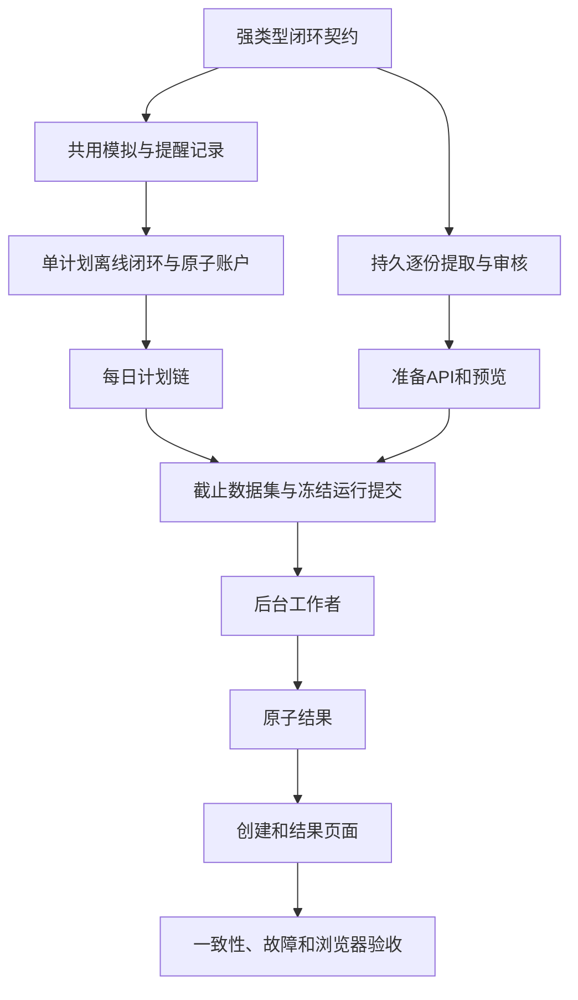

# 实施方案：监控闭环回测

状态：用户于 2026-10-07（Asia/Shanghai）授权先隔离再实施。业务决策来自[设计方案](../docs/specifications/backtesting/PROPOSAL-monitor-loop-backtest.zh-CN.md)，最终 API 批准及真实环境/负载验收仍待完成。实际检查：[验证记录](../docs/verification/monitor-loop-backtest.zh-CN.md)。英文版：[plan.md](plan.md)。当前任务：[todo.zh-CN.md](todo.zh-CN.md)，编号 `ML-T01`–`ML-T39`；此前已完成任务保留在其后。

完整交付验收缺口已记录于 [MV10](../docs/verification/monitor-loop-backtest.zh-CN.md#mv10-完整验收缺口清单)，当前隔离收尾证据见 [MV12](../docs/verification/monitor-loop-backtest.zh-CN.md#mv12-隔离收尾与契约审阅)。用户较窄的启动解耦验收见 [MV11](../docs/verification/monitor-loop-backtest.zh-CN.md#mv11-仅启动解耦验收)：**PASS**，已记录真实应用启动/重启、损坏资源及首次使用失败缓存证据。完整交付的业务/资源任务不是启动验收前置条件。已取消保护工作继续排除，提出新增范围时明确标注。

## IP01. 目标与交付边界

首份和全部后续计划一次上传，按时间顺序逐份 AI 提取，审核后形成不可变计划链；首份计划初始化账户，历史监控按日更新计划、生成提醒、模拟响应并原子反馈账户。没有新计划时沿用仍有效计划。结束日期可选，在提交运行时按 Asia/Shanghai 一次确定。

贯通准备、既有回测任务、API、现有 `/backtests/new` 页面和结果。保持在线单份计划流程与冻结历史运行兼容。首版每次运行一个股票/账户，不做跨股票共享资金。完整数量模拟和受支持技术条件沿用设计限制。不支持的导入条款明确展示为限制或准入阻断，不能静默丢弃。

此前空 WAL 修复与 CLI 移除已在分析基线 main 提交。工作区有独立未提交的盛新锂能研究产物，保留在本任务范围外。设计更新自身未授权代码；用户随后授权严格按薄片边界实施。用户随后于 2026-10-07 授权清理、提交并推送当前改动至 GitHub。部署仍在本任务范围外。保留并扩展现有方案及已完成历史任务记录。

## IP02. 决定实施顺序的代码现状

| 现有位置 | 已确认事实 | 对实施的影响 |
|---|---|---|
| `ai/plan_extraction.py`、`ai/extraction.py` | 已有单原文提取、来源绑定和严格输出校验。 | 增加明确更新提取契约，不将全部计划一起发送，不改变旧提示词含义。 |
| `web/ai_service.py` | 提取操作在进程内保存，当前并发提取槽为一个。 | 持久批次需要独立耐久条目状态，复用提取防护并顺序执行。新增全局 AI 预算不是资源隔离前置条件。 |
| `backtest/run_input.py` | 单个 `plan_snapshot`、正数现金、运行公式 v1–v4。 | 新增独立闭环输入，允许明确零现金，未知现金单独表示，禁止假现金。 |
| `backtest/research_session.py` | 单活动计划，禁止 `_enqueue`，执行调用私有 HTTP 辅助函数。 | 增加记录提醒的闭环会话，并提取共用应用层模拟参与者。 |
| `web/daily_service.py`、`state/daily_accounting.py` | 已有执行校验与持仓转换。 | 最小提取并先证明在线一致性，再加入研究现金提交。 |
| `backtest/research_valuation.py` | 监测回执后才修改资金，期初估值使用持仓成本。 | 新模式需要资金/库存原子更新，区分历史成本与期初市值。 |
| `backtest/dataset.py`、历史 profile 校验 | 当前历史数据就绪依赖完整交易日证据/profile 规则。 | 截至今天需要明确的末日部分时段覆盖，不能削弱既有完整交易日就绪条件。 |
| `backtest/jobs/models.py` | 序列化任务请求上限 256 KiB。 | 冻结计划链独立存储，队列传有界已验证引用，不塞入全部原文/快照。 |
| `backtest/results.py` | 输入持久化、发布检查和投影假设单输入模型。 | 同时扩展解码、校验、保留期，不能只增加运行器。 |
| `backtest/composition.py` | 提交已有幂等预留，再读取/固定输入。 | 在预留内一次确定默认结束/截止时间，重试复用。 |

表中路径相对 `src/trade_plan_monitor/`。

## IP03. 架构与分段交付



按任务顺序实施。先用人工构造且已审核的测试快照证明高风险的“提醒 → 成交 → 账户 → 后续评估”路径，这是开发夹具，不是最终用户流程；再接通真实批量准备。每段在后续依赖它之前都有可执行检查。本方案不安排主动多代理并行工作。

只有用户明确提交准备操作时，准备过程才调用配置的 AI 供应商。开发检查全部使用虚拟响应。回放不调用 AI、行情供应商或通知通道，数据获取仍属于既有独立同步操作。

## IP04. 模型、存储与身份

### IP04.1 强类型契约

增加职责明确的模块，不继续把旧运行器扩成另一大分支：

| 建议模块 | 职责 |
|---|---|
| `backtest/loop_input.py` | 不可变闭环运行、期初账户、日程引用、响应/费用设置和规范身份。 |
| `backtest/plan_schedule.py` | 首份起点、每日生效版本、沿用、结束/截止解析与日历转换。 |
| `backtest/preparation_models.py` | 批次/条目/审核状态，以及绑定原文/基线的变化操作。 |
| `ai/plan_update_extraction.py` | 有界历史上下文和独立提示词身份的首份/后续提取适配。 |
| `backtest/plan_updates.py` | 确定性应用已校验的新增/修改/撤销/保留操作。 |
| `backtest/loop_session.py`、`backtest/loop_runner.py` | 隔离当前监控参与者及按时间排序的事件编排。 |
| `backtest/reminder_capture.py`、`backtest/response_policy.py` | 发送资格、提醒身份和延迟完整数量意图。 |
| `backtest/loop_account.py`、`backtest/loop_report.py` | 原子资金参与者与强类型审计/绩效投影。 |

除实施开始时已经存在者外，以上均为建议新增文件。Python 契约严格且不可变，公共载荷不用任意字典。资金采用整数分和精确 Decimal 运算，期初单股成本通过准确总成本保留原精度。审核状态、提取状态和模拟权限相互区分。

建议区分值为 `monitor-loop-input-v1`、`monitor-loop-report-v1`，运行哈希域为 `backtest-run-v5`，在 ML-T01 检查命名冲突。旧 v1–v4 编码逐字节不变。新公共模式不把内部 Schema 号作为产品选择。语义哈希包含输入和冻结策略，不把供应商尝试 ID、批次 UUID、任务时间放入语义事件身份。修改未来计划不能重命名早期事件。

### IP04.2 存储归属

- **准备存储：** 在配置的回测存储旁新增独立 `backtest-preparation.sqlite3`，保存批次、条目修订、尝试、候选变化、审核和冻结清单。使用明确模式/版本与路径域检查，拒绝指向在线/行情/结果数据库。不向在线监控库添加准备表。支持新空库初始化，迁移既有用户库不属于开发测试。
- **回放会话：** 私有临时 SQLite 会话，资金分录与监控持仓/信号/风险更新在同一连接、同一事务。共用执行参与者内部不能提交，由研究工作单元统一提交/回滚。
- **已提交输入：** 回应任务提交前，将已审核清单和完整规范闭环输入复制到耐久结果/输入存储。队列只需不可变 `(run_id, input_hash)` 引用，工作者不能依赖可变准备批次。原子预留在入队前绑定引用，中断后留下可恢复绑定或可回收的无引用产物。
- **结果：** 复用既有暂存和原子完成流程，为新区分值明确扩展输入编解码和发布校验。现有 JSON 存储能安全承载时优先使用；确需结果库版本升级时，须有文档化迁移与旧库夹具测试，不能在启动时随意 `ALTER TABLE`。
- **保留期：** 历史已发布运行总共保留最新 30 个；新结果发布后复用有界维护，清理最旧超额运行及其摘要、成交和详情。置顶不豁免总数上限。保留运行保护其输入链，清理准备数据不能破坏保留运行或其兼容导出。保护排队/运行中任务引用及共用数据集/快照。既有失败/取消暂存及任务/幂等过期规则保持不变。不新增磁盘/日志字节预算或空闲容量准入；数量保留策略归 ML-T21，不阻塞 ML-T34 隔离。

### IP04.3 建议有界默认值

ML-T01 在引入常量前检查既有更严格限制，新模式不能隐式提高旧上限。建议首版上限：每批 256 份原文、UTF-8 原文总计 8 MiB、沿用单份 150,000 字符限制、每批同时一个 AI 提取、每项可重试失败最多共 3 次尝试。保留普通提取既有并发防护。语义歧义直接进入审核；供应商结果未知的超时须记录，重启后不能盲目重试。

保留任务请求 256 KiB、初始批次 200 个、安全整数范围，以及包含状态刷新的 70,000 次监控评估上限。每次运行的提醒、响应意图和执行尝试分别上限 70,000，流式记录并在超限前明确失败。这是建议的新模式容量，不代表已有性能验收。用边界测试验证，不为此重跑无关的高成本全量容量套件。

## IP05. 提取、审核与执行算法

### IP05.1 顺序准备

先持久化批次和有序原文哈希，带修订/代次保护领取一项，在事务外调用 AI。首项输出明确期初账户事实与规则候选；后续项仅接收自身原文、已校验前版和原始来源绑定，不读取未来原文。校验变化并形成完整版本。原文/基线已变化的晚到结果拒绝接收。

通过接收候选及多原文证据包的应用参与者复用现有条款/字段审核语义。继承字段绑定原始文字及已审核继承范围，不能改标为本次原文或伪造 `HUMAN_SUPPLEMENT` 证据。已校验候选可以支持下一项提取，但只有已审核清单才能授权回放。批次审核预览全部生效快照并绑定链哈希；修改祖先使受影响后续批准失效。

逐项进度/重试状态持久化，重启以新代次接管未完工作，拒绝旧代次完成，保留此前成功项。区分请求失败、语义歧义和供应商结果未知，显示可处理状态而不是跳过计划。批内逐项顺序提取，复用既有提取防护；新增跨入口全局 AI 额度基础设施不作为资源隔离门槛。

### IP05.2 事件循环与每日更新

生成行情可用、日历、计划切换和允许的外部证据事件。每个时点依次执行：证据/日历可见 → 日程生命周期变化 → 共用监控评估 → 复核/记录提醒 → 处理就绪意图 → 提交/刷新状态 → 审计/估值。同版本沿用保留信号发生；真实替换使旧普通意图失效，但继承账户和风险义务。次日信号因早晨替换而失效时明确报告，不静默转交新版本。

响应策略为每个授权发生创建一个稳定意图，并重新检查风险目标。首根合格分钟区间起点不早于响应就绪时间，收盘价只能在证据可用后消费。禁止信号同根成交、任意冲突排序、部分数量替代和零时间循环。现有共用检查继续控制 T+1、CORE、容量、风险及权限。

变更前计算价格/滑点/费用和现金是否充足。在一个私有事务中：复核修订/资格 → 应用现金与批次变化 → 消费信号/完成风险 → 写回执/审计 → 提交。在任意写入之间注入故障均须整体不变。重复意图返回同一结果，不二次成交。在线模拟保持现有行为，研究资金参与者不能静默给在线监控增加现金账户。

### IP05.3 覆盖与结束日期

保留旧完整交易日清单。新闭环模式冻结独立区分的覆盖描述，包括解析结束日期、可用截止、完整历史交易日及可选末日部分时段。校验截止前所有要求的完整区间；尚未完成区间不在范围内，要求区间缺失才是缺口。保留供应商规范化和日历语义，不把部分交易日标为完整已验证交易日。回放工作者不获取网络数据。

提交时在幂等预留后一次解析默认结束/截止，同一请求次日重试返回原输入。使用当时可用的完整证据，报告实际末条证据/估值时间。到截止后停止，保留持仓和未成交意图，不编造末日清仓。期初市值与会计成本独立，期初权益分母为零时不提供百分比收益，不能除零。

## IP06. 应用接口与页面边界

建议新增准备资源，在模式/API 任务中冻结后再编写 UI：

| 操作 | 建议路径/用途 |
|---|---|
| 创建准备批次 | `POST /api/v1/backtest-preparations` — 有序有界原文条目，返回耐久身份和状态。 |
| 读取进度/条目 | `GET /api/v1/backtest-preparations/{id}`、`GET /api/v1/backtest-preparations/{id}/items` — 有界分页投影。 |
| 修正原文/日程 | `PATCH /api/v1/backtest-preparations/{id}/items/{itemId}` — 预期修订，失效后续依赖。 |
| 开始/恢复/重试提取 | `POST /api/v1/backtest-preparations/{id}/extraction-requests` — 预期批次修订和可选失败项身份，稳定幂等。 |
| 取消准备工作 | `POST /api/v1/backtest-preparations/{id}/cancellations` — 停止新调用，阻止晚到响应提交。 |
| 审核/冻结 | `POST /api/v1/backtest-preparations/{id}/review-confirmations` — 精确绑定链/原文/证据/修订。 |
| 提交回放 | 既有 `POST /api/v1/backtest-runs` 增量接受有区分值的闭环命令，引用已审核准备修订、可选 `endDate`、数据集和响应设置。 |

以上是建议路径，不是已有端点。服务端决定资格、期初事实、合并结果和解析日期。复用同源/变更保护、请求幂等和现有错误结构。请求体/模式/语义错误沿用现有校验约定；资源缺失为 404，修订冲突/过期或幂等载荷复用为 409，配置服务不可用为 503。HTTP 不接受文件路径，不泄漏供应商密钥、原始异常或任意生成 HTML。

Web/API 构建不可变已审核计划链输入，提交给既有后台任务协调器。ML-T19 实现工作者分发。移除回测 CLI 命令及专用兼容逻辑，不新增 CLI 入口或命令专用独立协调器。

| Vue 职责 | 建议组件/composable 边界 |
|---|---|
| 上传有序原文 | `PlanBatchSourceForm.vue`：接收原文项，发出编辑/提交事件。 |
| 条目进度和重试 | `PlanBatchProgress.vue`：接收服务端状态，发出重试/取消意图。 |
| 审核变化与账户 | `PlanBatchReview.vue`：接收强类型快照/差异/问题，发出修正/审核意图。 |
| 准备副作用 | `usePlanBatch.ts`：API/轮询/修订/错误状态，在卸载/终态停止轮询。 |
| 提交运行 | 既有 `BacktestRunForm.vue` / `useBacktestRunForm.ts`：已审核链、可选结束及明确假设。 |
| 解释结果 | `MonitorLoopTimeline.vue`、`PlanVersionTimeline.vue`：分页事件/版本投影，既有图表使用服务端估值。 |

路由视图只负责组合。使用 Vue Composition API、TypeScript 和 `<script setup>`，props 下传、事件上传。不在浏览器重复实现计划合并、现金检查或提醒决策。

## IP07. 任务顺序与检查点

权威勾选状态和文件清单位于 [todo.zh-CN.md](todo.zh-CN.md)。每项约五个主要文件以内，包含测试；若额外独立行为或契约产物扩大范围，应继续拆分。

| 检查点 | 任务 | 可运行结果/门槛 |
|---|---|---|
| ML-C01 | ML-T01–ML-T03 | 强类型输入、共用模拟/提醒记录适配，在线回归不变。 |
| ML-C02 | ML-T04–ML-T06 | 离线单计划与每日计划链、原子现金/库存，不预写未来交易。 |
| ML-C03 | ML-T07–ML-T09 | 持久准备、有界更新提取、可追溯合并版本。 |
| ML-C04 | ML-T10–ML-T12 | 可重启批次/审核、真实准备 API 配虚拟 AI。 |
| ML-C05 | ML-T13–ML-T15 | 生成准备契约，上传/进度/审核 UI。 |
| ML-C06 | ML-T16–ML-T18 | 截止数据、耐久规范输入引用、幂等提交。 |
| ML-C07 | ML-T19–ML-T21 | 工作者到原子存储报告，取消不发布完成结果。 |
| ML-C08 | ML-T22–ML-T24 | 结果 API、既有导出兼容保持不变、生成契约和常规创建运行 UI。 |
| ML-C09 | ML-T25–ML-T27 | 结果时间线、独立一致性/故障检查、浏览器流程。 |
| ML-C10 | ML-T28–ML-T29 | 双语操作证据及经审阅的契约/快照一致。 |

门槛失败先定位，再继续依赖工作；不能以跳过断言或降低约束替代证据。检查点属于技术验证，不是每完成几项就自动请求许可。真正改变产品范围时提供具体差异再讨论。

## IP08. 验证、已知风险与完成标准

使用任务列出的新增针对性 pytest、现有统一运行/模拟/回放一致性和冻结兼容测试、虚拟 AI 提取测试、生成模式检查、Vitest、类型检查/构建及虚拟供应商 Playwright 流程。新测试文件名是计划产物，不声称已存在。本次文档规划不运行应用套件或付费外部请求。

最终标准命令，从 `trade-plan-monitor/` 执行：

```text
.venv/Scripts/python.exe -m pytest tests/unit tests/contract -q -m "not live"
.venv/Scripts/python.exe -m pytest tests/integration/test_unified_runtime.py tests/integration/test_unified_simulation_transactions.py tests/integration/test_unified_replay.py tests/integration/test_unified_replay_parity.py tests/integration/test_backtest_compatibility.py tests/integration/test_openapi_snapshot.py -q -m "not live"
.venv/Scripts/python.exe -m ruff check src tests scripts
.venv/Scripts/python.exe scripts/generate_frontend_types.py --check
npm --prefix web run test -- --run
npm --prefix web run type-check
npm --prefix web run build
npm --prefix web run test:e2e
git diff --check
```

另运行全部新增针对性测试。只按共用参与者变化扩大集成范围，保留未受影响的高成本容量证据，不标为新性能验收，不默认运行整个昂贵容量套件。

| 风险/已知限制 | 必须处理 |
|---|---|
| AI 继承遗漏或编造条款 | 多原文绑定、明确差异范围、独立语义夹具和人工审核。 |
| 每日替换取消昨日普通信号 | 保留约定行为，在报告解释取消，不静默转移权限。 |
| 原文含部分成交/基本面退出 | 明确不支持条款，执行前取得限定范围的已审核计划，不能以较窄引擎宣称复现全部盛新锂能原文。 |
| 故障导致资金/库存分离 | 同事务、独立前后断言和故障注入。 |
| 当前日期不是完整交易日 | 新截止覆盖区分值与时间边界夹具，旧 profile 不变。 |
| 编辑/重启后提取结果才返回 | 原文/基线/修订/代次保护及稳定意图幂等。 |
| OpenAPI 批准与最终接口审阅 | MV12 已审阅并纠正既有统一研究 API 的陈旧批准，单独保留原失败。未来监控闭环 API 差异须具体审阅后才在双语文档记录新批准摘要，不能静默填入未经审阅摘要或修改测试。 |
| 完整输入超过队列限制 | 冻结输入引用、哈希验证和保留期固定。 |

完成需具备 ML-A01–ML-A24 证据、可用的准备/回放/结果流程、旧字节兼容以及明确原文/数据限制。不意味着券商执行、真实通知、真实 AI 认证、生产迁移或部署。

## IP09. 已选线程隔离与交付顺序

用户于 2026-10-07 选择同进程专用线程隔离，首次明确使用回测才准备。ML14–ML17 与[ADR 0008](../docs/decisions/0008-isolate-backtest-service-lifecycle.zh-CN.md) 已描述该选择。未选择子进程，也不把它作为必经后续阶段。启动耦合源于“全部成功”的生命周期组合，不是监控依赖回放的固有业务关系。

保留 ML-T01–ML-T39 和完成历史，就地修订未完成隔离任务。交付 ML-T30 → ML-T31 → ML-T32 → ML-T33 → ML-T34：契约、无副作用启动与首次激活、有界线程归属、感知排空的恢复/取消、既有有限工作防护回归及历史同步本地限速。ML-C11 验证独立启动/归属，ML-C12 验证安全恢复和有界准入。业务任务沿用依赖图：ML-T01 依赖 ML-T30，ML-T10/ML-T19 依赖 ML-T34，ML-T12/ML-T18 依赖 ML-T33。

准备/运行 API 后 ML-T35 公开服务状态/控制，ML-T39 先生成传输契约再实施 ML-T36 UI。ML-T27 加入降级/恢复导航。ML-T37 验证 Windows 线程/故障/负载范围，ML-T38 记录操作。ML-T28 依赖 ML-T37，ML-T29 依赖 ML-T38/ML-T39。ML-C10 为最终审阅，不能绕过未解决门槛。

| 新增检查点 | 任务 | 门槛 |
|---|---|---|
| ML-C11 | ML-T30–ML-T32 | 启动/状态/关闭不打开回测资源，并发首次使用只初始化一次，元数据与执行分开，无子进程或 CLI。 |
| ML-C12 | ML-T33–ML-T34 | 取消/发布保护，物理排空后替换，既有有限工作防护回归及历史同步本地限速。 |
| ML-C13 | ML-T35–ML-T39 | 独立 API/UI、Windows 故障/负载测量及双语恢复指导。 |

组合改动：lifespan 只注册无副作用惰性回测管理器。首次真正数据/操作使用请求 single-flight 准备，通过按需创建的自有执行器完成，元数据读取不激活执行。能力就绪后才发布绑定。保留现有协调器、仓库执行器、耐久队列/结果库和原子发布。回测异常/清理归属与监控分开。应用启动零回测校验/I/O/预热/队列恢复。新提交只授权自己的任务，历史待处理任务仅明确选中授权后恢复，不能由历史读取触发。

ML-T33 决定与验证，2026-10-07：过期历史 RUNNING/CANCEL_REQUESTED 保留原记录并休眠，明确选中前不处理，且不再占执行槽。未过期或未知/null 租约同时阻止新领取及选中恢复。即使租约过期，协调器仍须等待当前物理工作线程返回；管理器替换仍须物理排空。选中恢复先筛选授权 ID 再排序，保留 30 秒租约/最多 3 代领取，旧 token 不能重新获得续租/进度/发布权限。既有取消与幂等规则保留。不需要新增状态、数据库迁移或公开 API。ML-T33、ML-T34 和 ML-C12 已通过 MV12 离线检查；公开控制/UI 与完整负载验收继续作为独立任务。

初始化超时和取消不能停止线程。记录未完成物理工作，保留晚到工作所需存储，排空前禁止替换。不协作工作时整个进程重启仍是明确最终手段，并影响监控。不包括每线程硬 CPU/内存上限、IPC、spawn、Job Object 或进程恢复保证。

2026-10-07 用户确认低频 AI 提取不是资源隔离阻塞项，并将正式容量项收窄为历史同步本地限速。保留普通提取防护及批内顺序执行。监测请求控制保持既有行为。ML-T34 仅在串行同步请求开始之间增加固定最小间隔，沿用已有 1.25 秒节奏值、取消及超时/错误处理。不规划全局额度池、容量预留、跨业务调度器、共用冷却、账号/接口注册表、动态分配或额度页面。不要求新增 AI/监测连接或通用准入框架，在 `backtest/sync.py` 内实现。虚拟调用测试覆盖间隔和取消，整体负载验收保持独立。回放无网络/AI/真实通知能力。Windows 证据使用临时存储和虚拟服务；付费请求及生产迁移仍在范围外。当前清理/提交/推送授权见 IP01。

完成要求 ML-A01–ML-A24、39 项任务和 13 个检查点。既有统一研究 API 批准不一致已在 MV12 修复；未来服务/准备 API 差异仍须具体最终审阅后才可改摘要。文档检查验证双语 ID/依赖/命令/文件、完成历史不变及相对链接。验证记录区分已执行离线应用/故障检查与待完成负载工作。

2026-10-07 用户将导出限定为既有兼容，不新增开发。ML-T22 只新增分页闭环结果/明细 API，不新增闭环导出格式、下载 UI、批量打包、导出任务/调度器或导出互斥准入。浏览器/负载范围不增加导出流程。同一批准备必须审核、冻结后才可回放；已提交不可变输入不依赖可变批次。准备另一批与回放已冻结运行没有必然业务冲突。从本次范围移除拟议的全局准备/回放互斥，尚无实测竞争证据支持该限制。保留同步/验证/回放既有单活跃槽及批次级修订/冻结保护，不新增跨操作锁、队列或调度层。本次范围更新只修改文档。

存储范围，2026-10-07：仅保留既有独立默认数据库、路径规范化及存储领域拒绝。不新增深度 Windows 文件身份或跨文件别名检查。ML-T34 保留既有防护回归，不要求新增存储保护实现。用户随后采用仅保留既有内存防护的建议：保留有限输入/事件/队列、单执行、有界线程及分页，移除新增动态 CPU/内存压力准入/取消及通用资源控制模块。保留离线负载验证以测量实际竞争。ML-T34 现仅新增本地同步限速并回归既有防护。

按需细节：ML16 定义 NOT_INITIALIZED/READ_READY、single-flight/503 重试、无副作用状态/预取/关闭及明确积压恢复。现有未完成任务保留 ID/依赖，不新建冲突清单。
